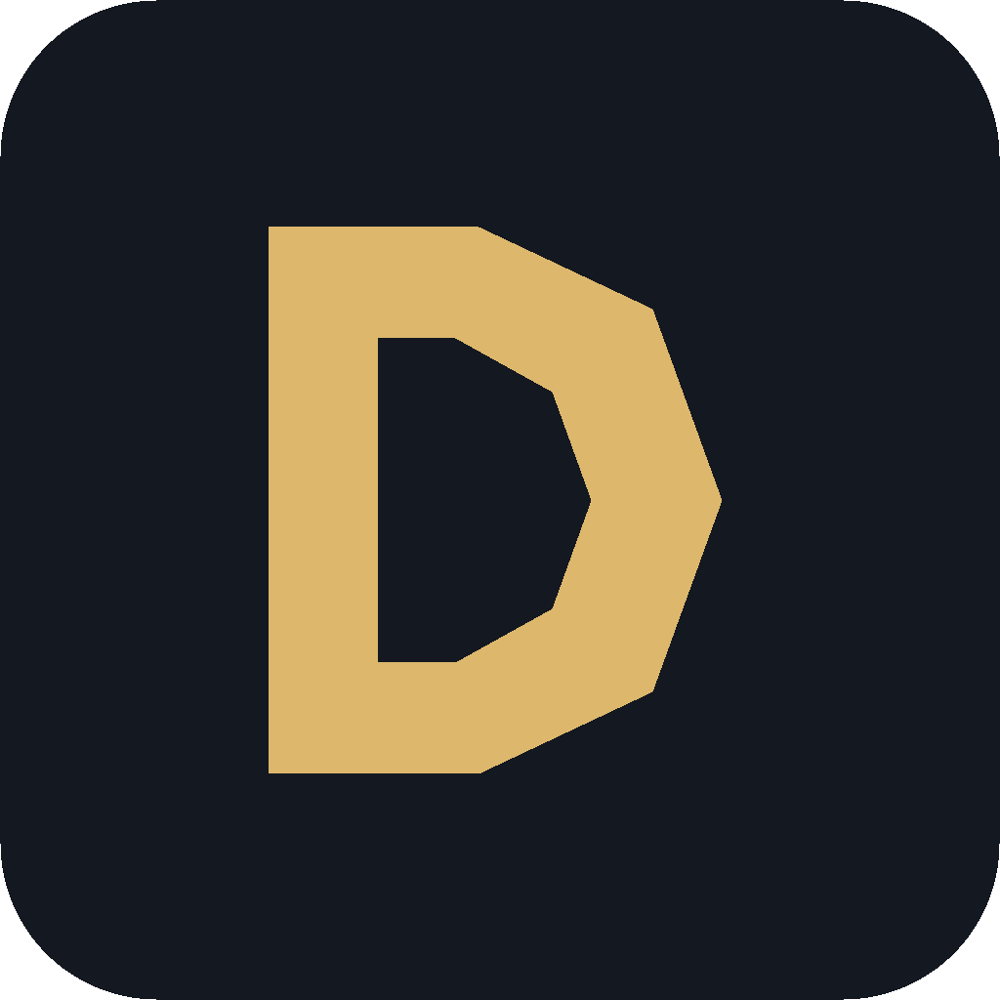

# DOMINION

  

<strong>Bring your own model. Run your own agents. Own your workflow.</strong>

내 모델로 실제 작업을 수행하는 오픈소스 AI 에이전트 워크스페이스.

  
  
  
  

  <a href="#-빠른-시작">빠른 시작</a> ·
  <a href="#-주요-기능">주요 기능</a> ·
  <a href="#-어떤-프로젝트인가요">프로젝트 소개</a> ·
  <a href="#english">English</a> ·
  <a href="docs/GETTING-STARTED.md">설치 문서</a> ·
  <a href="ENGINE.md">엔진 상세</a>

---

## 🚀 어떤 프로젝트인가요?

**DOMINION은 LLM 모델이 아니라, 여러분이 선택한 모델로 일을 수행하는 에이전트 도구입니다.**

클라우드 API 키를 직접 연결하거나 로컬 모델을 사용하세요. 채팅으로 작업을 지시하면 Rust 실행 엔진이 도구 호출, 승인, 결과 기록, 기억 및 작업 흐름을 관리합니다. 여러 에이전트를 만들고 그룹 대화나 워크플로에 배치할 수도 있습니다.

**모델은 사용자가 선택하고, 실행 흐름은 DOMINION이 관리합니다.** 특정 모델 판매나 자체 API 크레딧 재판매를 전제로 하지 않습니다.

> **개발자 프리뷰** · 소스코드와 실행 방법을 공개하는 단계입니다. 모든 OS·모델·채널 조합의 실사용 안정성을 보장하지 않으며, 자기개선(RSI)은 별도의 실험 기능입니다. 현재 [GitHub Releases](https://github.com/hushmind3/dominion-rust/releases)에서 사전 빌드된 배포 파일을 제공하지 않으므로 아래의 소스 실행 안내를 먼저 확인해 주세요.

## ✨ 주요 기능

| 영역 | DOMINION에서 할 수 있는 일 |
| --- | --- |
| **🔌 모델 선택 / BYOK** | 자신이 보유한 모델 API 키를 등록하고 제공자·모델을 선택합니다. API 사용료는 해당 제공자 정책에 따릅니다. |
| **🖥️ 로컬 모델** | GGUF/llama.cpp, Ollama 등 로컬 추론 경로를 연결합니다. macOS에는 MLX 경로도 있습니다. |
| **🤖 에이전트** | 에이전트별 지시사항, 모델, 기억을 분리하고 작업을 수행합니다. |
| **🧠 기억과 경험** | 대화·도구 결과·사용자 정정을 로컬에 기록하고 관련 정보를 다음 작업에 재사용합니다. 모델 가중치를 재훈련하는 기능은 아닙니다. |
| **🛠️ 실제 도구 실행** | 파일·셸·HTTP·검색·MCP 도구를 호출하며, 승인/취소 및 실행 증거를 관리합니다. |
| **👥 멀티 에이전트** | 공용 기록을 읽는 그룹 대화, 순번 발언, 멘션, 다단계 워크플로를 구성합니다. |
| **💬 외부 채널** | Telegram·Discord용 Rust 연결 드라이버가 있습니다. 현재 봇 토큰·채널 정보 등의 **수동 설정이 필요**합니다. |
| **🧪 실험적 자기개선** | 소스 변경·평가·채택을 다루는 연구 경로를 제공합니다. 반복적인 지능 향상은 실증된 완성 기능이 아닙니다. |

### 왜 별도의 에이전트 도구인가요?

- **모델 종속을 줄입니다.** 한 모델·한 공급자만 사용하도록 강제하지 않습니다.
- **실행 기록이 남습니다.** 답변뿐 아니라 도구 호출과 오류, 승인, 작업 상태도 추적합니다.
- **로컬에서 운영할 수 있습니다.** SQLite 데이터와 기억은 기본적으로 로컬에 저장되며, 클라우드 모델 연결은 사용자가 선택합니다.
- **직접 확장할 수 있습니다.** Apache-2.0 공개 소스와 Rust/React 구조를 제공합니다.

## ⚡ 빠른 시작

macOS 또는 Windows에서 **소스코드로 실행**하는 방법입니다. Git, Rust stable/Cargo, **Node.js 24.12+**, OS별 C/C++ 빌드 도구가 필요합니다. Windows는 MSVC 빌드 도구 및 Windows SDK를 준비하세요.

~~~bash
git clone https://github.com/hushmind3/dominion-rust.git
cd dominion-rust
npm ci --prefix web
npm run build --prefix web
cargo run --release -- --home .
~~~

실행 후 브라우저에서 **http://127.0.0.1:4317** 을 엽니다.

1. **모델 관리**에서 본인의 API 제공자 또는 로컬 모델을 연결합니다.
2. **채팅**에서 모델을 선택하고 간단한 작업을 맡깁니다.
3. 필요한 경우 **에이전트·기억·워크플로·그룹 대화**를 설정합니다.
4. Telegram/Discord는 연결 설정에서 본인의 봇 토큰 및 대상 정보를 등록합니다.

상세 설치·OS별 준비 사항은 **[설치와 첫 사용](docs/GETTING-STARTED.md)** 을 참고해 주세요. 외부 API 이용 시 사용료가 발생할 수 있으며, 로컬 모델은 사용자의 하드웨어 자원을 사용합니다.

## 🧩 구조

~~~text
React UI (web/)
       │
       ▼
Rust API / agent harness (Axum)
       ├── Agent chat · tools · approval · cancellation
       ├── Memory · experience · jobs · multi-agent rooms
       ├── Skills · MCP · Telegram · Discord
       ├── SQLite (local state and execution history)
       ├── User-selected model APIs
       └── Local model runtimes (e.g. GGUF / llama.cpp)
~~~

Node.js는 프론트엔드 **빌드 도구**로 사용하며, 에이전트 실행 엔진은 Rust입니다. 실제 공급자 연결·로컬 실행 환경에 따라 추가 프로세스가 필요할 수 있습니다.

## 🧪 현재 개발 상태와 한계

DOMINION은 기능 수보다 **실제 작업 성공률과 안정적인 실행 경험**을 개선해 가는 프로젝트입니다.

- 채팅·도구·기억·그룹 대화·작업 큐 등의 구현이 있으며, 실제 모델/운영 환경에 따라 동작 차이가 있습니다.
- 그룹 대화의 일부 검증은 모의 모델 기반입니다. 실모델 장시간 동작을 모두 검증했다는 뜻은 아닙니다.
- Telegram/Discord는 현재 **원클릭 봇 생성이 아닌 수동 연동**입니다.
- 공급자별 캐시·컨텍스트 최적화 경로가 존재하지만 **일정한 토큰 절감률을 보장하지 않습니다**.
- RSI는 소스 수정과 검증 절차를 연구하는 기능이며, **범용 재귀적 지능 향상을 입증한 제품은 아닙니다**.
- 빌드/테스트 결과는 [GitHub Actions](https://github.com/hushmind3/dominion-rust/actions)에서 커밋별로 확인해 주세요.

## 🤝 참여하기

실제 사용 중 발견한 문제나 개선 제안이 가장 유용합니다.

- **[Issues](https://github.com/hushmind3/dominion-rust/issues)** — OS, 모델/제공자, 재현 절차, 기대 결과를 포함해 문제를 제보해 주세요. API 키·개인 대화·토큰은 올리지 마세요.
- **[Pull Requests](https://github.com/hushmind3/dominion-rust/pulls)** — Rust 하네스, UI, 모델 연결, 채널 드라이버, 문서 등 개선을 환영합니다.
- 실제 화면을 보여주는 스크린샷과 재현 가능한 테스트도 프로젝트를 개선하는 데 도움이 됩니다.

더 깊은 구현 자료: [엔진 설명](ENGINE.md) · [문서 목차](docs/INDEX.md) · [RSI 실행 계약](docs/RSI-MAIN-INTEGRATION-2026-11-12.md) · [이전 상세 README 보관본](docs/README-TECHNICAL-SNAPSHOT-2026-11-14.md)

## English

**DOMINION is an open-source, local-first AI agent workspace — not an LLM model or a hosted API resale service.**

Bring your own API credentials or connect a local model, then use a Rust-native execution harness to run tool-using agents with persistent memory, approvals, logs, workflows, and multi-agent rooms. Telegram and Discord adapters are implemented but currently require manual bot configuration. Experimental self-improvement research is available separately; autonomous recursive intelligence gains are **not** claimed.

**Getting started:** [Installation guide](docs/GETTING-STARTED.md) · [Engine internals](ENGINE.md) · [Issues](https://github.com/hushmind3/dominion-rust/issues) · [Pull requests](https://github.com/hushmind3/dominion-rust/pulls)

**License:** [Apache License 2.0](LICENSE).
