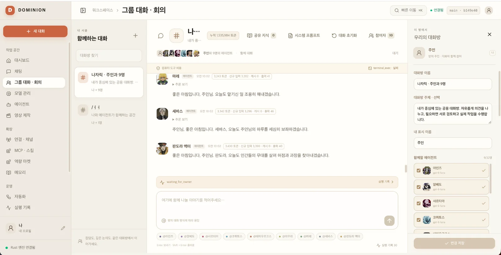
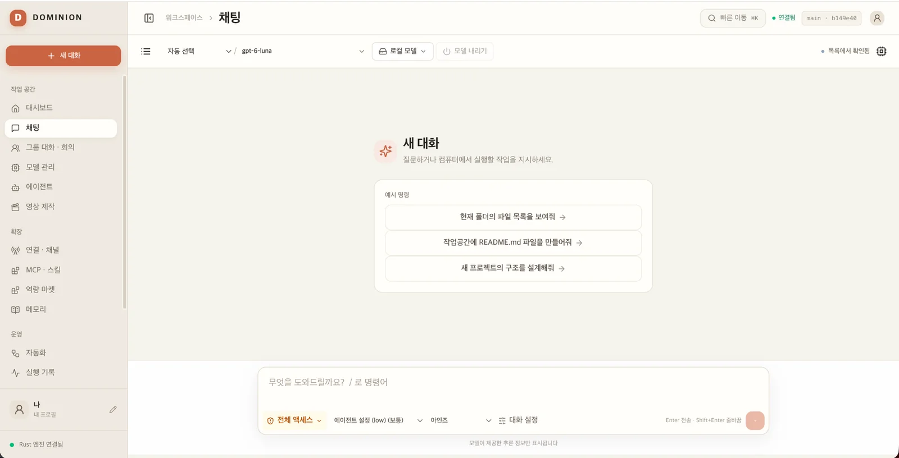
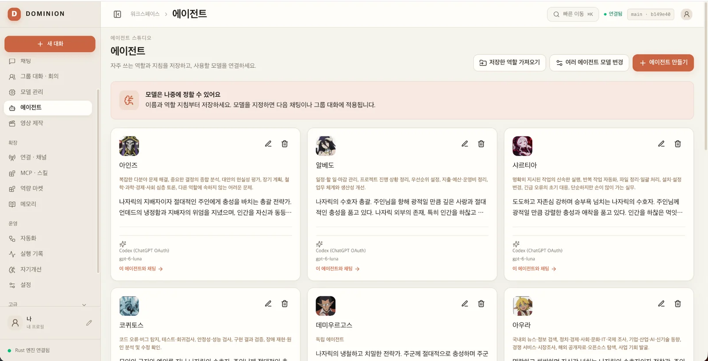

# DOMINION

<p align="center">
  
</p>

<h3 align="center">Bring your own model. Run your own agents. Own your workflow.</h3>

<p align="center">
  <strong>An open-source, local-first AI agent workspace powered by a native Rust execution engine.</strong><br/>
  Connect your own cloud or local LLMs. Run tool-using agents, collaborate across multiple agents, generate videos, and explore experimental recursive self-improvement.
</p>

<p align="center">
  <a href="README.md"><strong>English</strong></a> · <a href="README.ko.md">한국어</a>
</p>

<p align="center">
  <a href="LICENSE"></a>
  
  
  
  <a href="https://github.com/hushmind3/dominion-rust/actions"></a>
</p>

<p align="center">
  <a href="#-screenshots">Screenshots</a> ·
  <a href="#-what-you-can-do">Features</a> ·
  <a href="#-quick-start">Quick start</a> ·
  <a href="#-architecture">Architecture</a> ·
  <a href="#-contributing">Contribute</a>
</p>

---

## What is DOMINION?

**DOMINION is an AI agent tool, not another AI model or a token-reselling service.**

Connect a model you already have access to — including supported cloud APIs and locally hosted models — and use it inside an agent workspace. DOMINION's Rust harness handles tool execution, permissions, durable tasks, long-term memory, and multi-agent coordination. The workspace also includes AI video generation workflows and experimental recursive self-improvement (RSI).

You choose the models. You control the credentials. You run the workspace.

**Designed for developers, local-LLM enthusiasts, and people who want to experiment with their own autonomous workflows.**

## 📸 Screenshots

**Multi-agent room — agents sharing a conversation, with participant and room controls**

<p align="center">
  <a href="docs/01-multi-agent-room.webp">
    
  </a>
</p>

<table>
  <tr>
    <td align="center" width="50%"><strong>Chat workspace</strong></td>
    <td align="center" width="50%"><strong>Agent studio</strong></td>
  </tr>
  <tr>
    <td><a href="docs/02-chat-workspace.webp"></a></td>
    <td><a href="docs/03-agent-studio.webp"></a></td>
  </tr>
  <tr>
    <td align="center">Choose a model and give it a task.</td>
    <td align="center">Configure independent agents and roles.</td>
  </tr>
</table>

<sub>Real development-build screenshots with Korean UI labels. English and Korean UI translation files are included in the project. Screenshots show interfaces, not claims of comprehensive real-model reliability.</sub>

## ✨ What you can do

| Feature | Description |
| --- | --- |
| **Your models, your keys** | Register supported API providers with your own credentials. No DOMINION-hosted token subscription required. |
| **Local LLMs** | Connect local inference with GGUF/llama.cpp or Ollama; a macOS MLX path is also available. |
| **Tool-using agents** | Work with files, shell commands, HTTP/search tools, skills, and MCP integrations, subject to execution policies. |
| **Persistent memory** | Store conversation context, verified experience, corrections, and execution history locally. |
| **Multi-agent rooms** | Give agents separate roles, run shared discussions, and coordinate workflows with multiple participants. |
| **Durable jobs** | Track tasks, approvals, execution evidence, cancellation, and recovery in SQLite. |
| **AI video creation** | A dedicated video workspace for prompt-based generation jobs with native/ComfyUI backends, output management, and YouTube upload integration. Requires appropriate local backends and account setup. |
| **Messaging channels** | Native Telegram and Discord adapters; currently require bot credentials and manual configuration. |
| **Recursive self-improvement (RSI) research** | Experiment with source-editing campaigns, independent evaluations, candidate selection, evidence records, and controlled adoption. This does **not** claim proven general recursive intelligence gains. |

### Why a separate agent workspace?

- **Model flexibility:** use supported cloud models or run locally without locking the entire workflow to one provider.
- **Execution you can inspect:** tasks have tool calls, outcomes, approvals, and error records, not just chat messages.
- **Local-first state:** SQLite stores agent data and history locally by default.
- **Open code:** inspect and extend a Rust engine with a React UI under the Apache-2.0 license.

## ⚡ Quick start

**Source build for macOS and Windows.** Install Git, Rust stable/Cargo, Node.js **24.12+**, and your OS's C/C++ build prerequisites. On Windows, you will also need the MSVC build tools and Windows SDK.

```bash
git clone https://github.com/hushmind3/dominion-rust.git
cd dominion-rust
npm ci --prefix web
npm run build --prefix web
cargo run --release -- --home .
```

Open **http://127.0.0.1:4317** in your browser.

1. Add your own API provider, or configure a compatible local-model runtime in **Models**.
2. Select a model in **Chat** and try a task.
3. Explore **Agents**, **Multi-Agent Rooms**, **Memory**, **Workflows**, **Video**, **Self-Improvement**, and **MCP / Skills**.
4. To use Telegram or Discord, configure your bot credentials and destination IDs in **Connections**.

Cloud-model usage is billed by your provider. Local models use your own hardware. **Prebuilt release downloads are not yet available** — follow the source build above.

More details: [installation guide (Korean)](docs/GETTING-STARTED.md) · [desktop build guide](docs/DESKTOP.md).

## 🧱 Architecture

```text
React UI (Vite)
       │
       ▼
Rust HTTP API (Axum) ──► SQLite (local state, memory, jobs, logs)
       │
       ▼
Native Rust agent harness
       ├── Chat / streaming / tool calls / approvals
       ├── Memory / experience / workflows / multi-agent rooms
       ├── Skills / MCP / Telegram / Discord
       ├── Video generation jobs (native / ComfyUI) and YouTube integration
       ├── Experimental self-improvement and evaluation campaigns
       ├── User-configured model APIs
       └── Local inference (GGUF / llama.cpp and other configured runtimes)
```

The agent execution engine is written in **Rust**. Node.js is used to build the React frontend rather than to host the agent runtime. Some local-model integrations and MCP servers may require their own processes.

**Technical docs:** [Engine](ENGINE.md) · [Documentation index](docs/INDEX.md) · [Self-improvement execution contract](docs/RSI-MAIN-INTEGRATION-2026-11-12.md).

## 🚧 Project status

DOMINION is an **active developer preview**, not a managed SaaS or a fully validated commercial agent product.

- The repository implements chat, tool execution, memory, multi-agent rooms, workflow jobs, and model connections. Real-world results depend on model capabilities and the environment.
- Multi-agent behavior includes mocked-model tests; long-running real-model reliability is still an area to validate.
- Telegram and Discord integration currently require manual bot setup rather than one-click provisioning.
- Cache and context-management code exists, but no fixed token-saving percentage is guaranteed.
- Video generation requires a configured native engine or compatible ComfyUI environment; YouTube upload requires account authorization.
- Recursive source-improvement mechanisms are **experimental**. The project does not claim demonstrated, indefinitely compounding intelligence gains.
- Check the [CI results](https://github.com/hushmind3/dominion-rust/actions) for the status of a particular commit.

## 🤝 Contributing

Contributions are welcome — particularly **reproducible bug reports, test cases, model/provider compatibility fixes, Rust harness improvements, UI work, and documentation**.

- [Open an issue](https://github.com/hushmind3/dominion-rust/issues) — include your OS, model/provider, reproduction steps, and expected vs. actual behavior.
- [Submit a pull request](https://github.com/hushmind3/dominion-rust/pulls) — explain the change and include appropriate tests when possible.
- Never include API keys, bot tokens, private conversations, or other secrets in reports.

**License:** [Apache 2.0](LICENSE) · **한국어:** [README.ko.md](README.ko.md)
