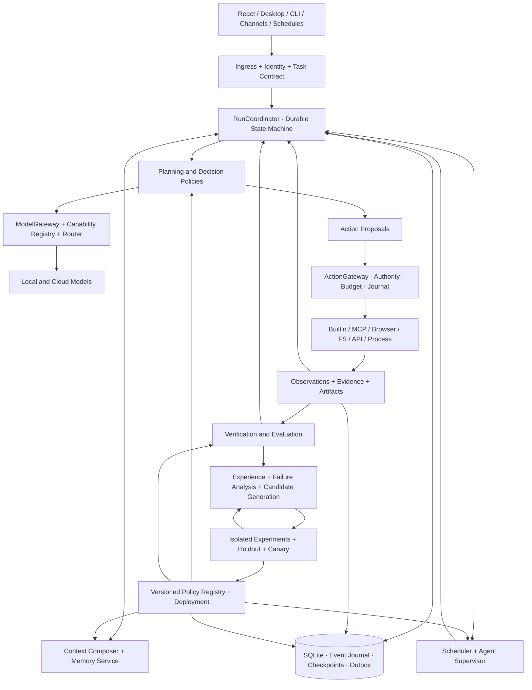
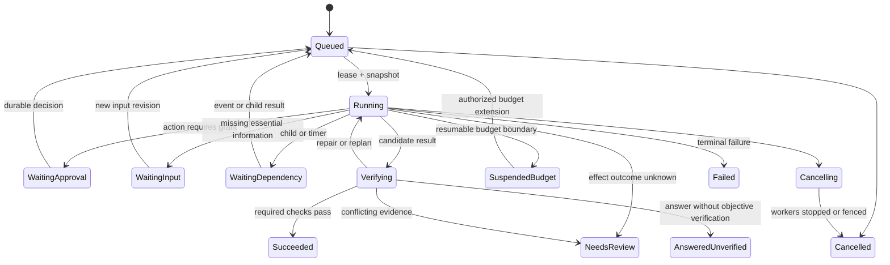

# DOMINION — 범용 자율 AI 하네스 통합 마스터 설계서

**버전:** 1.0 · **작성일:** 2026-11-05 (Asia/Seoul) · **구현 인계 대상:** DeepSeek / Rust 개발자

**상태:** 현행 소스 분석과 목표 설계. 이 문서의 신규 구조는 구현 완료를 의미하지 않는다. 이번 작업은 애플리케이션 코드를 수정하지 않았다.

## 문서 사용법과 분석 기준

이 문서가 DOMINION의 최상위 설계 기준이다. 기존 `DOMINION-DEEPSEEK-HANDOFF-2026-11-05.md`와 S0~S12 문서는 세부 연구와 과거 구현 기록으로만 참조한다. 충돌 시 현재 소스의 사실관계와 이 문서의 목표 계약을 각각 구분하여 적용한다.

| 항목 | 확인값 |
| --- | --- |
| 저장소 | `hushmind3/dominion-rust` |
| 분석 작업 디렉터리 | `/Users/gim-yeonsu/dominion-rust` |
| 브랜치 | `codex/native-memory-harness` |
| HEAD | `2a4aae03e01d60b6cdf39e463ad0c8bf03b896f2` |
| 기준 소스 | 위 HEAD **및 분석 시점의 미커밋·미추적 소스** |
| tracked diff SHA-256 | `293af91f58f45f6778a33ad563fdbaa070c6e9edeed3c1d41c5208180df7cdfa` |
| 소스 인벤토리 | `src`, `web/src`, `src-tauri/src`, `tests`, `scripts`의 소스·스타일·스크립트 133개, 32,619줄 |
| 이번 실행 검증 | `cargo test --release`: 단위 테스트 184개 + E2E 26개 통과. 벤치마크 바이너리 단위 테스트는 0개 |
| 프론트엔드 검증 | `web`에서 `npm run typecheck` 통과 |
| 이번에 수행하지 않은 검증 | 실제 모델 능력/성장 실험, 실제 계정의 메시지 발송·업로드·OAuth 동의, Tauri 전체 빌드·설치, 다중 기기·OS 실기 검증 |

미커밋 변경은 `src/api/mod.rs`, `src/engine/chat/{mod,runtime}.rs`, `src/engine/{discord,goals,jobs,procedure,rooms,workflows}.rs`, `tests/e2e.rs`; 미추적 구현은 `src/api/benchmark.rs`, `src/bin/dominion-benchmark.rs`다. 구현자는 이 변경을 지우거나 HEAD만으로 되돌리지 말고 소유자 변경으로 보존해야 한다. 기존 `benchmark/BASELINE-2026-11-05.json`은 다른 HEAD(`a779986…`)의 기준선 기록이며 현행 성능 측정값이 아니다.

분석 방법은 전체 파일 인벤토리, 공개 함수와 API 등록 관계, 핵심 실행·저장·권한·복구 경로의 본문 조사, 관련 테스트 본문과 실제 실행 결과의 교차 확인이다. 모든 파일을 동일 깊이로 형식 검증했다는 뜻은 아니다. 비밀키·운영 DB를 열어 개인 데이터나 실계정을 조사하지 않았다. 핵심 근거는 파일명과 함수명으로 제시하며, 줄 번호는 이 스냅샷에서만 유효하다.

**판정 기호:** `확인`은 호출 경로와 해당 실행 증거를 확인한 범위, `부분`은 경로는 있으나 보장 범위가 제한된 경우, `미연결`은 타입·테이블 등의 존재에 비해 실제 소비 경로가 없는 경우, `중복`은 같은 책임이 여러 경로에 있는 경우, `결함`은 소스에서 계약 위반을 도출할 수 있는 경우, `부재`는 조사 범위에서 구현 경로를 찾지 못한 경우다. 정적 분석으로 확인한 결함과 실제 재현한 테스트는 구분한다.

## 목차

1. 프로젝트 비전과 최상위 설계 철학
2. 범용 AI 하네스의 정의와 역할
3. 기존 저장소 전체 분석 결과
4. 현행 아키텍처의 문제점과 기술 부채
5. 목표 시스템 전체 아키텍처
6. 모델 활용 및 동적 능력 지원 설계
7. 범용 에이전틱 실행엔진 설계
8. 하네스 내부 알고리즘 체계
9. 장기기억·경험·학습 아키텍처
10. 자율개선 및 메타개선 알고리즘
11. 멀티에이전트·멀티모델 협업 설계
12. 도구·MCP·플러그인·외부 연결 설계
13. 실행 권한·상태·검증·장애 복구
14. Rust 모듈·trait·데이터·API 계약
15. 실제 작업의 종단 간 실행 시나리오
16. 기존 구현 재사용·통합·교체 방안
17. 새로운 단계별 개발 로드맵
18. 성능·성공률·자율개선 검증 방법
19. 기술적 위험·한계·대안
20. 최종 아키텍처 검토와 구현 인수 조건

---

## 1. 프로젝트 비전과 최상위 설계 철학

DOMINION은 **모델의 추론을 실제 환경의 행동으로 연결하고, 수행 경험으로 실행 정책을 검증하며 개선하는 Rust 기반 범용 자율 AI 하네스**다. 대화, 개발, 조사, 문서·미디어 생성, 파일 관리, 서비스 운영, 장기 목표, 에이전트 협업을 같은 실행 기반으로 처리한다.

최상위 단위는 DAG나 bandit이 아니라 **Task → Run → Observation → Evaluation → Policy Revision**이다. DAG는 의존성을 표현하는 선택 가능한 계획 형식이며, contextual bandit은 적격한 정책 후보를 고르는 한 방법이다. 모델의 크기를 실행 계약에 넣지 않는다. 모델마다 다른 능력은 기능 계약과 실측 프로파일로 표현한다.

핵심 원칙은 다음과 같다.

1. **모델 우선 판단:** 의미 이해, 개방형 계획, 가설, 새 도구의 조합, 결과 설명은 모델이 담당한다. 모든 요청을 사전 정의된 단계에 끼워 넣지 않는다.
2. **엔진의 정확성:** 권한, 예산, 상태 전이, 동시성, 증거 출처, 저장, 재개, 외부 부수효과의 불확실성은 Rust가 책임진다.
3. **선택 가능한 지원:** 구조화 출력 교정, 짧은 계획, 검색, 절차 보조, 다른 모델 검토를 실측 필요에 따라 추가한다. 강한 모델에는 불필요한 재계획·교사 호출·작은 컨텍스트 제한을 부과하지 않는다.
4. **실제 결과로 갱신:** 모델의 완료 선언, 정상 HTTP 응답, 파일 생성, 절차 준수, 사용자 목적 달성은 서로 다른 신호다.
5. **가역적 정책 발전:** 새 정책은 불변 revision으로 만들고 평가·canary·배포·회귀 관찰을 거친다. 실행 중 정책을 몰래 바꾸지 않는다.
6. **동일한 행동 경계:** 모델, 절차 실행기, 다른 에이전트, 스케줄러가 제안한 행동은 같은 권한·예산·Operation 경로를 통과한다.
7. **로컬 우선:** 단일 Rust 프로세스와 SQLite로 시작한다. 모델·임베딩·연결을 로컬에 둘 수 있으며, 클라우드 전송은 명시한 데이터 경계 안에서만 허용한다.

범용성은 모든 문제의 성공 보장이 아니다. 새 작업을 표현·탐색·시도하고 관찰에 따라 수정할 수 있으며, 능력이나 자원이 부족하면 그 이유와 미완료 상태를 정확히 보존하는 성질이다.

## 2. 범용 AI 하네스의 정의와 역할

| 개념 | 소유자 / 의미 | 혼동하면 안 되는 것 |
| --- | --- | --- |
| Session | 사용자와 에이전트의 대화·출처·접근 범위 | 하나의 작업 또는 실행과 동일하지 않음 |
| Task | 사용자 의도, 완료 계약, 권한, 전체 예산을 가진 작업 | 모델이 만든 계획과 구분 |
| Run | 동결한 정책·모델 설정으로 Task를 수행하는 실행 | 복구·재시도 때문에 Task당 여러 개 가능 |
| Step / Operation | 판단 경계 / 환경에 대한 개별 시도 | 한 tool call ID가 영구적 식별자는 아님 |
| PlanRevision | 목표를 달성하기 위한 수정 가능한 계획 | 원래 사용자 목적을 바꾸는 권한은 없음 |
| Evidence | 원문·도구 receipt·파일 해시 등 관측 자료 | 모델 해석 또는 주장과 구분 |
| Evaluation | 특정 oracle revision이 증거를 판정한 기록 | 실행 상태와 별개, 재평가 가능 |
| PolicyRevision | 프롬프트·검색·계획·라우팅·복구·선택 등의 불변 구현/설정 | 사용자 지시·권한 규칙을 대체하지 않음 |
| Job | 작업을 깨우는 영속 스케줄링 단위 | worker의 Rust Future 자체를 저장하는 것은 아님 |

모델은 `ActionProposal`을 내고 엔진은 이를 검증하여 `AuthorizedOperation`으로 바꾼다. 모델이 엔진을 자유롭게 활용하되 모델 출력 자체를 권한으로 사용하지 않는다. 알고리즘은 판단 후보와 점수·불확실성·측정 기록을 제공하며 실행 권한을 직접 갖지 않는다.

자율성의 범위는 Task 계약에 저장한다. `interactive`는 필요한 입력을 기다릴 수 있고, `background`는 허가된 범위에서 UI 없이 진행하며, `scheduled`는 시간·이벤트에 의해 재개한다. 이 모드는 모델 지능 등급이 아니라 작업 수명과 상호작용 방식이다.

## 3. 기존 저장소 전체 분석 결과

### 3.1 실제 호출 경로

```text
main → bootstrap::run/serve
  → Store::open → migrations::run
  → jobs::recover + improve::recover_finalizations
  → jobs::start + discord::start + telegram::start → api::router

POST /api/chat → api/chat::chat → chat/transport::run
  → run_turn → run_turn_with_policy → run_turn_body
  → provider::select_provider / stream 호출
  → dispatch_tool_call → approval → tools::execute 또는 mcp::call
  → finalize_execution → Store::finalize_once
  → learning::enqueue / reflect::enqueue

POST /api/goals → jobs::enqueue → jobs::run_job → goals::run
  → GoalControl::complete (계획·검토) + run_quiet_outcome (실행)
  → chat::run_turn_background → 동일 run_turn_with_policy

Room 메시지 → 원문과 Job 원자 저장 → rooms::run/run_locked
  → run_room_quiet → chat::run_room_turn → 동일 턴 런타임
Workflow → jobs → workflows::run → run_quiet → 동일 턴 런타임
Discord → poll → durable job → discord::run → run_quiet 또는 bridge::ingest
Telegram → poll → bridge::ingest → Room 경로
delegate_task → tools::delegate → 자식 Session + prompt Job → jobs::start_now
```

이미 공유되는 턴 엔진을 유지하는 것이 핵심이다. 목표·회의·워크플로 각각에 새 도구 실행 루프를 만드는 방식은 채택하지 않는다. 일반 SSE 채팅은 `tx.closed()`에서 중단되지만 background collector가 수신을 유지하는 작업은 UI 종료와 분리되어 있다. 따라서 “모든 채팅이 브라우저 종료 후 지속된다”는 주장은 현재 코드와 다르다.

### 3.2 기능별 판정

| 영역 | 현행 경로와 증거 | 판정 / 남은 경계 |
| --- | --- | --- |
| Rust 서버 | `bootstrap::serve`, Axum router, SQLite WAL, loopback bind | 확인. 다중 디바이스용 인증·읽기 권한·전송 보안은 부재 |
| 채팅 | `chat/runtime.rs::run_turn_body`, native/compat tool loop, 26개 E2E 중 관련 실행 검증 | 확인/부분. 8 round·40 tool·10분·250k token 상수, foreground 연결 종속 |
| Goal | `goals::run`, `GoalControl::complete`, plan/execute/review/repair/replan | 확인/부분. 파일 증거 검사·취소 검증 있음. 일반 Task 실행과 계획/검토 경로가 분리됨 |
| 모델 제공자 | `chat/provider.rs`, `llm.rs`, `models::{load,load_lmstudio}` | 확인/부분/중복. OpenAI 호환 HTTP와 GGUF·LM Studio 연결. 일반 capability 협상·측정 기반 라우팅은 부재 |
| 멀티모달 | `attachments::{upload,validate_ids,content}` → history → image_url parts | 확인/부분. 텍스트·이미지 첨부 계약 테스트 있음. 모델별 vision 적격성·audio/video 표준 처리는 부재 |
| 내장 도구 | `tools::{definitions,requires_approval,execute}`, 파일·셸·HTTP·메모리·위임·GitHub | 확인. 정적 match 등록, 자원별 권한과 모든 실행경로의 공통 gateway는 부분 |
| MCP | `mcp::{tools,definitions,call}`, stdio/HTTP 세션 | 부분. 도구 실행 경로 존재. 2024-11-05 선언, 매 호출 연결, 이름 slug 라우팅, 현대 규격 전체 준수는 미확인 |
| 승인/취소 | `chat/approval`, `api/approvals`, `AppState` epoch, shell process group | 확인/부분. 취소·자식 프로세스 종료 테스트 있음. 재시작 후 승인 재개와 root 권한 상속은 부재 |
| 기억 | `memory::{retrieve,save_grounded,visible}`, `learning::apply_learning` | 확인/부분. 인용·소유권·정정·한국어 검색 검증. 임베딩 검색 부재, reflect global 경로는 별도 경계 |
| 경험 | `experience::{record,record_global,retrieve,consolidate}` → context | 확인/부분. 서명 유사도·중복·보관. 일반화의 정확성·전이 효과는 입증되지 않음 |
| 반성/학습 | `learning::run`, `reflect::run` → improve/memory/skill | 확인/부분. 후보를 생성하지만 전역 공유·가설 승격·통제 평가가 혼재 |
| Improvement | `improve::{propose,active_values,execution_updates}` → runtime snapshot/finalization | 부분/결함. 실제 주입과 준수 검사는 연결됨. 운영 관찰 5회로 validated/E2 승격; 인과적 개선 검증 아님 |
| adaptation 타입 | `adaptation/types.rs` → runtime의 TaskContract/Decision/Observation 저장 | 부분. 일부 타입은 연결됐지만 내용이 legacy placeholder. FailureClass 등은 타입만 있고 분류 경로 미연결 |
| adaptation 테이블 | `db::open`의 adaptation schema/finalizations/updates | 부분/미연결. finalize 표시는 기록하지만 본체는 JSON marker, updates 기반 projection 소비 경로 없음 |
| Procedure/DAG | `procedure::{normalize,ready_intent,evaluate}` → `run_harness_nodes` → 공통 dispatch | 확인/부분/결함. E2E DAG 실행 통과. evaluator는 before/after만 판단하며 DAG nodes/edges 자체의 이행 증명은 없음 |
| Room | `rooms::{plan_speakers,run_locked,route_peers}`, API 원문 원자 저장 | 확인. 9명 fixture 테스트는 용량 상한의 근거가 아님. 범용 병렬 작업 graph와 결과 합성은 부분 |
| 위임 | `tools::delegate/task_payload`, `jobs::start_now` | 확인/결함. 실제 자식 실행 E2E 있음. 부모 권한·scope·취소·예산 상속과 결과 접근 검사가 불충분 |
| Job/자동화 | `jobs::{enqueue_once,next_queued,recover,schedule_automations}` | 확인/부분. CAS 선점·체크포인트 있음. worker lease·전역 자원 admission·공정성 부재 |
| SQLite | `Store`의 JSON records/messages/audit/secrets, 일부 원자 transaction | 확인/부분. 광범위 `all()` scan, sync Mutex, JSON 계약 불일치·오류 Option 소실 |
| 채널/브리지 | `discord::start/run`, `telegram::start`, `bridge::{ingest,flush}` | 모의 HTTP 실행 확인. 기타 manifest는 드라이버 완료를 뜻하지 않음. 실계정 검증은 별도 |
| 계정 | `oauth::{start,callback,fresh_access_token}`, vault, `tools::github_api` | 부분. 암호화·state 검사 등 테스트 있음. 실제 동의·refresh·scope는 계정별 검증 필요 |
| 스킬 | `skills::{catalog,import,import_repo}`, context 활성 스킬 주입 | 확인/부분. 절차 초안과 활성 지시 존재. 불변 skill revision·공급망/호환성 계약은 부재 |
| 개발 스튜디오 | `dev::{start_job,run_job,execute,start_preview}` | 부분/중복. 자체 spawn/job/process 경로; 공통 실행 권한·복구 관리로 통합 필요 |
| 영상 | `video::{enqueue,run,native,comfy,enqueue_upload,upload}`, API/video | 부분. native playable container 테스트 통과. 외부 Comfy·실제 YouTube 업로드는 미검증; 일부 API는 empty/501 |
| React/API | `web/src/api.ts`, pages, ExecutionMonitor → REST/SSE | 확인/부분. 실행은 Rust 소유. replay 가능한 event cursor·일관된 Task UI 모델은 부재 |
| 데스크톱/운영 | `src-tauri/src/engine.rs`, `platform/*`, launch/build scripts | 부분. 프로세스/parent EOF 단위 테스트 존재. 서비스 모드와 desktop-owned lifetime 분리 필요 |
| 벤치마크 | 미추적 `dominion-benchmark.rs`, identity·seed endpoint, 기존 shell runner | 부분. isolated root와 교대 실행 코드 있음. 일반 실험 manifest·불변 trial·통계·holdout·정책 배포 루프는 부재 |
| 테스트/CI | 소스 내 tests + `tests/e2e.rs` + package check | 현행 로컬 테스트 확인. 조사 경로에서 저장소 CI workflow는 발견하지 못함. 운영 능력의 전면 보증은 아님 |

### 3.3 오래된 문서와 다른 현재 사실

README/ENGINE 일부에는 Telegram·MLX·영상이 미이식, Rust 실험 runner가 없다고 적혀 있으나 현재 소스에는 각각 호출 경로가 존재한다. 반대로 `adaptation` 타입과 실험 바이너리가 있다는 이유만으로 contextual bandit·통제 실험·메타개선까지 완료된 것은 아니다. 구 문서의 0/3 실모델 기록은 당시 조건의 역사 자료이며 이번 HEAD의 재측정 결과로 사용하지 않는다.

### 3.4 전체 표면의 소유 관계

`api/{chat,goals,jobs,rooms,sessions,executions,approvals}`는 실행 입구, `api/{providers,models,gateways,oauth,channels,extensions,agents,personas}`는 연결·설정, `api/{memory,experience,improvements,collections}`는 지식·정책 관리, `api/{dev,video,attachments,translation}`는 전문 기능, `api/{system,settings,compat,response}`는 공통 표면이다. `shim.rs`는 provider 호환 프록시이며 별도의 추론 엔진이 아니다.

React의 Chat/Rooms/Workflows/Operations/Memory/Models/Connections/Extensions/Agents/Capabilities/Developer/Video는 이 API의 view다. `web/src/components`의 shell·composer·monitor·account/settings와 i18n·CSS는 표현 책임이다. UI에서 도구 실행·정책 승격·학습 성공 판정을 만들지 않는다. `src-tauri`는 호스트와 연결 수명을 담당하고 engine policy를 중복 구현하지 않는다.

## 4. 현행 아키텍처의 문제점과 기술 부채

### 4.1 우선 해결할 계약 문제

다음은 이번 분석의 **정적 코드 근거**다. 기존 테스트 통과로 반증되지 않으며, 아래 재현 조건을 구현 단계의 회귀 테스트로 추가해야 한다.

| ID | 근거 / 재현 조건 | 영향 / 설계 대응 |
| --- | --- | --- |
| D01 | `runtime::run_turn_with_policy`에서 TaskContract.family=chat, source=owner, mandatory/permissions 비어 있음. 내부 prompt/goal 실행도 이 경로 사용 | 파생 지시와 주인 지시 구분 손실. ingress에서 원문 계약을 만들고 자식은 derived authority로 참조 |
| D02 | 같은 함수의 Decision은 첫 improvement 선택으로 기록하면서 최대 6개를 함께 주입. candidates의 1/N과 decision probability=1이 실제 다중 선택을 표현하지 않음 | IPS/DR·bandit 자료로 사용 불가. legacy 기록은 진단용으로만 보존; 실제 bundle 선택확률 저장 |
| D03 | `selection_snapshot`의 hash가 executionId만 해시, 저장 실패를 `let _`로 무시 | 실행 재현에 필요한 정책·컨텍스트가 누락돼도 실행됨. 전체 canonical snapshot과 필수 transaction 도입 |
| D04 | `improve::execution_updates`가 uses≥5 및 과거 baseline 비교로 validated/E2 설정 | 작업 난도·모델·다른 전략의 교란. observed와 experimentally_validated 분리 |
| D05 | `procedure::evaluate`가 nodes/edges를 검사하지 않음. before/after 없이 유효 nodes만 있는 절차와 빈 operations를 주면 triggered=true/followed=true 경로 | DAG 실행 완료와 독립 검증 불일치. node receipt·edge happens-before·binding digest 검증 |
| D06 | `ready_intent`와 `run_harness_nodes`가 procedureNodeId만으로 완료/결과 map 생성 | 한 Run의 서로 다른 전략에 node id가 같으면 완료/결과가 섞일 수 있음. `(instance, revision, node)` 식별자 |
| D07 | `reflect::run`이 global 경험·전략·lesson을 만들고 memory/improve/experience visible이 global을 즉시 허용 | 채널 격리와 사실/가설 구분 약화. 공유 grant와 hypothesis 저장 경로 일원화 |
| D08 | `tools::delegate`의 자식 session에 부모 channel scope·권한 grant 없음, toolsEnabled=true. `task_payload`에 부모/소유자 검증 없음 | 위임으로 권한·정보 경계를 잃을 수 있음. attenuated grant와 task ACL 필수 |
| D09 | `jobs::start_now`는 worker 수를 우회하는 spawn; 부모 취소 시 자식은 계속됨 | 재귀 위임 자원 폭증·수명 불명확. 전역 admission과 명시적 child lifetime 도입 |
| D10 | `chat/provider`, `llm::try_complete`, `compact::run`에 별도 모델 호출; llm local만 별도 Mutex | 비용·usage·동시성·fallback 정책 불일치. 공통 ModelGateway로 수렴 |
| D11 | `llm::model_rank`는 모델명 숫자, fallback은 최대 다른 2개 provider, local은 일괄 think=false | 능력·데이터 전송 허용과 무관한 추정. capability+benchmark+data policy로 적격성 판단 |
| D12 | 승인 record put 실패해도 oneshot과 이벤트 생성; 승인 API는 메모리 waiter에 의존 | crash 후 승인 이어받기 불가. operation-bound 승인 저장, CAS resolve, durable waiting |
| D13 | `events::Bus`는 512 broadcast, `system::events`가 Lagged 무시; chat 채널은 unbounded | UI 누락·느린 소비자 메모리 증가. durable event sequence와 bounded delta buffering |
| D14 | `finalize_execution`에서 improvement 전체 값을 transaction 밖에서 계산 후 `finalize_once`로 upsert | 서로 다른 Run이 같은 revision 카운터를 갱신할 때 lost update 가능. 원자 observation append와 projector dedupe |
| D15 | finalize hash에 종료시각·mutable counters가 포함되고 adaptation evaluation_revision에 payload hash 저장 | 동일 평가의 재시도와 새 평가 revision 혼동. stable semantic hash와 evaluator version 분리 |
| D16 | global Compliance 집계가 한 followed를 먼저 선택하므로 다른 violated가 함께 있어도 followed 가능 | bundle 준수 왜곡. 항목별 결과 보존, summary의 violated/unknown 우선순위 명세 |
| D17 | benchmark runner는 기본 3쌍·고정 파일/정답 절차·autoLearning=false. 코드에 fixture 승인 resolver가 없음 | 수동 승인 없으면 write가 timeout할 수 있고, 성공해도 실행 보조 비교일 뿐 학습/전이 증명 아님 |
| D18 | API guard는 주로 write Origin/optional token, GET 읽기 인증 없음. MCP slug는 이름 기반 first match | 원격 서비스에 그대로 노출 불가; 같은 표시 이름 서버 충돌 가능. principal ACL과 stable server ID |

### 4.2 구조 문제

현재 구조는 유효한 Rust 실행 기반 위에 목표·절차·학습·채널 기능이 성장한 상태다. 전면 폐기할 이유는 없다. 문제는 `runtime.rs`가 계획·검증·절차·학습 통계까지 함께 소유하고, 반대로 일부 전문 기능은 그 공통 경로 밖에서 process/network 부수효과를 만든다는 점이다.

공통 상태가 JSON으로 흩어져 있어 `status=completed`의 의미가 레코드마다 달라진다. 모든 모듈에 필드를 덧붙이는 방식 대신 typed domain과 저장 repository를 중심으로 경계를 정리한다. 설정 JSON·외부 provider payload까지 무리하게 강타입으로 바꾸지는 않는다.

## 5. 목표 시스템 전체 아키텍처

### 5.1 통합 구조



실행 경로와 개선 경로는 같은 Task/Run/Evidence/Policy 계약을 사용한다. 개선 작업도 하네스의 Job으로 수행하지만 foreground 예산과 권한을 공유하지 않는 별도 quota를 갖는다. 개선 지연이나 실패가 사용자 실행의 완료를 지연시키지 않도록 outbox에 관측 이벤트를 원자적으로 남긴다.

### 5.2 계층과 의존 규칙

| 계층 | 책임 | 허용 의존 |
| --- | --- | --- |
| domain | ID, 계약, 상태, evidence, errors, 이벤트 | serde 등 기본 타입; AppState/HTTP/DB 금지 |
| runtime | 상태 전이, proposal 처리, checkpoint, lifecycle | domain + port traits |
| model/context/tools/memory | 모델·컨텍스트·행동·지식 서비스 | domain + repository/adapter ports |
| policies | 계획·검색·선택·복구·스케줄링 알고리즘 | immutable inputs와 제한된 model port; DB 직접 수정 금지 |
| adaptation | 후보 생성, 실험, 정책 revision 및 배포 | 평가된 관측, registry, sandbox runner |
| storage/adapters | SQLite·provider HTTP·MCP·process·channel | domain 구현; runtime 판단을 역호출하지 않음 |
| api/ui | 인증·요청 DTO·이벤트 projection·표현 | application facade; 직접 tool/process 실행 금지 |

런타임이 adaptation 내부를 직접 호출하는 순환 의존은 없앤다. 런타임은 registry의 동결 PolicyBundle을 읽고 Observation을 기록한다. adaptation은 그 기록을 소비해 새로운 bundle을 발행한다. 등록된 policy implementation이 compiled Rust인 경우 composition root가 연결한다.

### 5.3 고정할 최소 불변조건

- I1: 권한이 확인되지 않은 외부 부수효과는 dispatch하지 않는다.
- I2: 실행 시작 기록 저장에 실패하면 외부 행동을 시작하지 않는다.
- I3: 확인되지 않은 결과는 Unknown이며 성공이나 자동 재실행으로 치환하지 않는다.
- I4: Task 성공 조건을 후보 정책이 임의 완화하지 못한다.
- I5: Run의 contract·policy·model config·context snapshot revision을 추적할 수 있다.
- I6: root budget과 grant는 자식·재시도·모델 전환에도 보존된다.
- I7: durable evaluation과 outbox는 한 transaction으로 한 번만 반영한다.
- I8: 생성한 가설, 운영 관찰, 통제 실험의 근거 등급을 섞지 않는다.
- I9: UI 연결·이벤트 손실·서버 재시작이 작업 목적이나 권한을 바꾸지 않는다.
- I10: 승인/접근통제/평가 기준 변경을 일반 온라인 정책 학습에 맡기지 않는다.

이 조건을 엔진에 고정하되 계획 깊이·추론 방식·모델 수·DAG 사용 여부는 고정하지 않는다.

## 6. 모델 활용 및 동적 능력 지원 설계

### 6.1 ModelGateway와 능력 계약

provider가 OpenAI 호환 API인지 여부와 모델의 실제 능력을 분리한다. `ProviderAdapter`는 전송·인증·stream decoding을, `ModelProfile`은 기능과 측정값을 담당한다. 초기에는 기존 Chat Completions adapter를 이식하고, 다른 native API는 별도 adapter로 추가한다. 모든 provider를 최저 공통 API로 강제하지 않는다.

| 필드 | 의미 / 취급 |
| --- | --- |
| identity | providerId, modelId, model/version digest(가능할 때), endpoint revision |
| capabilities | text/image/audio/video input/output, native tools, structured JSON, parallel calls, streaming, cache, continuation |
| support | 각 capability의 Supported / Unsupported / Unknown + declared/probed/measured 출처 |
| limits | context, max output, request bytes, tool count/schema 제한, provider concurrency |
| reasoning | provider가 지원하는 옵션 schema와 범위. 공개 가능한 reasoning summary와 opaque state 구분 |
| extensions | adapter namespace의 typed 옵션과 schema version; 알 수 없는 옵션은 경고/거절 |
| performance | task family별 성공률·JSON 유효율·tool 오류율·p50/p95 지연·비용·표본 수·측정일 |
| data boundary | 로컬/허용 region/외부 전송 금지/사용 가능한 secret account |

Capability 조회는 등록 정보 → 공식 API 메타데이터 → 부수효과 없는 probe → 실제 실행 통계 순서로 보완한다. Unknown을 지원으로 가정하지 않는다. 사용자가 지정한 모델의 기능 부족을 알게 되면 허가된 fallback, 기능 보조, 입력 요청 중 하나를 선택하고 이유를 남긴다.

숨겨진 chain-of-thought를 하네스의 필수 인터페이스로 요구하지 않는다. 결정·도구 제안·공개 rationale·검증 evidence만으로 제어한다. provider 고유 continuation 데이터는 원래 adapter에서 opaque하게 보관하며 다른 모델로 넘길 때 이식 가능한 원문·도구 결과·작업 상태만 사용한다.

### 6.2 선택 및 전환

선택은 먼저 `capability ∩ permission ∩ privacy ∩ available budget ∩ availability`로 적격 집합을 만든 뒤 한다. 초기 정책은 사용자 지정 모델 우선 + 명시적 대체 목록 + 실측 비용/성공률 tie-break다. 데이터가 충분할 때만 contextual router를 도입한다.

`route(task_features, role, required_capabilities, constraints)`는 `{model, adapter, config_revision, alternatives, reasons, decision_id}`를 반환한다. 역할은 executor/planner/reviewer/embedding/reflector 등이며 모델 인스턴스와 독립적이다. 하나의 모델이 여러 역할을 맡아도 된다. 실험에서는 역할별 모델 변경을 분리해 “동일 모델 하네스 개선”과 “더 강한 모델로 교체한 효과”를 따로 측정한다.

전환은 모델 호출 경계에서만 수행한다. 이미 실행한 tool operation은 다시 실행하지 않는다. 변경 전후 모델·입력 hash·usage·실패 유형을 저장한다. 불확실한 서버측 tool 실행을 제공하는 provider는 operation receipt/reconcile adapter 없이는 투명 재시도하지 않는다. 모델 답변 스트림이 끊겼을 때 partial answer를 최종 성공으로 저장하지 않는다.

### 6.3 지원 수준은 독립 옵션의 조합

| 관찰된 필요 | 지원 정책 | 지원 해제 / 상향 조건 |
| --- | --- | --- |
| 도구 schema를 안정적으로 따름 | native tools, 동적 도구 검색, 가능한 병렬 제안 | protocol 실패 시 해당 adapter capability 재평가 |
| native tools 미지원 | 명시적 compat protocol과 schema validation | probe/실측으로 native 안정성이 확인되면 전환 |
| 인자 오류 반복 | 구조화 오류 관측, 최소 교정 예시, 제한된 repair | 최근 유효율이 회복되면 추가 교정 프롬프트 제거 |
| 컨텍스트 부담 | relevant tool subset, 토큰 기반 압축·검색 | 더 큰 context 모델/더 높은 budget이면 확대 |
| 계획 불안정 | 짧은 subgoal, 중간 verifier, 선택적 planner | 단독 실행의 성공·비용이 더 좋으면 보조 해제 |
| 검증된 절차의 기계적 단계 | 적합성이 확인된 procedure assistance | 낯선 조건·불완전 binding·drift면 model planning으로 복귀 |
| 의미 판단 불확실 | 독립 reviewer 또는 사용자 입력 | 비용/위험 기준과 평가 신뢰도를 기록 |

4B라고 모두 compat/DAG, 70B라고 항상 무보조로 정하지 않는다. 강한 모델이 긴 탐색을 할 수 있도록 Task budget을 설정할 수 있고, 단순 인사에는 planner·reviewer를 추가하지 않는다. 지원은 능력을 보충하지만 올바른 추론을 보장하지 않는다.

### 6.4 컨텍스트와 비용

`ContextComposer`는 mandatory instruction, Task 계약, 최근 원문, 관련 memory, 현재 plan, 최신 observation, tool schema, artifact 참조를 토큰 예산 안에서 구성한다. 필수 조건과 미해결 승인·operation 결과를 요약 때문에 잃지 않는다. 도구 call/result 쌍은 protocol 단위로 유지한다. 고정 40/160 메시지 절단은 이 정책으로 대체한다.

모든 모델 호출은 root ledger에 예약하고 실제 usage로 정산한다. planning/review/compaction/reflection/fallback도 예외가 아니다. usage 미제공이면 `estimated=true`와 토큰 추정기를 사용하며 0으로 기록하지 않는다. 가격표 revision·통화·실측/추정 여부를 저장하고 가격을 모르면 금전 지표는 Unknown으로 둔다. 토큰·시간 예산은 계속 적용된다.

공통 gateway의 자원 semaphore는 runtime instance별로 둔다. 기존 local LLM 전역 lock은 같은 서버를 사용하는 streaming·non-streaming 호출 모두에 적용되는 자원 admission으로 이동한다. 네트워크 호출 중 DB lock이나 worker 소유권을 붙잡지 않는다.

## 7. 범용 에이전틱 실행엔진 설계

### 7.1 계약 생성과 계획

Ingress는 실제 principal, source event, session, attachments, 사용자의 원문을 검증해 Task를 만든다. 명시한 성공 조건과 권한은 immutable contract revision에 저장한다. 의도 해석 모델이 제안한 조건은 `inferred`로 구분한다. 경로·도구 사용 여부만으로 복잡한 문서 품질이나 서비스 운영 성공을 판정하지 않는다.

계획은 `Reactive`, `Outline`, `DependencyGraph`, `ProcedureInstance` 중 선택하며 서로 전환할 수 있다. 저장된 DAG가 없으면 Reactive 실행에서 관측하고 새 계획을 만든다. Outline의 자연어 설명은 모델 입력이고, 기계가 실행할 단계만 schema 검증된 ActionProposal로 바꾼다.

PlanRevision은 parent revision, 생성 모델/정책, subgoal, dependency, assumptions, success signals, change reason을 갖는다. 완료한 operation을 history에서 지우지 않는다. 재계획은 미실행 단계를 대체하거나 보상 행동을 새로 제안한다. 사용자 목적·권한 확장은 새 contract revision과 필요한 사용자 결정을 거쳐야 한다.

### 7.2 상태 전이



상태 transition은 `expected_version`, `lease_epoch`, `cancel_epoch`를 비교하는 transaction으로 저장한다. terminal Run은 다시 Running으로 바꾸지 않는다. Task 재개는 새 Run을 생성해 이전 checkpoint와 evidence를 참조한다. 대기·예산 중단은 terminal 실패와 구분한다.

`TaskOutcome`과 `RunStatus`는 분리한다. Run이 끊겨도 이미 검증한 결과물은 남을 수 있다. converse 응답은 `AnsweredUnverified`로 끝나도 정상 UX이며, 자동 학습의 객관적 성공 표본으로 세지 않는다. Cancelled는 작업의 의미적 실패나 모델 품질 실패로 집계하지 않는다.

### 7.3 공통 실행 루프

```text
resume(task, checkpoint):
  claim fenced lease; load contract and pinned policy bundle
  reconcile unfinished operations before proposing new side effects
  while authorized resources remain:
    read pending owner input and cancellation epoch
    assemble context + bounded authorized memory
    select next action policy (reactive / outline / graph / procedure)
    obtain proposal from model or compiled algorithm
    validate proposal; persist decision and new checkpoint
    match proposal:
      Tool: ActionGateway.dispatch -> durable observation -> next decision
      Delegate: Supervisor.spawn -> parent WaitingDependency or continue
      PlanPatch: validate dependencies and goal preservation -> new revision
      Wait/Input: durable subscription -> release worker -> return
      Finish: VerificationService.evaluate -> success / repair / unknown
  atomically finalize + append evaluation/outbox + release reservations
```

엔진은 Rust Future를 그대로 저장하지 않는다. 재개 가능한 경계의 입력·모델 결과·operation 결과를 저장하고 다음 step을 생성한다. checkpoint가 가리키는 완료 operation을 재실행하지 않는다. 동일 prompt 재호출은 새 model attempt이며 같은 reasoning을 재현한다고 주장하지 않는다.

### 7.4 병렬성, 장기 실행, 실패 수정

독립 읽기·독립 artifact 작업은 병렬 허용한다. 같은 경로/계정 resource를 쓰는 변경은 resource lock과 expected version으로 직렬화하거나 isolated workspace에서 합친다. DAG edge는 선행성만 표현하며 무관한 노드의 `opSeq`가 실제 완료 순서를 뜻하지 않는다. happens-before는 node completion event와 dependency receipt로 검증한다.

장기 Task는 다음 wake 조건과 checkpoint, 남은 root budget, 승인 만료, policy pin을 저장한다. 작업의 장기 수명과 한 dispatch의 timeout을 분리한다. 재시작 후 외부 연결/도구 버전/permission이 바뀌면 적격성을 재검사한다. 서비스가 꺼져 있는 동안 실행되었다고 간주하지 않는다.

오류는 invalid argument / transient transport / rate limit / permission denied / missing prerequisite / artifact mismatch / semantic uncertain / outcome unknown / exhausted로 분류한다. 모델은 원인 가설과 대체 방법을 제안하고 엔진은 retry 가능성·횟수·backoff·중복 방지를 판정한다. 같은 실패 signature가 반복되면 재시도 대신 다른 방법·모델·입력 요청으로 이동한다.

## 8. 하네스 내부 알고리즘 체계

### 8.1 슬롯과 알고리즘의 위치

모든 알고리즘은 `slot + implementation_id + version + config_revision + input/output schema`로 등록한다. 초기 기본값은 단순하고 측정 가능한 정책이다. 교체는 registry의 versioned bundle 변경으로 수행하며 온라인 code injection은 사용하지 않는다.

| 슬롯 / 문제 | 초기 방법과 적용 조건 | 입력 → 출력 | 모델과 Rust의 분담 | 장단점·연결·효과 측정 |
| --- | --- | --- | --- | --- |
| intent/contract | 모델 의미 해석 + 명시 조건 추출 | 원문/출처 → 제안 intent/checks | 모델 제안, 엔진 authority·schema 검증 | 범용; 오해 가능. 목적 보존률·수정 요청률 |
| planning | ReAct형 관찰 반복, 필요 시 outline | task/context/observations → proposal/plan patch | 모델 계획, 엔진 예산·상태 | 낯선 문제 대응; 호출 비용. verified success/cost |
| dependency | topological ready queue, 조건부 branch | validated graph/receipts → ready nodes | 모델이 graph 제안, Rust cycle/binding 검사 | 병렬 효율; 동적 상황엔 replan 필요. makespan·deadlock |
| procedure reuse | applicability filter + typed binding | task features/procedure → executable intents | 모델 적합성 보완, Rust typed binding | 반복 작업 비용 절감; 과적용 위험. transfer success·false trigger |
| tool discovery | 권한 filter + lexical retrieval; 선택적 semantic rerank | intent/catalog → eligible tool set | 모델 최종 선택, 엔진 등록·schema | 작은 context에 유리; 누락 위험. recall@k·선택 성공률 |
| model routing | constraints filter + explicit priority, 이후 contextual estimator | role/features/capabilities → model/config | 모델 필요 설명, Rust 허용 집합 | 단순·재현성; 데이터 필요. same-budget success·latency |
| context packing | mandatory-first + relevance/token knapsack 근사 | ranked blocks/token budget → context snapshot | 모델 요약, Rust provenance/size | context 효율; 요약 손실. required fact retention·task success |
| memory retrieval | lexical+embedding hybrid, RRF, optional reranker | scope/query/index watermark → citations | 모델 relevance 보완, Rust ACL 선필터 | paraphrase 향상·index 비용. nDCG/Recall·누출 0 |
| memory consolidation | exact dedupe + evidence/key conflict graph | memory revisions → merge/supersede proposal | 모델 일반화, Rust lineage·원문 보존 | 중복 감소; 과일반화 위험. contradiction/false merge |
| scheduling | quota + weighted fair queue + aging + resource tokens | runnable jobs/resources → leases | 모델 분해 제안, Rust admission | starvation 억제; overhead. wait p95·GPU utilization |
| multi-agent assignment | 능력·권한·부하 기준 매칭 | subtasks/agent profiles → delegation plan | 모델 역할 설계, 엔진 제약 | 병렬 이득; 통신 비용. gain per extra model token |
| recovery | typed error rules + bounded backoff + model replan | failure/effects/budget → retry/reconcile/repair | Rust side-effect 판단, 모델 대안 | 안전한 재시도; 과보수 가능. recovery success·duplicate effects |
| verification | deterministic oracle + calibrated semantic judge | contract/artifact/receipts → check verdicts | Rust 물리 검사, 모델 의미 평가 | 신뢰 향상; judge 편향. false pass/negative·agreement |
| runtime policy selection | none baseline + deterministic ranking, 이후 ε-greedy/contextual bandit | eligible bundles/context → chosen bundle+propensity | 통계 선택, 모델은 후보 제안 | 저비용 적응; 장기 credit 한계. randomized lift·regret |
| candidate generation | failure clustering + LLM reflection + bounded mutation | trace clusters/current policy → candidate patch | 모델 가설, 엔진 변경 범위 검사 | 새로운 방법 생성; hallucination. yield of valid improvements |
| experiment allocation | paired blocked trials, 고정 n; 이후 사전 정의 sequential design | candidates/suite/budget → trial allocation | Rust 배정, 모델 결과 해석 보조 | 인과 비교; 비쌈. effect CI·evaluation cost |
| drift/rollback | task/model별 window + regression thresholds | canary metrics → keep/stop/rollback | 엔진 규칙, 모델 diagnosis | 빠른 회귀 대응; 잡음. detection delay·false alarms |
| meta-improvement | optimizer revision 간 nested held-out 비교 | optimizer history/meta suite → optimizer candidate | 모델 새 탐색법, 엔진 독립 gate | 장기 효율 개선; 과적합·비용. net gain per eval budget |

ReAct는 reasoning과 action의 상호작용을 연구한 방법이다. 여기서는 외부 관찰에 따라 다음 행동을 바꾸는 패턴을 활용하며 특정 프롬프트나 공개 reasoning format을 강제하지 않는다. [ReAct 원문](https://arxiv.org/abs/2210.03629)

### 8.2 후보 알고리즘 비교와 선택 기준

| 방법 | 적합한 상황 | 채택하지 않는 기본 사용법 |
| --- | --- | --- |
| 고정 규칙/priority | 초기 데이터가 적고 제약이 명확 | 새 작업 의미까지 문자열 규칙으로 판단 |
| contextual bandit | 한 decision slot에서 반복 선택·관측 reward·탐색 가능 | 전체 하네스 지능/새 알고리즘 생성/장기 신용할당의 대체 |
| Bayesian 추정 | 적은 데이터의 불확실성·prior 표현 | posterior가 곧 인과 증거라고 주장 |
| beam/tree search | 되돌릴 수 있는 계획·샌드박스 코드 후보 | 실제 외부 서비스를 탐색 branch마다 변경 |
| 모델 기반 reflection/search | trace의 실패 원인을 언어로 수정 가능한 prompt/절차 | 모델의 자기평가만으로 채택 |
| offline RL / sequence policy | 충분한 궤적·정의된 reward·신뢰 가능한 simulator가 확보됨 | 초기 sparse·편향 로그에서 즉시 production 정책 학습 |
| meta-optimization | 안정된 evaluation 계약과 여러 task family가 있음 | optimizer가 자기 시험지·권한·채택 threshold를 동시에 변경 |

교체의 우선 기준은 품질·자원 제약을 만족하는 가장 단순한 방법이다. 더 복잡한 방법이 추가 비용을 상쇄하는지 ablation으로 비교한다. 알고리즘 호출 실패는 reason을 기록하고 검증된 baseline으로 되돌린다. silent fallback은 금지한다.

## 9. 장기기억·경험·학습 아키텍처

### 9.1 네 종류의 저장물을 분리

1. **Conversation state:** 원문·화자·첨부·도구 메시지·요약 checkpoint. 세션의 진행 맥락이다.
2. **Knowledge memory:** 사용자 선호·검증된 사실·결정. 근거, 유효기간, 소유권을 갖는다.
3. **Episode/experience:** 특정 Task의 시도, 환경, 실패·성공, evidence, 평가. 다른 상황에 그대로 맞는 규칙이 아니다.
4. **Hypothesis/policy candidate:** 경험에서 일반화한 추정과 새로운 방법. 평가되기 전에는 사실·강제 지시가 아니다.

`learn`은 근거 기반 추출기, `reflect`는 실패 가설/후보 생성기로 정리한다. 동일 source를 저장했거나 전략을 프롬프트에 넣었다는 사실은 학습 효과가 아니다. 후속 행동 변화와 비교 실험이 있어야 개선으로 표시한다.

### 9.2 기억 계약

```text
MemoryRevision {
  memory_id, revision, kind: Fact | Preference | Decision | Hypothesis,
  body, normalized_key?, subject, claim,
  source_refs[], evidence_grade, confidence?, confidence_method?,
  owner_principal, partition, allowed_audiences[], sharing_grant_id?,
  valid_from, valid_until?, observed_at, last_confirmed_at,
  supersedes[], conflicts_with[], status,
  embedding_model_revision?, content_digest
}
Episode {
  task_id, run_id, contract_revision, environment_fingerprint,
  policy_bundle, models_used[], operation_refs[], outcome,
  evaluation_refs[], failure_classes[], costs, scope
}
```

정확한 사용자 인용은 “사용자가 그렇게 말했다”의 증거이며 그 내용의 외부 사실성까지 증명하지 않는다. 파일 내용·HTTP receipt 역시 관측 시점과 자원 버전에 한정된다. 모델의 가설 confidence는 교정되지 않았다면 calibrated probability로 표시하지 않는다.

### 9.3 검색과 갱신

접근 가능한 partition/visibility/expiry/status를 **검색 전에** 적용한다. lexical baseline을 유지하고 선택 가능한 로컬 embedding adapter를 추가한다. 초기 벡터 저장은 SQLite에 model revision·차원·float bytes를 저장하고 작은 authorized subset에서 cosine scan을 사용한다. 규모가 커지면 동일 인터페이스 뒤에 검증된 인덱스를 둔다. embedding 서버 부재 시 lexical로 degraded 실행하되 원인을 기록한다.

제안하는 기본 hybrid는 `RRF(d)=Σ_j 1/(k+rank_j(d))`이고 k와 후보 수는 suite에서 조정한다. dense 결과와 lexical 결과는 각자의 rank로 합치고 필요할 때만 reranker를 호출한다. 필수 사용자 선호는 relevance 점수와 별도 mandatory lane으로 넣되 출처와 적용 scope를 유지한다. exact identifier·코드 심볼·숫자 질의의 lexical 성능을 회귀 검사한다.

같은 key의 conflicting claim은 최신 timestamp만으로 정답을 정하지 않는다. 같은 권한을 가진 주인의 명시적 정정은 supersede할 수 있지만 서로 다른 주체·환경·시간의 사실은 병존할 수 있다. 일반화 후보는 원문 episode를 참조하고, 반례·예외 조건·검증 대상 task family를 함께 저장한다. 삭제 대신 archived/superseded를 기본으로 하되 사용자가 삭제를 요구한 데이터는 파생 embedding·요약·cache까지 추적하여 제거한다.

### 9.4 공유와 context 격리

개인, agent, project, room, external account/channel의 경계를 명시한다. 공유는 `SharingGrant(source_scope,target_audience,content_class,expiry,issuer)`로 허용한다. `scope=global` 문자열은 grant를 대체할 수 없다. 공동 작업에 필요한 artifact만 전달하고 모델에 보이는 사실이 곧 장기 저장 허가는 아니다.

기존 global 기억은 자동 삭제하지 않는다. 출처/동의가 확인되는 항목은 grant에 매핑하고 나머지는 원래 partition에서만 보이도록 migration quarantine에 둔다. 기존 명시적 사용자 공유 설정은 보존하되 해석 결과를 migration report에 남긴다.

임베딩 재생성은 content digest와 embedding version으로 멱등 처리한다. index watermark보다 최신인 기억은 lexical overlay로 검색한다. snapshot에는 실제 채택한 memory revision과 검색 policy/version, ranking score, 제외 이유를 기록해 후속 평가가 재현 가능하게 한다.

## 10. 자율개선 및 메타개선 알고리즘

### 10.1 통합 폐쇄 루프

```text
Run 수행 → evidence/usage 관찰 → 고정 oracle 평가
  → failure cluster / success pattern → 모델의 개선 가설
  → typed candidate revision → static compatibility checks
  → isolated paired experiments → held-out effect comparison
  → eligible policy bundle → bounded canary → active deployment
  → drift/regression 감시 → 유지 / rollback / 다음 가설
```

이 루프는 실행과 같은 domain/store/scheduler를 사용한다. 실험은 별도 namespace·workspace·credential policy·예산을 사용한다. 사용자 실행을 시험 환경으로 몰래 바꾸지 않는다. 이미 승인된 자동 개선 범위 안의 변경은 매번 사용자의 재지시 없이 진행한다.

### 10.2 개선 대상과 적용 범위

| 범주 | 예시 | 생성·검증·적용 경로 |
| --- | --- | --- |
| runtime configuration | context token 배분, tool retrieval k, 허용 retry/backoff, 모델 role 선택 | 허용 범위 내 후보 → offline tests → canary → 다음 Run 적용 |
| prompt/policy data | planner/reviewer prompt, bounded procedure, applicability, rubric 사용 방식 | 불변 revision + schema/권한 검사 + task suite; 평가 정답 자체 변경과 구분 |
| compiled algorithm selection | lexical→hybrid, greedy→ε-greedy, scheduler policy version | 이미 배포된 implementation registry에서 선택; compatibility hash 확인 |
| 새 알고리즘 구현 | 새로운 ranking/search/recovery/selector/optimizer Rust 코드 | isolated source branch + patch artifact + build/test/benchmark + 배포 단계; 실행 중 프로세스 직접 수정 금지 |
| evaluation 시스템 | semantic judge calibration, 새 task family oracle | 별도 evaluator release; 기존 후보와 독립 검증·기존 결과 재평가 |
| 모델 가중치 | fine-tuning/adapter/model artifact | 이후 TrainingAdapter로 확장. dataset rights·holdout·모델 registry·serving 검증 필요 |

권한/사용자 목적/secret 접근/평가 정답/실험 provenance/예산 상한은 온라인 학습 후보가 변경하지 못한다. 소스·실행파일 변경은 정책 데이터 승격과 다른 release 계약을 사용한다. 본 문서는 그 생성과 검증 절차를 설계하며 자동 바이너리 교체가 이미 존재한다고 주장하지 않는다.

### 10.3 Candidate와 Promotion 상태

```text
Draft → ValidatedSchema → SandboxTesting → Eligible → Canary → Active
            ↘ Rejected        ↘ Inconclusive       ↘ RolledBack
Active → Superseded 또는 RolledBack
```

배포 상태와 근거 등급은 다른 필드다. `Observed`, `DeterministicVerified`, `ControlledExperiment`, `HeldOutTransfer`를 분리하고 labels/provenance를 함께 보존한다. “5번 사용됨”은 표본 수일 뿐 ControlledExperiment가 아니다. 기존 adopted/validated/E2는 legacy_observed로 이관하고 원래 표시를 raw legacy 필드에 보존한다.

후보는 target slot, parent revision, exact patch, motivation, failure/evidence refs, applicability, expected effect, risk bounds, allowed capability delta, compatibility, proposer model, generation cost, generation dataset watermark를 갖는다. 권한을 늘리는 patch는 일반 자동 개선 후보에서 거절한다.

### 10.4 contextual bandit의 정확한 역할

Bandit은 **이미 생성되고 적격성 검사를 통과한 실행 정책 중 무엇을 사용할지** 결정한다. 새로운 알고리즘의 코드나 실패 원인 설명, 실험 oracle, 배포 및 rollback을 스스로 제공하지 않는다. 따라서 전체 자율개선을 bandit 하나로 구현할 수 없다.

초기에는 단일 slot의 bundle을 arm으로 삼아 credit assignment를 단순화한다. 여러 전략을 같이 넣으면 bundle 전체가 treatment다. 개별 효과를 알고 싶으면 한 변수 ablation 또는 사전 정의 factorial 설계를 별도로 한다. 어떤 전략도 안 쓰는 `none` arm을 반드시 포함한다.

초기 학습 선택기의 구현 제안은 명시적 ε-greedy다. 적격 arm K개, greedy tie를 분배한 확률 g(a|x)에 대해 `p(a|x)=(1-ε)g(a|x)+ε/K`를 기록한다. random seed뿐 아니라 후보 집합·filter 이유·정확한 확률·선택 결과를 저장한다. ε=0이면 선택하지 않은 arm의 로그 기반 효과를 추정하지 않는다. Thompson sampling을 나중에 도입할 경우 선택 propensity가 단순 posterior sample 값이 아님을 주의하고, 정확하거나 검증된 근사 확률을 기록할 수 있을 때만 OPE에 쓴다.

기본 성공 추정은 task family/model stratum별 Beta-Bernoulli 같은 단순 모델로 시작할 수 있다. prior와 decay/window는 revision에 포함한다. 비용을 함께 비교하되 `Unknown`, 취소, 무검증 답변을 성공 0/1에 억지로 넣지 않는다. outcome label이 늦으면 pending observation으로 두고 갱신한다.

`U = success - λ_cost·normalized_cost - λ_time·normalized_latency`는 제약을 통과한 후보의 순위 보조에만 사용한다. 권한 위반·증거 위조·critical regression은 성공률로 상쇄할 수 없는 별도 gate다. quality·cost·latency는 원시 값도 함께 보고하여 가중치 조작으로 개선이 만들어지지 않게 한다.

### 10.5 실험과 인과 판단

동일 task fixture와 environment snapshot으로 baseline/treatment를 짝지어 실행하고, arm 순서는 무작위 또는 균형 배정한다. 모델 version·parameters·tool versions·grants·artifact 초기 상태를 고정한다. seed 미지원 provider는 seed 고정이 가능하다고 주장하지 않고 반복 표본으로 변동성을 측정한다.

성공률 차이는 pair의 `d_i=y_i,T-y_i,C`, `Δ=mean(d_i)`로 구한다. 같은 template의 반복은 독립 task로 취급하지 않으며 template/family 단위 cluster bootstrap 또는 사전 정한 paired 분석을 사용한다. 작은 표본에서는 폭넓은 불확실성과 Inconclusive를 허용한다. 한 후보를 수십 번 고른 뒤 같은 holdout에서 유리한 결과만 보고하지 않는다.

채택 규칙은 실험 전에 `minimum_effect`, 허용 회귀 폭, 비용/지연 상한, 표본 계획, critical cases, 통계 방법을 고정한다. 예: quality 개선 후보는 효과 하한이 사전 정의 δ보다 크고 비용 상한 내일 때만 승격. 비용 절감 후보는 품질 비열등성 경계를 만족하면서 비용이 개선되어야 한다. 숫자는 업무에 맞게 정하며 이 문서의 예시를 보편적 합격선으로 쓰지 않는다.

로그 기반 IPS/DR은 정확한 propensity, support overlap, 사전 정의 reward, 편향·누락 평가가 있을 때 **후보 우선순위**에 보조 사용한다. 현재 legacy Decision 기록에는 적용하지 않는다. DR이 항상 인과 효과를 보장하는 것은 아니며 propensity/reward model 가정·분산·effective sample size를 보고한다. [Doubly Robust Policy Evaluation and Learning](https://arxiv.org/abs/1103.4601)

### 10.6 후보 생성과 메타개선

Reflexion의 언어 피드백·episode 기억은 후보 생성의 참고가 된다. DOMINION에서는 반성 문장을 검증된 지식으로 즉시 승격하지 않고 실제 outcome에 연결된 Hypothesis로 저장한다. [Reflexion 원문](https://arxiv.org/abs/2303.11366)

GEPA의 trace 기반 반성·prompt mutation·Pareto 후보 관리 방식은 prompt/policy 탐색의 참고다. DOMINION 적용 효과는 별도 실험 대상이며 논문 수치를 프로젝트 성능으로 옮기지 않는다. [GEPA 원문](https://arxiv.org/abs/2507.19457)

메타개선은 optimizer `O_v`가 proposer prompt, mutation operator, failure clustering, 실험 예산 배정, 후보 선택 방식을 가진다는 데서 시작한다. 다른 optimizer `O_v+1`이 같은 **생성·평가 총예산**으로 얻는 held-out 개선의 크기와 비용을 비교한다. 내부 train/validation은 policy를 찾는 데, 외부 meta-test는 optimizer를 비교하는 데 사용한다.

```text
for optimizer in [incumbent, candidate_optimizer]:
  for family in meta_train_families:
    search within identical compute/eval budget
    freeze best eligible policy; do not inspect meta-test labels
  evaluate frozen policies on disjoint meta-test families
compare net held-out gain, generation cost, regressions, stability
promote optimizer only through the independent deployment gate
```

optimizer가 evaluator·holdout·권한 gate를 직접 바꿀 수 없다. 평가 알고리즘 자체도 개선 대상이지만 별도의 adjudicated gold set과 독립된 변경 경로에서 검증한다. 동시 변경은 원인 식별이 불가능하므로 분리한다. 메타 단계는 한 층의 optimizer 비교부터 시작하고 무한 재귀 자기수정은 요구하지 않는다.

### 10.7 배포와 회귀

새 Run 시작 시 활성 bundle을 pin한다. 진행 중 Run은 기존 version을 유지한다. 위험한 결함으로 revision을 폐기하면 해당 revision의 새 dispatch를 차단하고 checkpoint에서 안전한 정책으로 재계획하거나 NeedsReview로 전이한다. 권한 철회는 정책 pin보다 우선한다.

Canary는 사전에 허용된 low-risk task family·비율·기간/표본 상한으로 제한한다. production에서 baseline과 treatment의 외부 변경을 두 번 실행하지 않는다. shadow는 제안/읽기 전용 평가 또는 샌드박스에서만 한다. rollback은 registry active pointer를 이전 revision으로 CAS 변경하고, 이미 일어난 외부 변경의 복원은 별도 compensation Task로 취급한다.

## 11. 멀티에이전트·멀티모델 협업 설계

### 11.1 AgentSpec과 Supervisor

에이전트는 이름이 다른 프롬프트에 그치지 않고 역할·모델 요구·도구 허용·기억 범위·작업 계약을 가진 실행 actor다. 영구 persona와 일시적인 worker instance를 분리한다. 동적 생성은 모델이 `AgentSpec`을 제안하고 Supervisor가 기존 principal의 권한 안에서 instance를 만든다. 생성 요청은 새 사용자 권한을 만들지 않는다.

```text
AgentSpec {
  role, instructions_revision, model_requirements,
  requested_tools, requested_memory_scopes, output_schema,
  lifetime: Linked | DetachedWithGrant
}
DelegationContract {
  parent_task_id, child_task_id, delegated_by,
  source_contract_revision, subgoal, acceptance_checks,
  inherited_partition, attenuated_grant, budget_reservation,
  artifact_inputs, output_schema, deadline, cancellation_mode
}
AgentEnvelope {
  message_id, from_agent, to_agent_or_topic, task_id,
  correlation_id, causation_id, logical_sequence,
  message_kind: Request | Progress | Evidence | Result | Critique,
  payload_ref, visibility, created_at
}
```

동료 메시지는 owner instruction으로 기록하지 않는다. 모델은 상대 의견을 검토할 수 있지만, 검증 없는 동료의 “완료”를 부모 Task 성공 증거로 쓰지 않는다. 결과에는 구조화 요약·artifact digest·operation/evaluation refs·미완료 항목이 있어야 한다.

### 11.2 자원과 권한 상속

자식 권한은 `parent grant ∩ role allowance ∩ task grant ∩ current account capability`다. toolsEnabled 같은 boolean은 표시/모델 노출 옵션으로만 사용하고 실제 권한은 이 grant로 결정한다. 자식이 부모보다 더 큰 데이터 scope를 얻을 수 없다. task_result/status도 principal 및 delegation edge ACL을 검사한다.

root ledger는 자식 예산을 예약한다. 부모가 가진 전체 10달러 중 자식에 3달러를 할당했다면 부모가 동시에 10달러를 쓰지 못한다. 자식 종료 시 미사용분을 반환하고 실제 사용은 root에 한 번만 합산한다. 위임 깊이·동시성·agent 수는 구성 가능한 budget/admission 제약이며 고정 9인 구조로 만들지 않는다.

부모가 결과를 기다릴 때는 WaitingDependency로 저장하고 worker permit을 반환한다. 자식은 동일 scheduler에서 lease를 얻는다. 현재 `start_now`의 무제한 bypass는 제거하되, 이는 자식 실행 기능 삭제가 아니라 deadlock 해소 방법의 교체다. 기본 Linked 자식은 부모 취소를 상속한다. 독립 장기 작업은 명시적 DetachedWithGrant 계약이 있을 때만 계속된다.

### 11.3 협업과 결과 통합

- 토론은 RoomSession의 공용 원문과 actor별 발언을 유지한다. 현재 owner·peer 구분과 첫 발언 공정성은 재사용한다.
- 작업 병렬화는 각 child task의 독립 workspace/artifact를 사용한다. 공유 파일 변경은 version check 후 integrator가 합친다.
- 재시도는 child attempt만 교체한다. 성공한 형제 task를 다시 실행하지 않는다.
- 부모 검증기는 자식의 산출물과 상호 의존 조건을 검사한다. 합성 단계 자체도 budget과 evaluation을 갖는다.
- 협업 이득은 단일 agent·동일 총비용 baseline 대비 성공률과 시간으로 측정한다. agent 수 증가를 성능 개선으로 간주하지 않는다.

## 12. 도구·MCP·플러그인·외부 연결 설계

### 12.1 도구 레지스트리와 공통 실행

ToolDescriptor는 stable tool ID, namespace, version, input/output schema, resource resolver, effects, approval hint, idempotency, cancellation/reconcile 지원, timeout, maximum output bytes, required account scopes를 가진다. 표시 이름은 바뀔 수 있으므로 라우팅 키로 사용하지 않는다.

`builtin:fs/write@1`, `mcp:<server_uuid>:<tool_name>@<schema_digest>`처럼 출처와 revision을 식별한다. 모델에 노출하는 짧은 이름은 Run snapshot에 매핑한다. schema 변경 후 오래된 호출은 재검증한다. 이름만 같다는 이유로 다른 서버에 실행하지 않는다.

```text
proposal (origin=model|procedure|agent|scheduler|service)
  → schema validation
  → tool/resource resolution + data classification
  → authority decision + budget reservation
  → operation prepared journal
  → approval if required (suspend, resume, revalidate)
  → dispatching marker
  → adapter invocation
  → result/receipt/artifact persistence
  → observation + task wake event
```

모델과 하네스의 도구 사용은 동일 gateway다. dev/video/channel의 모든 HTTP를 generic model tool로 공개할 필요는 없지만 **외부 변경**은 service-origin ActionProposal과 scoped service grant로 같은 journal을 거친다. 내부 순수 변환·파일 render 계산은 실행 비용만 기록하고 불필요한 사용자 승인 창을 만들지 않는다.

### 12.2 권한 계약

Effect는 `Read`, `WorkspaceWrite`, `ProcessExec`, `NetworkRead`, `RemoteWrite`, `Publish`, `CredentialUse`로 분류하고 resource를 붙인다. Tool annotation은 참고값이며 권한 부여의 근거가 아니다. HTTP GET도 민감 데이터 전송을 할 수 있으므로 method만으로 전체 위험을 판정하지 않는다.

ApprovalRequest는 principal, task/run/operation ID, exact canonical args hash, resolved resource set, tool version, policy revision, expiry, max uses를 포함한다. 승인 뒤 args·도구 버전·권한이 변하면 다시 평가한다. 실제 사용자 의도를 이미 포함하는 standing grant가 유효하면 매 호출 재승인을 요구하지 않는다. 구 `autoApproveAll`은 그대로 무한 전역 grant로 확장하지 않고 기존 사용자 설정의 범위·의미를 명시적으로 이관한다.

### 12.3 MCP

현재 client의 2024-11-05 선언을 근거로 모든 MCP 기능을 지원한다고 하지 않는다. 구현자는 지원할 protocol versions를 명시하고 해당 버전의 공식 schema와 conformance fixtures를 pin한다. 본 설계는 확인한 **2025-11-25 명세를 참조 기준 중 하나**로 사용하며 이것이 작성일의 유일한 최신 버전이라고 주장하지 않는다. [MCP 명세](https://modelcontextprotocol.io/specification/2025-11-25)

버전별 adapter가 connection lifecycle, capability negotiation/discovery, tools/list pagination, resources/prompts, notifications, cancellation, progress, structured output, reconnect를 처리한다. 2025 계열의 initialize/session 계약과 다른 세대의 lifecycle을 혼합하지 않는다. 동의하지 않은 sampling/elicitation 요청은 명시적 unsupported 또는 별도 승인 경로로 처리한다. 서버가 요청한 sampling도 ModelGateway 예산과 data policy를 통과해야 한다.

HTTP 계정 인증은 audience/resource에 묶인 token으로 처리하고 token passthrough를 금지한다. stdio credential은 제한된 env/secret reference로 전달한다. 모든 MCP 자격증명을 공통 API 키 하나로 축약하지 않는다. [MCP Authorization](https://modelcontextprotocol.io/specification/2025-11-25/basic/authorization)

프로세스 풀과 요청 multiplexing은 server capability 및 thread safety에 따라 사용한다. 모델별 도구 검색은 전체 catalog에서 권한을 적용한 뒤 수행하며 선택 subset에 없던 도구를 찾을 `discover_tools`도 제공한다. “관련 도구 10개”를 영구 능력 상한으로 두지 않는다.

### 12.4 플러그인·스킬·브라우저·채널

PluginManifest는 package ID/version, compatible engine ABI/protocol, tools/capabilities, requested permissions, secret references, install digest, enabled scopes를 갖는다. 초기 플러그인은 manifest+MCP/별도 process adapter 조합을 권장한다. 안정된 Rust ABI가 없는 임의 dylib hot load는 기본 확장 방식으로 채택하지 않는다. WASM은 나중에 제한된 host API가 필요할 때 비교한다.

SkillRevision은 지침·artifact template·선택적 procedure·provenance를 담는 데이터 패키지다. 활성화는 실행 권한 부여가 아니며 외부 텍스트가 secret이나 system policy를 변경하지 못한다. native browser/computer-control 구현은 현재 부재로 분류한다. 향후 ToolAdapter로 추가하고 observation(화면/DOM), action target, before/after evidence, cancellability를 같은 operation 계약에 맞춘다.

채널은 `InboundEnvelope → Task submission`, `Response artifact → Outbox delivery`만 담당한다. `connectionId + remoteEventId` unique로 중복 수신을 막는다. outbox는 binding revision과 cancel epoch를 확인하며 불확실한 전송은 자동 중복 발송하지 않는다. Discord/Telegram의 현재 브리지 원장·offset·echo 방지는 이 adapter의 기반이다. 나머지 manifest는 availability=false로 유지하고 실제 adapter·검증이 있어야 활성화한다.

## 13. 실행 권한·상태·검증·장애 복구

### 13.1 Operation 상태와 crash window

```text
Proposed → Prepared → AwaitingApproval → Ready → Dispatching
Dispatching → Succeeded | Failed | OutcomeUnknown
Prepared/Ready → Cancelled | Denied | Expired
OutcomeUnknown → Reconciling → Succeeded | Failed | NeedsReview
```

| crash 지점 | 저장된 사실 | 재개 행동 |
| --- | --- | --- |
| Prepared 이전 | 외부 실행 안 함 | proposal을 다시 검증 가능 |
| Prepared/승인 대기 | 실행 의도만 있음 | 승인/만료·권한 확인 후 이어감 |
| Dispatching 저장 후, 호출 직전 | 실제 호출 여부를 DB만으로 모름 | idempotency 지원이면 같은 key, 아니면 reconcile/NeedsReview |
| 외부 성공 후 receipt 저장 전 | 효과는 생겼을 수 있음 | readback/remote idempotency로 확정; 임의 재전송 금지 |
| receipt 저장 후 observation 전 | 결과가 있음 | DB transaction으로 observation/wake 재생성 |
| evaluation commit 후 consumer 전 | outbox가 있음 | idempotent consumer가 재처리 |

SQLite transaction과 외부 API 호출을 하나의 원자 transaction으로 만들 수 없다. **외부 exactly-once를 일반적으로 보장한다고 주장하지 않는다.** 멱등 키를 실제 remote API가 지원하는 경우와 로컬 dedupe만 있는 경우를 구분한다. 파일 쓰기는 staging/temp+fsync+rename 및 expected digest로 재조정할 수 있지만 모든 shell command는 그렇게 할 수 없다.

### 13.2 취소와 lease

Run·Task·root cancel epoch를 durable하게 증가시키고 cooperative token으로 빠르게 알린다. gateway는 승인 후와 dispatch 직전에 epoch를 다시 확인한다. shell은 process group 종료 및 wait, MCP는 지원하는 cancellation을 전송하고 bounded cleanup을 수행한다. 외부 취소가 보장되지 않는 요청은 OutcomeUnknown으로 남긴다.

Scheduler lease에는 worker_id, expires_at, fencing_epoch가 있다. heartbeat 실패로 lease를 잃은 worker는 새 operation을 시작하지 못한다. DB commit도 fencing epoch를 검사한다. 외부 서비스가 fencing을 지원하지 않으면 이미 출발한 요청을 막을 수 없으므로 lease 만료만으로 동일 operation을 재실행하지 않는다.

Task가 WaitingApproval/Dependency/Timer일 때 worker permit을 해제한다. 승인 자체는 process-local oneshot의 생존과 무관하게 API transaction으로 저장된다. 이벤트 bus는 깨우기 최적화이고 polling/recovery로 다시 찾을 수 있어야 한다.

### 13.3 Verification 계약

각 CheckSpec은 id, origin(owner/inferred/policy), mandatory 여부, artifact/resource target, oracle type+version, expected condition, baseline digest, evidence freshness를 가진다. 결과는 Pass/Fail/Unknown/NotApplicable이며 판정 이유와 evidence refs를 저장한다.

- 파일 oracle: path authorization, symlink/TOCTOU 방지, digest/version, 존재·내용·변경 확인.
- tool oracle: 성공 receipt와 **어떤 결과를 보장하는지** 제한. tool 성공을 업무 성공으로 확대하지 않음.
- procedure oracle: instance/revision/node별 실제 receipt, resolved argument digest, dependency 완료 이후 dispatch 여부, postconditions 확인.
- semantic oracle: rubric revision, judge model/config, source/citation 검사, blind evaluation, calibration 기록. 이 결과를 deterministic로 표시하지 않음.
- human oracle: principal과 exact evaluated artifact revision을 보존. 후속 artifact 변경에 이전 판정을 재사용하지 않음.

필수 Check에 Fail이 있으면 성공 불가, Unknown이면 요구한 신뢰도에 따라 NeedsReview/추가 검증, NotApplicable은 applicability 자체가 검증되어야 성공 조건에서 제외할 수 있다. adaptive strategy 미준수는 독립적인 사용자 목적이 달성됐으면 Task 실패와 분리한다. owner의 mandatory 절차 위반은 실패다.

종합 결과만 저장하지 않고 check별 결과를 남긴다. mixed compliance summary는 `Violated > Unknown > Followed > NotTriggered > NotApplicable`처럼 설명 가능한 규칙을 사용하되, mandatory와 adaptive 결과를 따로 집계한다. 하나의 followed가 다른 위반을 가리지 못하게 한다.

### 13.4 운영 권한과 다중 디바이스

단일 로컬 principal을 첫 배포 기본값으로 유지한다. 원격 접근은 별도 모드로 인증, device pairing/revocation, TLS 또는 인증된 tunnel, 읽기·쓰기·이벤트·artifact별 ACL을 제공한 뒤 연다. 현재 loopback bind를 0.0.0.0으로 바꾸는 것만으로 지원하지 않는다.

다중 디바이스는 처음에 **한 authoritative engine에 여러 UI가 접속**하는 모델이다. SQLite 파일을 여러 기기에서 동기화해 동시에 실행하지 않는다. 동시 명령은 idempotency key와 expected_version으로 충돌 처리한다. read-only observer와 executor를 분리하고 이벤트 구독도 scope filter를 적용한다.

Desktop-owned 프로세스는 앱 종료와 함께 끝날 수 있다. 지속 실행을 원하는 mode는 별도 service lifecycle로 관리하며 UI에 active/suspended 상태를 정확히 표시한다. shutdown은 신규 lease 중지 → 실행 drain/cancel → checkpoint flush → process 종료 순서로 처리한다.

## 14. Rust 모듈·trait·데이터·API 계약

### 14.1 목표 모듈 구조

아래는 **최종 목표 경계**다. 한 번에 폴더를 전부 만들거나 복제 엔진을 추가하지 않는다. 현재 모듈에서 책임을 추출하며 compatibility facade를 유지한다.

```text
src/
  domain/           ids, task, run, operation, evidence, authority, budget, event, error
  application/      submit, resume, cancel, approvals, query projections
  engine/
    runtime/        coordinator, reducer, checkpoint, finalizer, recovery
    models/         gateway, profiles, router, resource admission
    context/        composer, compaction, provenance
    tools/          registry, gateway, authorization, resource resolution
    memory/         repository service, retrieval, consolidation, sharing
    policies/       planner, procedure, recovery, selector, scheduler policies
    adaptation/     candidates, experiments, evaluator, registry, promotion, meta
    agents/         supervisor, delegation, messaging, integration
    jobs/           scheduler, leases, subscriptions, quotas
  adapters/
    providers/      openai_compat, provider-specific protocols, local runtime
    tools/          fs, process, http, github, browser, mcp
    channels/       discord, telegram, bridge
    services/       video, dev studio, skill packages
  storage/          sqlite repositories, migrations, artifact blobs, outbox
  api/              existing facade + v2 task/run/event/policy APIs
  bootstrap.rs      composition root; registry/adapters wiring
```

### 14.2 핵심 타입와 trait

다음 Rust는 **구현 계약을 보여주는 인터페이스 초안**이다. 참조하는 domain 타입과 구현체를 생략했으므로 복사만으로 컴파일되는 새 엔진 코드가 아니다. 구현 단계에서 DTO/schema와 함께 컴파일·conformance test를 작성한다. dyn dispatch가 필요한 async trait은 boxed future를 사용한다.

```rust
use std::{pin::Pin, sync::Arc};
use futures_util::{future::BoxFuture, Stream};

pub type ModelStream = Pin<Box<dyn Stream<Item = Result<ModelEvent, ModelError>> + Send>>;

pub struct RunContext {
    pub task_id: TaskId,
    pub run_id: RunId,
    pub principal: PrincipalId,
    pub contract: Arc<TaskContract>,
    pub policy: Arc<PolicyBundle>,
    pub grant: GrantSnapshot,
    pub budget: BudgetAccountId,
    pub lease: LeaseFence,
    pub cancel: CancelHandle,
}

pub enum ActionProposal {
    CallTool(ToolIntent),
    Delegate(DelegationProposal),
    RevisePlan(PlanPatch),
    Ask(InputRequest),
    Wait(WakeCondition),
    Finish(ResultProposal),
}

pub trait ProviderAdapter: Send + Sync {
    fn describe(&self) -> AdapterDescriptor;
    fn start<'a>(&'a self, request: ModelRequest, ctx: ModelCallContext)
        -> BoxFuture<'a, Result<ModelStream, ModelError>>;
}

// Algorithm cannot invoke a raw HTTP client or persist arbitrary domain records.
pub trait DecisionPolicy: Send + Sync {
    fn descriptor(&self) -> PolicyDescriptor;
    fn propose<'a>(&'a self, input: DecisionInput, models: &'a dyn ModelPort)
        -> BoxFuture<'a, Result<DecisionOutput, PolicyError>>;
}

pub trait ToolAdapter: Send + Sync {
    fn descriptor(&self) -> ToolDescriptor;
    fn invoke<'a>(&'a self, call: AuthorizedOperation, cancel: CancelHandle)
        -> BoxFuture<'a, Result<ToolReceipt, ToolError>>;
    fn reconcile<'a>(&'a self, pending: PendingOperation)
        -> BoxFuture<'a, Result<ReconcileResult, ToolError>>;
}

pub trait VerificationPort: Send + Sync {
    fn evaluate<'a>(&'a self, request: EvaluationRequest)
        -> BoxFuture<'a, Result<Evaluation, EvaluationError>>;
}

pub trait MemoryPort: Send + Sync {
    fn retrieve<'a>(&'a self, query: AuthorizedMemoryQuery)
        -> BoxFuture<'a, Result<MemorySnapshot, MemoryError>>;
}

pub trait RunRepository: Send + Sync {
    fn transition<'a>(&'a self, command: TransitionCommand)
        -> BoxFuture<'a, Result<TransitionReceipt, StoreError>>;
    fn finalize<'a>(&'a self, command: FinalizeCommand)
        -> BoxFuture<'a, Result<FinalizeResult, StoreError>>;
}

pub trait CandidateGenerator: Send + Sync {
    fn propose<'a>(&'a self, batch: FailureBatch, budget: SearchBudget)
        -> BoxFuture<'a, Result<Vec<PolicyCandidate>, PolicyError>>;
}

pub trait ExperimentRunner: Send + Sync {
    fn evaluate<'a>(&'a self, manifest: FrozenExperimentManifest)
        -> BoxFuture<'a, Result<ExperimentReport, ExperimentError>>;
}
```

`AuthorizedOperation`의 생성자/필드는 gateway 모듈 밖에서 임의 구성할 수 없게 한다. Adapter가 repository나 global AppState를 통째로 받지 않게 하고 필요한 resource/credential handle만 부여한다. RunContext의 grant snapshot은 현재 철회 여부를 우회하지 못한다.

`CancelHandle`은 현재 epoch 검사와 Tokio 신호를 감싸는 내부 타입으로 시작할 수 있다. 필요하면 `tokio-util::CancellationToken`을 새 의존성으로 검토한다. JSON Schema validator, tracing, vector index도 필요한 단계에서 dependency ADR을 남긴다. 현행 Cargo.toml에 이 라이브러리가 이미 있다고 가정하지 않는다.

### 14.3 구체적인 데이터 계약

| 타입 | 필수 필드 | 검증 / 불변조건 |
| --- | --- | --- |
| TaskContract v2 | schemaVersion, taskId, revision, principal, sourceRefs, intent, acceptance[], permissionGrant, budget, parentTaskId?, family? | sourceRefs 실제 존재·읽기 권한, mandatory 조건 출처, 전체 content digest |
| PolicyBundle | revision, slots:{slot→implementation/config revision}, compatibility, activatedBy, effectiveFrom | 등록된 구현만, dependencies 만족, immutable |
| SelectionSnapshot | contractRevision, policyBundle, model configs, tool schemas, memory refs/watermark, context artifact hash, decisions[], environment | 실제 실행 직전 동결, secrets와 비공개 reasoning 제외 |
| DecisionRecord | id, run/step, slot, inputHash, candidates/filterReasons, selectedBundle, actualPropensity?, rngInfo, policyRevision | deterministic 선택과 randomized 선택 구분; 없는 확률을 만들어 넣지 않음 |
| Operation | id, runId, stepId, toolRevision, origin, argsDigest, resourceSet, grantId, approvalId?, idempotencyKey, status, attempt, timestamps, receiptRef? | execute 전 prepared 저장; model call ID와 별도 identity |
| ProcedureNodeKey | procedureInstanceId, procedureRevision, nodeId | node id가 다른 절차와 충돌하지 않음 |
| Evaluation | id, task/run, evaluatorRevision, contractRevision, checkResults[], outcome, evidenceRefs, labelProvenance, payloadDigest | 판정 변경은 새 evaluation revision; 원자료 덮어쓰기 금지 |
| Observation | id, decisionId, runId, evaluationId, regime, costs, attributionUnit, observedAt | regime별 집계 분리; delayed label 지원 |
| PolicyCandidate | revision, parent, slot, patch, scope, provenance, hypothesis, constraints, compatibility | 신규 runtime code는 release artifact 참조 |
| Deployment | id, candidateRevision, baselineRevision, scope/strata, canaryPlan, gateReport, state, expectedVersion | promotion 원자 CAS; 과거 active pointer 기록 |

Task 예시(설계용, 신규 API):

```json
{
  "schemaVersion": 2,
  "sessionId": "session-user-1",
  "input": "자료를 조사해서 보고서를 작성하고 검증해 줘",
  "mode": "background",
  "acceptance": [
    {"kind": "artifact_exists", "path": "report.md", "required": true},
    {"kind": "semantic_rubric", "rubricId": "cited-report-v1", "required": true}
  ],
  "budget": {"maxModelTokens": 120000, "maxToolCalls": 100, "maxWallSeconds": 3600},
  "grantRef": "user-project-research-grant",
  "modelPreference": {"providerId": "local", "modelId": "selected-model", "fallbackPolicy": "configured"}
}
```

principal, run outcome, actual cost, evidence grade는 클라이언트 입력으로 받지 않는다. 가격 예산이 없더라도 token/time/tool 예산으로 제한할 수 있다. 사용자 입력의 성공 조건을 더 약한 inferred 조건으로 덮어쓰지 않는다.

### 14.4 SQLite 저장과 원자성

설정·legacy UI records는 유지하고 실행의 핵심 key와 상태부터 typed table로 옮긴다. `Store`를 당장 전체 ORM으로 교체할 필요는 없다. 한 writer actor 또는 bounded blocking executor에 rusqlite 쓰기를 모아 async runtime thread의 긴 blocking을 줄인다. 네트워크/LLM 대기 중 transaction을 유지하지 않는다.

다음은 최소 스키마의 키·index 계약이다. payload는 schemaVersion을 가진 canonical JSON이다. 실제 migration에서는 enum CHECK, FK, retention/backup과 기존 레코드 변환을 포함해야 한다.

```sql
CREATE TABLE tasks (
  id TEXT PRIMARY KEY, principal_id TEXT NOT NULL, contract_revision TEXT NOT NULL,
  state TEXT NOT NULL, version INTEGER NOT NULL, root_id TEXT NOT NULL,
  parent_id TEXT, payload TEXT NOT NULL
);
CREATE TABLE runs (
  id TEXT PRIMARY KEY, task_id TEXT NOT NULL REFERENCES tasks(id),
  state TEXT NOT NULL, version INTEGER NOT NULL, policy_revision TEXT NOT NULL,
  cancel_epoch INTEGER NOT NULL, checkpoint_seq INTEGER NOT NULL, payload TEXT NOT NULL
);
CREATE TABLE operations (
  id TEXT PRIMARY KEY, run_id TEXT NOT NULL REFERENCES runs(id),
  state TEXT NOT NULL, idempotency_key TEXT NOT NULL,
  lease_epoch INTEGER NOT NULL, payload TEXT NOT NULL,
  UNIQUE(run_id, idempotency_key)
);
CREATE TABLE run_events (
  global_seq INTEGER PRIMARY KEY AUTOINCREMENT, run_id TEXT NOT NULL,
  run_seq INTEGER NOT NULL, event_type TEXT NOT NULL, payload TEXT NOT NULL,
  UNIQUE(run_id, run_seq)
);
CREATE TABLE evaluations (
  id TEXT PRIMARY KEY, run_id TEXT NOT NULL REFERENCES runs(id),
  evaluation_revision TEXT NOT NULL, payload_hash TEXT NOT NULL, payload TEXT NOT NULL,
  UNIQUE(run_id, evaluation_revision)
);
CREATE TABLE outbox (
  id TEXT PRIMARY KEY, topic TEXT NOT NULL, payload TEXT NOT NULL,
  available_at TEXT NOT NULL, delivered_at TEXT
);
CREATE TABLE consumer_receipts (
  consumer TEXT NOT NULL, event_id TEXT NOT NULL, projection_version TEXT NOT NULL,
  PRIMARY KEY(consumer, event_id, projection_version)
);
CREATE TABLE policy_revisions (
  revision TEXT PRIMARY KEY, slot TEXT NOT NULL, parent_revision TEXT, payload TEXT NOT NULL
);
CREATE TABLE deployments (
  id TEXT PRIMARY KEY, scope_key TEXT NOT NULL, slot TEXT NOT NULL,
  revision TEXT NOT NULL REFERENCES policy_revisions(revision),
  state TEXT NOT NULL, version INTEGER NOT NULL, payload TEXT NOT NULL
);
CREATE INDEX operations_by_run_state ON operations(run_id, state);
CREATE INDEX tasks_by_state ON tasks(state, root_id);
CREATE INDEX outbox_due ON outbox(delivered_at, available_at);
```

추가 저장 계약: `job_leases(job_id PK,worker,epoch,expires_at)`, `wake_subscriptions(id PK,task_id,event_key,deadline)`, `approvals(id PK,operation_id,args_hash,state,version,payload)`, `budget_accounts(id PK,parent_id,version,limits,spent,reserved)`, `budget_reservations(id PK,account_id,operation_id,state,payload)`, `decision_records(id PK,run_id,slot,payload)`, `observations(id PK,decision_id,evaluation_id,regime,payload)`, `memory_revisions(id,revision PK,payload)`, `artifacts(id PK,digest,scope,storage_ref)`, `experiment_manifests(id PK,digest,payload)`, `trial_results(experiment_id,trial_id PK,payload_hash,payload)`가 필요하다. 모델·provider·grant·agent catalog는 초기에는 versioned records로 유지할 수 있다.

`finalize` transaction은 expected Run version/lease 확인 → stable evaluation insert → terminal state update → observation/outbox insert를 수행한다. 동일 `(run,evaluation_revision)`와 동일 semantic payload이면 AlreadyApplied, 다른 payload면 Conflict로 반환한다. `finishedAt` 같은 재시도마다 달라지는 값은 identity hash에서 제외하거나 최초 값을 재사용한다.

정책 통계는 full record read-modify-write를 transaction 밖에서 수행하지 않는다. consumer receipt의 unique key를 먼저 확인하고 **동일 transaction 안에서** observation의 delta를 적용한다. projector를 새 버전으로 재생하면 이전 revision 통계를 덮어쓰지 않고 병렬 projection으로 비교한다. 모든 저장 오류를 typed Result로 반환하고 기록 실패를 성공으로 흡수하지 않는다.

### 14.5 API와 이벤트 계약

| 신규 API | 동작 / 필수 계약 |
| --- | --- |
| `POST /api/v2/tasks` | Idempotency-Key + body digest; task와 초기 job/event 원자 생성; 202 taskId/runId |
| `GET /api/v2/tasks/:id` | principal ACL, version, outcome, waits, current run, budget |
| `POST /api/v2/tasks/:id/cancel` | expectedVersion, cancelMode; epoch 증가; 이미 완료면 no-op 결과 |
| `POST /api/v2/tasks/:id/resume` | checkpoint/contract/budget 변경 확인, 새 Run; 불확실한 효과 무시 불가 |
| `POST /api/v2/approvals/:id/resolve` | expectedVersion + allow/deny + argsHash; durable CAS; replay 멱등 |
| `GET /api/v2/runs/:id/events?after=` | sequence 순서, 권한 filter, snapshot fallback |
| `GET /api/v2/runs/:id/operations` | receipt/effect/unknown을 별도 표시, secret redaction |
| `GET /api/v2/tools` / `models` | 권한 적용 catalog와 capabilities, availability 이유 |
| `GET /api/v2/policies/:revision` | exact immutable policy와 평가 근거 |
| `POST /api/v2/experiments` | frozen manifest 생성; 격리·quota gate; runtime production과 분리 |
| `POST /api/v2/deployments` | 평가 gate report와 expected active revision 필요 |

ID key가 같고 body가 다르면 409, 유효하지 않은 계약 422, 권한 부족 403, budget/resource queue 정책에 따라 202 대기 또는 429, 지원하지 않는 capability는 설명 가능한 structured error다. 오류 schema는 `{code,message,retryable,effectCertainty,operationId?,details}`다. 문자열에 “중단”이 포함되는지로 취소 상태를 판정하는 현재 코드는 typed error로 전환한다.

이벤트 envelope는 `{schemaVersion,eventId,globalSeq,runSeq,taskId,runId,causationId,occurredAt,type,payload}`다. 상태/권한/결과 이벤트는 DB commit 후 발행한다. token delta는 임시 스트림으로 허용하되 최종 message/artifact가 권위 자료다. bounded queue가 넘치면 delta를 합치거나 버리고 `resync_required`를 보내며 durable event는 cursor로 복구한다.

기존 `/api/chat`, `/api/jobs`, `/api/goals`, Room API는 facade로 유지한다. `chat::run_turn` compatibility adapter가 새 coordinator를 호출하도록 단계적으로 이동한다. 일반 채팅의 연결 해제 취소는 `lifecycle=foreground`로 보존할 수 있고 background로 생성된 Task는 연결 해제와 무관하다. API version 전환 전후의 SSE `done/error/assistant_saved` 계약을 regression test로 고정한다.

### 14.6 마이그레이션과 배포

1. DB·artifact·schema version·소스 fingerprint를 백업하고 읽기 전용 검증을 한다.
2. additive table과 typed parser를 추가한다. unknown legacy enum은 quarantined로 보존한다.
3. legacy→domain 변환과 read projection을 수행하며 원본 records를 삭제하지 않는다.
4. 한 Run은 legacy 또는 새 coordinator **하나만** 소유한다. routing version을 영속화한다.
5. 같은 transaction의 domain write와 legacy UI projection으로 한시 호환한다. 두 엔진의 이중 side-effect 실행은 금지한다.
6. 기존 running job은 drain하거나 명시적으로 NeedsReview 처리 후 새 Run으로 재개한다. 불완전 legacy evidence를 새 성공으로 승격하지 않는다.
7. 회귀/성능 검증 후 read path를 옮긴다. 구 데이터는 retention 정책에 따라 보존하고 rollback은 호환 바이너리·DB backup 쌍으로 검증한다.

schema migration은 번호·checksum·시작/완료·복구 상태를 기록한다. 새 schema가 옛 바이너리에 호환되지 않으면 자동 binary rollback을 중지하고 백업 복원을 안내하는 운영 계약이 필요하다.

## 15. 실제 작업의 종단 간 실행 시나리오

### 15.1 낯선 복합 작업 → 실패 → 개선 → 전이

예시 요청: “새로운 공개 API에서 자료를 모아 표와 한국어 보고서를 만들고, 출처와 계산을 검증해 프로젝트 폴더에 저장해 줘.” 이 사례는 특정 파일을 쓰는 DAG가 이미 저장되어 있지 않다고 가정한다. 외부 게시·메일 발송은 요청에 없으므로 Task grant에 포함하지 않는다.

| 단계 | 모델 판단 | Rust의 책임 / 내부 흐름 | 알고리즘 / 남는 증거 |
| --- | --- | --- | --- |
| 1. 수신 | 사용자가 요구한 산출물·범위 해석 | Ingress가 principal/source를 검증, Contract v1과 전체 예산 저장 | 의도 추출, 명시/추론 조건 구분, TaskSubmitted |
| 2. 초기 계획 | API 문서 확인→수집→정규화→집계→보고서→검증 outline 생성 | Coordinator가 PlanRevision p1 저장; 목적과 권한 확장 여부 검사 | 모델 계획 정책, plan artifact |
| 3. 실행 환경 | 필요한 HTTP·파일·계산 도구 선택 | Registry 권한 filter, gateway schema 검사, isolated work dir 제공 | tool retrieval, context packing, DecisionRecords |
| 4. API 탐색 | 문서와 첫 응답을 보고 pagination·schema 파악 | ModelGateway 호출과 HTTP operation 예약·저장·실행 | Reactive loop, raw response digest·source URL |
| 5. 실패 발생 | 429/누락 필드/중복 행을 보고 가설 생성 | transport/error classifier가 transient와 data mismatch를 구분; 완료 선언 차단 | failure signature, response code, check Fail |
| 6. 복구 | pagination cursor 보존, backoff 후 재개, dedupe 기준 수정 제안 | RecoveryPolicy가 허용 retry·시간 예산 확인; 기존 수집 receipt 재사용 | bounded backoff + replan p2, 새 operation IDs |
| 7. 협업 | 자료 검토와 보고서 초안을 병렬로 맡길지 판단 | Supervisor가 두 subtask에 grant/예산 분할; 부모 wait 시 permit 반환 | assignment policy, child evidence refs |
| 8. 결과 통합 | 표의 설명·예외·출처를 종합 | integrator가 artifact digest와 버전 충돌 확인; 산출물 저장 | artifact versioning, parent result proposal |
| 9. 검증 | 의미 rubric과 근거 충분성을 reviewer가 검토 | 행 수/합계/파일/citation oracle 실행; 필수 Fail은 repair | deterministic+semantic Evaluation, provenance 분리 |
| 10. 완료 기록 | 사용자에게 결과와 한계 설명 | finalization transaction으로 outcome·cost·evidence·outbox 저장 | verified result와 response artifact |
| 11. 실패 분석 | 실패 trace를 묶어 “API pagination 관측 후 계획 확정” 가설 생성 | adaptation consumer가 Hypothesis와 Candidate c1 저장 | failure clustering + reflection, 원문 episode 링크 |
| 12. 통제 실험 | 후보 prompt/절차를 제안하되 시험 정답을 보지 않음 | 샌드박스 API fixture baseline/c1 paired trials, 모델/환경 고정 | trial assignment, blind checks, effect CI |
| 13. 채택 | 모델은 보고서 해석을 보조 | PromotionGate가 품질·비용·critical criteria 확인, canary 후 active | Deployment d1, candidate/baseline revisions |
| 14. 다른 작업 | 다른 공개 API의 구조를 다시 탐색하고 추상 전략의 적용 여부 판단 | 새 Task의 context와 적격성만 공유; 이전 URL/credential/행 데이터를 복사하지 않음 | held-out transfer, applicability/different schema 검증 |

마지막 작업에서 “endpoint가 바뀌었지만 pagination 관측 전략이 유효했다”는 결과가 있어야 전이의 근거가 된다. 정답 경로와 내용이 같은 파일 생성만 반복한 성공은 전이 증거가 아니다.

### 15.2 모델 능력에 따른 같은 Task의 차이

| 상황 | 추가 지원 | 동일하게 유지되는 기반 |
| --- | --- | --- |
| 도구 호출·계획이 안정적인 고성능 모델 | native calls, 더 넓은 context, 독립 작업 병렬 제안; 명시 planner 생략 가능 | Task 계약, 권한, 예산, operation, 결과 검증 |
| 작은 모델이 인자를 자주 잘못 작성 | 짧은 tool subset, schema 오류 feedback, subgoal, 검증된 변환 단계 assistance | 동일 Task/API. 실패하면 대체 모델 또는 입력 요청 |
| vision 미지원 모델에 이미지 첨부 | 허가된 vision adapter/모델 또는 OCR 도구로 실제 관찰 후 텍스트 전달 | 이미지 내용을 읽었다고 거짓 표시하지 않음 |
| 로컬만 허용 | 로컬 provider/embedding만 적격, 리소스 queue와 작은 context 보조 | 클라우드 fallback을 자동 사용하지 않음 |
| 고비용 검토가 이득 없는 단순 대화 | 직접 응답, 필요 없는 planner/reviewer/experiment 생략 | 응답은 AnsweredUnverified, 출처와 비용은 기록 |

### 15.3 사용자 개입 없이 장기 수행

“허가한 폴더의 자료를 정리하고 다음 날 새 자료가 오면 이어서 처리”는 Task에 wake subscription과 유효 grant, 기간/누적 budget을 둔다. 파일 이벤트가 오면 scheduler가 새 Run을 깨우고 이미 처리한 content digest는 건너뛴다. 사용자 개입은 범위가 바뀌거나 필수 정보·권한이 부족할 때만 필요하다. 시간 경과가 새 권한이나 예산 연장을 뜻하지 않는다.

### 15.4 외부 변경 후 장애

승인된 서비스 변경 API가 성공했지만 응답을 받기 전에 process가 죽으면 Operation은 OutcomeUnknown이다. 재시작한 Coordinator는 `reconcile(operation_id, remote_idempotency_key)`를 먼저 요청한다. readback이 일치하면 receipt를 확정하고 다음 단계로 간다. 일치 여부를 판정할 수 없으면 NeedsReview로 멈추고 같은 변경을 반복하지 않는다. 실패 원인 보고와 정책 개선 후보 생성은 가능하지만 불확실성을 숨겨 성공 표본으로 삼지 않는다.

## 16. 기존 구현 재사용·통합·교체 방안

### 16.1 파일·함수별 구현 연결점

| 현재 파일 / 함수 | 재사용할 자산 | 통합·수정할 책임 | 목표 위치 |
| --- | --- | --- | --- |
| `chat/runtime.rs::run_turn_with_policy/run_turn_body` | 실제 모델/도구 반복과 저장·취소 경험 | ingress 계약·coordinator lifecycle·판단 policy 분리 | runtime/coordinator + application facade |
| `chat/runtime.rs::dispatch_tool_call` | 공통 모델/절차 dispatch, operation evidence | prepared/approval/reconcile/resource grant 구조로 추출 | tools/gateway |
| `chat/runtime.rs::run_harness_nodes` | ready node 실행과 동일 dispatch 사용 | instance-qualified node, 모든 budget·permission 상속 | policies/procedure + runtime |
| `chat/runtime.rs::finalize_execution` | 종료 evidence와 finalize_once 진입 | immutable Evaluation, typed outcome, outbox, projector로 분해 | runtime/finalizer |
| `chat/{mod,transport}.rs` | TurnRequest·현재 SSE 계약 | v2 contract adapter와 lifecycle mode | legacy facade |
| `chat/provider.rs::{select_provider,apply_reasoning_options}` | 호환 스트림·추론 옵션 mapping | capability profile, 공통 route/config revision | adapters/providers + models |
| `llm.rs::{complete,complete_with_fallback}` | 계획·학습용 모델 호출 사용처 | ModelGateway로 일원화; 숫자 model_rank 제거 | models/gateway |
| `chat/context.rs::system_prompt_with_snapshot/history` | 화자 격리·tool pair 보존·snapshot 주입 | token-aware pack과 provenance, mandatory 조건 보호 | context/composer |
| `compact.rs::run` | 원문 보존·throughMessageId 요약 | 별도 HTTP 제거, summary evidence/faithfulness | context/compaction |
| `chat/approval.rs::request_approval` / `api/approvals::resolve_approval` | 승인 UI/API 흐름 | durable approval CAS와 operation hash binding | authority service |
| `chat/budget.rs::BudgetLedger` | proposals/tools/rounds 분리 | root/child reservation, model usage·실제 금전/시간 | domain/budget + storage |
| `goals.rs::run` / `goal_control.rs` | plan/review/repair, 취소 epoch, evidence 보존 | Goal을 장기 Task profile로; 별도 lifecycle 최소화 | application/goal facade + runtime |
| `verification.rs::{prepare_acceptance_checks,acceptance_gaps}` | 보수적 파일·도구 검사 | typed CheckSpec, provider/semantic/remote oracle 확장 | verification service |
| `procedure.rs::{normalize,ready_intent,evaluate}` | DAG validation, before/after 검사 | registry schema compile, node/edge oracle, typed bindings | policies/procedure |
| `jobs.rs::{enqueue_once,next_queued,recover,start_now}` | durable queue·CAS·보수적 recovery | indexed query·lease·resource queue·wake; start_now bypass 교체 | jobs/scheduler |
| `tools.rs::{definitions,execute}` | native fs/process/http 구현·process group 정리 | adapter 등록, resource ACL, typed errors/receipts | adapters/tools |
| `tools.rs::{delegate,task_payload}` | 자식 session/job·실제 result | 상속·ACL·Linked lifetime·parent wait 해제 | agents/supervisor |
| `mcp.rs::{tools,call,StdioSession,HttpSession}` | MCP 연결·tool decode | stable ID·version adapter·pool·notification/cancel·OAuth | adapters/tools/mcp |
| `memory.rs::{visible,retrieve,save_grounded}` | grounded 원문·정정·lexical 검색 | 공통 ACL, hybrid retrieval, grants·hypothesis 분리 | memory service |
| `learning.rs::{enqueue_for_agent_through,run,apply_learning}` | immutable watermark·중복 방지·정확 인용 | typed candidate output, model gateway, async outbox 소비 | memory extraction/adaptation |
| `reflect.rs::{correction_to_reflect,run}` | 교정 감지·실패 trace 분석 | global write 제거, source actor와 hypothesis 보존 | adaptation/candidates |
| `experience.rs::{record_with_scope,retrieve,consolidate}` | episode 검색·중복·보관 | 평가 refs, 환경 호환성·공유 grant·semantic index | memory/episodes |
| `improve.rs::{propose,active_values,execution_updates}` | revision hash·UI·현행 정책 자산 | immutable registry/selector/projection/promotion 분리 | adaptation + policies |
| `adaptation/types.rs` | outcome/provenance/revision 개념 | legacy placeholder 제거, v2 typed scope/grant/contract | domain + adaptation types |
| `db.rs::{open,patch_if,write_message_with_record,finalize_once}` | WAL·원자 생성/CAS·finalization | typed repositories·event/outbox·stable dedupe·오류 전달 | storage/sqlite |
| `migrations.rs::run` | 순차·멱등 이관 기반 | numbered migration/checksum/backfill/quarantine | storage/migrations |
| `rooms.rs::{run_locked,route_peers}` / `api/rooms` | 실제 owner 원문·roster/cursor·공정성 | Room을 협업 view로, child tasks/agent envelopes 연결 | agents + room facade |
| `workflows.rs::{run,render}` | 순차 step·cursor·안전한 치환 | Workflow를 PlanRevision compiler로 변환 | policies/plans |
| `discord/telegram/bridge::{ingest,flush}` | inbox/outbox·echo/offset·binding snapshot | ChannelAdapter 및 ActionGateway 전송 경로 | adapters/channels |
| `oauth.rs` / `vault.rs` | state·refresh·암호화·secret 보호 | scoped CredentialHandle, account grants, 사용 감사 | credentials adapter |
| `models.rs::{load,load_lmstudio,start_download}` | GGUF/LM Studio 프로세스·라이브러리 | runtime resource admission·장기 job/checkpoint | local runtime adapter |
| `skills.rs` / `personas.rs` | import/export·프로필 자산 보존 | package revision·scope·installation manifest | packages/agent catalog |
| `dev.rs` / `video.rs` | 실제 process/render/upload 작업 | 별도 spawn·비용·권한 경로를 service-origin으로 합류 | adapters/services |
| `attachments.rs` | 세션 바인딩·형식 확인·원본 보존 | artifact store와 capability-aware multimodal input | artifacts/context |
| `events.rs` / `api/system::events` | 기존 UI refresh bus | durable seq+bounded notification+replay | event projection |
| `web/src/api.ts` / Chat/Rooms/ExecutionMonitor/Memory | 사용자 UI와 실제 실행 모니터 | Task state·Unknown·approval wait·policy evidence 표시 | React view만 유지 |
| `bootstrap.rs` / `src-tauri/src/engine.rs` | process ownership·identity handshake | composition root·graceful drain·service/desktop lifetime | host integration |
| `src/bin/dominion-benchmark.rs` | 임시 엔진·workspace·교대 arm 실행 | manifest 기반 task suite·grant resolver·immutable result | experiment runner |

### 16.2 삭제하지 않고 단일화하는 원칙

기존 기능은 source→adapter 이동 후 facade를 통해 유지한다. 새 coordinator의 model/tool 루프를 기존 runtime 옆에서 독립적으로 계속 운영하지 않는다. 한 단계의 migration이 끝나면 실행 소유 경로를 하나로 고정하고 regression으로 보존한다. 사용자가 진행 중인 미커밋 작업을 덮어쓰거나 새 이름의 엔진을 복제해 해결하지 않는다.

UI compatibility projection은 표시용이며 source of truth가 아니다. legacy improvement와 새 PolicyRevision을 양방향으로 자유 수정하지 않는다. legacy editing API는 새 revision 생성 command로 바꿔 traceability를 유지한다.

## 17. 새로운 단계별 개발 로드맵

이 순서는 S0~S12를 복사하지 않았다. **공통 계약 → 행동 경계 → 공통 모델/실행 → 협업/기억 → 평가 → 개선**의 실제 의존성을 따른다. 각 단계는 독립 PR 또는 작은 PR 묶음으로 검토 가능하게 만든다. 일정은 팀 속도·실모델 환경에 좌우되므로 근거 없는 날짜 약속을 하지 않는다.

```text
H0 → H1 → H2 → H3 → H4
                    H4 → H5 (agents/extensions)
                    H4 → H6 (memory/provenance)
             H1,H2,H3,H4 → H7 (evaluation/experiments)
                    H5,H6,H7 → H8 (closed-loop improvement)
                    H7,H8 → H9 (meta-improvement)
                    H4,H5,H6,H8 → H10 (operations/release)
```

| 단계 | 목적 / 분류 | 수정·추가 파일 | 핵심 구현 | 선행 조건 | 테스트 / 완료 판정 |
| --- | --- | --- | --- | --- | --- |
| H0 기준선 고정 | 기존 기능 보존·분석 재현 | docs, benchmark manifests, tests/e2e, scripts | 현재 dirty snapshot 보존; API/feature matrix; D01~18 재현 fixture 명세 | 없음 | 현행 184+26 결과 재확인, source hash·부작용 없는 mock 기준선, 미검증 기능 명시 |
| H1 domain·저장 계약 | 새 핵심 기반 + 결함 수정 | domain/*, db.rs, migrations.rs, adaptation/types, runtime finalization | Task/Run/Effect/Evaluation/Grant/typed errors; stable ids/hash; atomically create/finalize/outbox | H0 | storage fault injection, duplicate/conflict finalization, concurrent observation lost update 방지, legacy DB 이관 보존 |
| H2 공통 행동 경계 | 정상 도구 통합 + 권한/복구 결함 수정 | tools gateway, chat dispatch/approval/budget, api approvals, state.rs, procedure.rs | 모든 model/procedure intent gateway화; durable approval·root budget·node namespace·receipt oracle | H1 | tools 금지 시 assisted도 금지, 재시작 승인, unknown external result 무재실행, 두 절차 same node id 격리 |
| H3 ModelGateway | 모델 재사용·중복 통합·능력 확장 | chat/provider, llm, compact, models, context, provider API | 하나의 routing/usage/admission; capability profile; native/compat; role model; context token budget | H1,H2 | streaming/non-streaming 동일 예산·취소, missing usage 추정, vision unsupported, privacy fallback 차단, strong-model 옵션 보존 |
| H4 RunCoordinator | 공통 범용 실행·장기 재개 | chat runtime, goals/goal_control, workflows, jobs, engine/mod, application/* | reactive/outline/graph 계획 정책, state reducer, lease/wake, persistent lifecycle, goal facade | H2,H3 | DAG 없는 새 task, UI disconnect background 지속, kill/restart 안전 재개, stalled replan, budget extension, legacy SSE parity |
| H5 협업·연결 | 기존 Room/채널 재사용 + 새 감독 구조 | agents/*, rooms, tools delegate, mcp, bridge/channels, dev/video | child grant/budget/ACL, no worker deadlock, registry tools, versioned MCP, service action paths | H4 | 1 worker에서 부모 대기/자식 진행, 깊은 위임 quota, cancel Linked child, unknown publish, 새 adapter에 core loop 수정 0 |
| H6 기억·경험 | 기존 grounding 재사용 + 의미 검색·공유 결함 수정 | memory/experience/learning/reflect/context/skills | MemoryRevision·Hypothesis·SharingGrant, lexical+optional embedding, conflicts/expiry, provenance | H4,H1 | cross-channel leak 0, unsupported global quarantine, 한국어 paraphrase+exact ID retrieval, index 재생, false generalization 사례 |
| H7 평가·실험 | 아직 없는 일반 검증 기반 | verification, adaptation/experiments, benchmark binary/API, tests fixtures | frozen manifests, sandbox identity, scoped fixture approvals, paired trials, immutable results, blind oracle, holdout | H1~H4 | 환경/권한 mismatch 즉시 거절, crash trial Incomplete, 순서 균형, rerun 동일 ID 중복 방지, 효과 없음→Inconclusive |
| H8 실제 자율개선 | 기존 improve를 폐쇄 루프로 교체 | improve facade, adaptation registry/candidates/promotion, policies selector, UI Memory/Operations | evidence→candidate→experiment→canary→active/rollback; exact propensity·none arm; bundle pin | H5,H6,H7 | 새 revision 자동 제안·비교·채택 trace, 무효 후보 거절, 악화 rollback, held-out transfer; 입증 안 되면 효과 미확인 보고 |
| H9 메타개선 | 이후 고급 개선 | adaptation/meta, optimizer registry, release evaluation | proposer/search/allocation optimizer 비교; compiled algorithm patch artifact; independent outer gate | H7,H8 안정 | 같은 총예산 nested evaluation, meta-test leakage 없음, evaluator 변경 분리, optimizer 회귀 rollback |
| H10 운영 안정화 | 성능·제품화 | storage indexes, events/API/UI, bootstrap/platform/Tauri, CI, docs | bounded streams, load/crash matrix, backup/migration, multidevice ACL, service mode, cross-platform packaging | H4,H5,H6,H8; H9는 별도 확장 가능 | 장기 soak·queue fairness·resource bound·restore drill, 실계정 명시 검증, 지원 OS별 설치/취소/recovery |

### 17.1 단계별 구체적인 전달물

- H0~H2: domain schema, migration report, 권한·상태 전이 표, 재현된 결함 fixture, 모든 tool origin의 같은 gateway trace.
- H3~H4: provider adapter conformance suite, capability manifest, Task 재개 crash matrix, 기존 API compatibility report.
- H5~H6: delegation authority graph, 자원 사용 trace, channel/agent 기억 격리 suite, retrieval 평가셋.
- H7~H8: frozen experiment manifest, 모든 trial raw evidence와 결과, CI/불확실성, promotion/rollback 기록. 성공한 몇 개 screenshot으로 대체하지 않는다.
- H9~H10: optimizer cost-inclusive 보고서, release artifact/digest, restore/runbook, 장기 성능·플랫폼 검증표.

### 17.2 DeepSeek에게 그대로 전달할 구현 지시

> 이 마스터 문서를 최상위 기준으로 삼아 H0부터 의존 순서대로 구현하라. 먼저 현재 HEAD와 미커밋 변경을 확인하고 이 문서의 분석 스냅샷과 차이를 기록하라. 기존 기능·사용자 변경을 보존하고 한 Run이 하나의 실행엔진만 소유하도록 현재 Rust 런타임에서 책임을 추출하라. 단계마다 수정 파일, 바뀐 계약, 실행 경로, 테스트 결과, 남은 결함을 보고하라. 알고리즘 존재·전략 주입·테스트 통과를 실제 자기개선 성능으로 표현하지 마라. 모델 크기·DAG·고정 agent 수를 전체 구조의 전제로 만들지 마라. 새 정책은 불변 revision과 격리 비교 실험을 거쳐 반영하라. 범용 실행 기반이 안정되기 전에 bandit이나 메타개선을 최상위 엔진으로 구현하지 마라.

## 18. 성능·성공률·자율개선 검증 방법

### 18.1 서로 다른 세 가지 검증

| 층 | 입증하는 것 | 입증하지 않는 것 |
| --- | --- | --- |
| deterministic/mock contract tests | 상태·권한·도구 evidence·취소·저장·복구의 정확성 | 실제 LLM의 계획/추론·일반화 능력 |
| controlled real-model task suite | 특정 모델/환경/작업 분포에서 정책의 효과·비용 | 모든 모델·모든 작업에 대한 일반 성능 보장 |
| production canary/soak | 실제 분포·운영 조건에서 회귀·자원·복구 동작 | 관찰만으로 엄밀한 인과 효과 확정 |

이번 설계 작업에서 실행한 것은 현행 계약 테스트 210개와 TypeScript 검사다. 새 목표 아키텍처의 테스트가 구현되어 통과했다는 뜻이 아니다.

### 18.2 필수 contract fixture

| Fixture | 주입 조건 | 반드시 관찰할 결과 |
| --- | --- | --- |
| F01 owner provenance | goal/room/delegation의 파생 prompt | 원문 source ID·principal 유지, 파생 내용 owner로 학습 안 함 |
| F02 all tool origins | model/assisted/scheduler/child의 같은 write | 같은 grant·approval·ledger·operation schema 적용 |
| F03 disabled tools | 모델 노출=false, execution=false의 각 조합 | 노출과 권한 구분, 권한 false에서는 모든 origin 거절 |
| F04 procedure oracle | nodes-only 절차·빈 receipt, 두 절차 동일 node ID | 미실행을 followed로 기록 안 함, instance 간 결과 격리 |
| F05 dependency | 병렬 완료 순서 뒤바뀜·누락 ancestor | 실제 happens-before 검사, opSeq 정렬만으로 pass 안 됨 |
| F06 approval crash | 승인 대기 중 재시작/args 변경 | 같은 요청 durable 재개 또는 재승인; stale 승인 적용 안 됨 |
| F07 effect uncertainty | remote write 성공 직후 response drop | 중복 write 0, reconcile 또는 NeedsReview |
| F08 cancel fence | 새 사용자 턴 시작 후 오래된 worker wake | 이전 epoch worker dispatch 0 |
| F09 child budgets | 재귀 위임·동시 fallback | root 한도 초과 예약 불가, 1 worker deadlock 없음 |
| F10 store faults | prepared/finalize/outbox write 실패 | 기록 없는 외부 실행 0, 성공 거짓 표시 0 |
| F11 concurrent finalize | 같은/다른 Run이 같은 정책을 갱신 | 동일 평가 한 번, 서로 다른 관측 모두 반영 |
| F12 stream recovery | 느린 UI·버퍼 초과·재연결 | 메모리 bounded, cursor로 terminal 상태 복구 |
| F13 privacy | private lesson→room/channel/model fallback | 허가 없는 조회/전송/embedding 0 |
| F14 provider variance | tool/schema/vision/usage 미지원 | 명시적 capability/estimate/degraded 결과 |
| F15 evaluation labels | semantic judge+deterministic 혼합 | check별 provenance·Unknown 유지; aggregate 왜곡 없음 |
| F16 policy pin | Run 도중 active revision 변경/철회 | 일반 갱신은 다음 Run, 권한 철회는 즉시 recheck |
| F17 sandbox isolation | 잘못된 server identity/roots/credentials | 실험 시작 거절; production tool invocation 0 |
| F18 migration | legacy global/validated/unknown schema | 보존·quarantine·projection, 가짜 실험 증거 생성 안 함 |

### 18.3 실제 모델 suite와 전이 분할

모델은 4B/9B/27B/70B급 로컬 및 상위 cloud 등 서로 다른 capability profile을 평가하되, 모든 환경에 특정 크기가 있어야 개발할 수 있는 구조로 만들지 않는다. 각 모델군의 이름·version·quantization·context·hardware·runtime을 기록한다. 모델이 없으면 그 행은 NotRun이며 추정으로 통과 표시하지 않는다.

작업 family는 대화·지시 유지, 파일 변환, 다단계 코드 수정, 정보 조사·출처, 문서 품질, API pagination/rate limit, 장기 재개, 멀티에이전트 합성, 의미 기억·충돌, 외부 효과 불확실성으로 나눈다. 코드 수정은 숨겨진 기능 테스트, 문서는 gold factual constraints+blind rubric, API는 mock remote state와 읽기 검증을 사용한다.

같은 template의 파일명만 바꾼 train/test는 약한 전이 시험이다. train은 후보 생성, validation은 후보 선택, held-out test는 final 비교, meta-test는 optimizer 비교에 사용하고 family/template/출처 중복을 확인한다. 생성기는 holdout 정답과 oracle 내부 코드를 읽지 못한다. fixture가 사용하는 tool/environment 구조는 필요한 범위에서 공개하되 답은 감춘다.

### 18.4 분리할 실험

| 실험 | 고정할 것 | 비교 | 주장 가능한 범위 |
| --- | --- | --- | --- |
| E1 실행 보조 | 같은 모델·같은 seeded procedure·같은 계약 | model-guided vs assisted | 보조 실행의 준수/비용 효과; 학습 효과 아님 |
| E2 기억 활용 | 같은 모델·고정 기억 snapshot | memory off/lexical/hybrid | retrieval/context의 효과 |
| E3 경험 기반 개선 | 같은 모델·동일 task family split | frozen baseline vs 경험에서 생성·검증한 policy | 하네스 정책 학습과 held-out 전이 |
| E4 선택 알고리즘 | 같은 후보 집합·같은 총예산 | fixed/greedy vs bandit | selector의 추가 효과 |
| E5 모델 협업 | 총비용 또는 시간 상한을 맞춤 | single model/agent vs routed/multi-agent | 협업 또는 라우팅 이득 |
| E6 메타개선 | 같은 generation+evaluation budget | optimizer O_v vs O_v+1 | 탐색 효율과 outer holdout 개선 |
| E7 새 compiled algorithm | 동일 계약·adapter·dataset | 기존 구현 vs 후보 빌드 | 실제 알고리즘 revision의 효과 및 회귀 |

현행 Rust benchmark runner는 E1의 초기 scaffold다. procedure에 정답 파일 내용이 들어 있고 학습을 끄므로 E3/E6의 성과로 보고할 수 없다. 실험 fixture의 승인 자동 처리는 exact tool/args/resource hash에 한정하며 production `autoApproveAll`을 켜지 않는다.

### 18.5 Experiment manifest와 결과물

```text
manifest = {
  experiment_id, schema_version, source_head, dirty_source_digest, engine_binary_digest,
  task_suite_revision, split_manifest_digest, task_template_ids,
  model_configs, provider_versions, hardware/runtime,
  baseline_policy_revision, candidate_policy_revision,
  oracle_revision, environment_image_or_fixture_digest,
  workspace_root, data_root, engine_instance_nonce,
  allowed_fixture_tools_and_args, network_allowlist, secret_policy,
  randomization_unit, order_seed, repeats, stopping_rule,
  primary_metric, minimum_effect, noninferiority_margin,
  cost_latency_limits, subgroup_gates, retention_policy
}
```

runner는 child PID/engine nonce, canonical data/workspace, benchmark mode, binary digest를 확인한 뒤 seed/execute한다. 임시 port를 먼저 탐색하고 나중에 bind하는 race를 identity handshake로 감지하며 가능하면 bound listener/port 전달로 제거한다. 잘못된 identity 서버에 어떤 seed/write도 보내지 않는다.

각 trial은 시작 전 artifact/environment reset을 검증하고 run_id, policy/context snapshot, raw receipt, model usage, check results, crash/incomplete 원인을 append-only로 기록한다. API 오류를 elapsed=0 정상 표본처럼 평균내지 않는다. 누락·취소·외부 장애의 처리 규칙을 사전에 정하고 intention-to-treat 결과와 completed-only 보조 결과를 구분한다.

필수 결과물은 `manifest.json`, `trials.jsonl`, artifact/evidence digests, `analysis.json`, `report.md`, promotion/rollback 판단이다. 보고서에는 전체 시도 수, 누락, 모델별/family별 결과, 비용·시간, confidence interval, 효과 없는 결과를 포함한다.

### 18.6 성능·운영 예산

아래 값은 **초기 SLO 제안이며 실측 사실이 아니다**. H0 hardware baseline에 맞춰 확정한다.

- 모델을 호출하지 않는 Task 제출·상태 조회 p95 100ms 이내를 목표로 한다.
- 로컬 permission/registry/checkpoint overhead는 외부 tool latency와 분리해 계측한다. p95 50ms를 초기 조사 기준으로 둔다.
- 취소 요청→신규 dispatch 차단 p95 200ms를 목표로 한다. remote 부수효과 중단 시간과는 구분한다.
- retrieval·context 준비는 모델 호출 전 별도 budget을 두고 초과 시 허용된 lexical/degraded path로 간다.
- event delta는 bounded bytes/messages, artifact는 blob 참조, DB query는 task/run/partition index로 제한한다.
- scheduler는 interactive/background/improvement별 quota와 aging을 갖고 reflection이 foreground 자원을 독점하지 못하게 한다.
- soak는 장기 Task·반복 restart·느린 consumer·대규모 memory/operation index에서 queue depth, DB lock time, RSS, GPU occupancy, dropped delta, pending outbox age를 측정한다.

개선의 순이득에는 후보 생성·실험·embedding·추가 검토 비용도 포함한다. 운영 Task에서 5% 빨라졌지만 탐색 비용 회수에 과도한 기간이 필요하면 이를 별도로 표시한다.

## 19. 기술적 위험·한계·대안

### 19.1 설계 위험과 대응

| 위험 | 관찰할 신호 | 기본 대응 / 대안 |
| --- | --- | --- |
| 작은 모델의 제한 | invalid schema, 목적 이탈, repair 반복 | capability 기반 보조·대체 모델·명시적 미완료; DAG로 모든 사고 대체 안 함 |
| 고성능 모델 과잉 제약 | planner/reviewer 비용 증가, baseline보다 낮은 성공 | 보조 ablation과 단독 모델 경로; optional plan |
| reward hacking | verifier 통과지만 사용자 목적 미달 | 독립 rubric/gold task, artifact revision 고정, critical checks |
| judge 편향 | 같은 모델 자기평가 과대, rubric 불안정 | blind judge, 다른 모델/인간 calibration, Unknown 허용 |
| 비정상 온라인 탐색 | production 손상, 낮은 성공률 | sandbox-first·allowlisted canary·rollback; 위험 작업 exploration 금지 |
| 인과 귀속 실패 | 여러 정책·모델 동시 변경 | bundle treatment 또는 분리 ablation, legacy observation 분리 |
| 메모리 오염/누출 | 가설이 사실로 재인용, scope cross | typed provenance·SharingGrant·삭제 lineage·근거 없는 사실 거부 |
| 분포 변화 | task/model/tool version별 회귀 | stratum metrics·expiry·revalidation·baseline fallback |
| restart/외부 불확실성 | dispatch receipt 누락 | reconcile/idempotency/NeedsReview; 외부 exactly-once 주장 금지 |
| 비용 폭증 | 재귀 agent·fallback·meta 실험 증가 | root reservations·global admission·search quota |
| SQLite 한계 | `all()` scan·writer 대기·큰 JSON | typed indexes·writer queue·blob 분리; 필요할 때 서버 DB adapter 검토 |
| sandbox 한계 | shell이나 plugin이 허가 영역 밖 접근 | OS/container isolation과 capability 제한; path check만으로 process sandbox 주장 금지 |
| plugin/protocol drift | tool schema나 auth 방식 변경 | pinned revision·conformance fixture·명시적 incompatibility |
| 장기 작업 정책 노후 | Run pin이 오래된 tool/provider와 불일치 | checkpoint boundary revalidation·새 Run migration |
| 설계 복잡성 | domain과 facade 중복·migration 장기화 | phase별 단일 ownership, 첫 구현은 최소 slot/interface만 |

예산, 정보, 모델 능력이 제한된 현실에서 모든 작업을 자동 완료할 수는 없다. 이 설계가 보장하려는 것은 일관된 실행과 측정 가능한 개선 경로다. 실제 성공률과 메타개선 효과는 H7~H9 실험으로 결정된다.

### 19.2 공개 시스템과 연구의 참고 범위

다음은 2026-11-05 열람한 공식 문서/원문에서 확인한 설계 참고다. 채택 여부와 한계 평가는 **DOMINION을 위한 설계 판단**이며 해당 제품의 전반적 성능 순위가 아니다. 타 엔진을 가져와 감싸는 구현은 제안하지 않는다.

| 참고 | 확인한 공개 구조 | DOMINION에 적용하는 판단 |
| --- | --- | --- |
| [LangGraph Persistence](https://docs.langchain.com/oss/python/langgraph/persistence) 및 [공식 Functional API 소스 문서](https://github.com/langchain-ai/docs/blob/main/src/oss/langgraph/functional-api.mdx) | checkpoint와 장기 store 구분, replay 가능한 task 경계·부수효과 관리 | Run checkpoint와 Memory를 분리. Rust coordinator는 자체 구현하고 모든 계획을 고정 graph로 강제하지 않음 |
| [AutoGen core concepts](https://microsoft.github.io/autogen/stable/user-guide/core-user-guide/core-concepts/agent-and-multi-agent-application.html) | 메시지·독립 상태·행동으로 협업하는 agent | AgentEnvelope/Supervisor 경계를 참고. DOMINION의 root budget·권한·artifact 검증은 별도 계약 |
| [CrewAI Flows](https://docs.crewai.com/v1.15.35/en/concepts/flows) | 상태와 이벤트 흐름을 이용한 workflow 구성 | workflow를 재사용 plan으로 제공. 새 작업은 reactive planning도 허용 |
| [OpenCode Server](https://opencode.ai/docs/server/) | headless HTTP server와 OpenAPI를 통한 client 연결 | React·desktop·CLI를 같은 엔진에 연결. 특정 제품 API를 DOMINION 코어로 대체하지 않음 |
| [Hermes Persistent Memory](https://hermes-agent.nousresearch.com/docs/user-guide/features/memory) | 제한된 curated memory와 session 시작 snapshot, profile 격리 | 기억 snapshot과 scope 필요성 참고. 저장된 문장이 실험적 개선 증거라는 해석은 하지 않음 |
| [OpenClaw Memory](https://docs.openclaw.ai/concepts/memory) | lexical/vector hybrid와 기억 도구·원문 접근 구분 | 정확 ID 검색과 의미 검색을 결합. 개인·채널 grant와 episode 평가를 자체 설계 |
| [MCP 명세](https://modelcontextprotocol.io/specification/2025-11-25) / [Authorization](https://modelcontextprotocol.io/specification/2025-11-25/basic/authorization) | tools/resources/prompts와 capability, transport별 인증 계약 | protocol adapter와 하네스 권한을 분리. tool annotation을 실행 허가로 사용하지 않음 |
| [ReAct](https://arxiv.org/abs/2210.03629) | 추론과 행동을 교차하여 외부 관찰로 계획 갱신 | 범용 기본 loop의 근거. 특정 chain-of-thought 노출은 요구하지 않음 |
| [Reflexion](https://arxiv.org/abs/2303.11366) | 언어 피드백을 episode 기억으로 사용 | failure candidate 생성 참고; 검증·배포 gate는 추가 필요 |
| [GEPA](https://arxiv.org/abs/2507.19457) | trace 반성과 prompt 후보 진화·Pareto 탐색 | prompt/policy candidate search 비교 대상; 논문 효과를 현행 성능으로 옮기지 않음 |
| [Doubly Robust Policy Evaluation](https://arxiv.org/abs/1103.4601) | partial feedback 로그에서 reward/propensity 모델을 결합한 정책 평가 | 정확한 logging과 overlap이 있을 때 보조 OPE. legacy fake propensity에는 적용 안 함 |

Codex/Claude Code의 공개하지 않은 내부 구현은 추정해 설계 근거로 쓰지 않았다. 모든 참고 제품을 조사하는 것보다 현행 코드의 계약 문제와 필요한 공개 기법을 검증하는 데 범위를 두었다. 이 문서의 RunCoordinator, grant 상속, 정책 revision·meta gate 조합은 DOMINION에 대한 독립 제안이다.

## 20. 최종 아키텍처 검토와 구현 인수 조건

### 20.1 요청한 12개 기술 질문의 대응

| 질문 | 목표 구조 | 현재 상태 | 남은 작업 / 합격 증거 |
| --- | --- | --- | --- |
| 1. 로컬 4B부터 상위 cloud까지? | 공통 ModelGateway+capability profile | 호환 provider와 로컬 연결 부분 구현 | H3 adapter matrix, 모델별 실험; 미보유 모델은 NotRun |
| 2. 강한 모델 능력을 제한하지 않는가? | optional assistance, dynamic budgets/context, native extensions | 상수·local 추론 억제·수동 routing | H3/H4 strong-model ablation·native capability 보존 |
| 3. 처음 접하는 작업? | Reactive/Outline planning·tool discovery·replan | tool loop·goal 계획 있음 | H4/H7 unseen family suite, 실패 근거·복구 trace |
| 4. 저장 DAG 없어도 실행? | default reactive + 선택적 graph | 일반 채팅 이미 가능 | H4 no-procedure fixture와 실제 신규 task |
| 5. 모델 오판 수정? | evidence→verification→recovery proposal | acceptance gate/repair 부분 구현 | H2/H4 F05/F07·semantic mismatch 실험 |
| 6. 반복 지시 없이 장기 지속? | durable waits/lease/checkpoints/service mode | background Job 있음, crash는 보수적 needs_review | H4/H10 timer·restart·UI disconnect 장기 시험 |
| 7. 도구·외부 시스템 확장? | registry+Tool/ChannelAdapter+gateway | builtin match/MCP·일부 channel | H5 새 도구·채널 추가 시 core loop 수정 없음 |
| 8. 여러 모델·agent 협업? | Supervisor+AgentEnvelope+role routing | room/role models/delegate 경로 있음 | H5 parent grant·예산·취소·합성 검증 |
| 9. 기억과 개선 구분? | memory/episode/hypothesis/evaluation/deployment 분리 | 저장·주입·observed 승격 혼재 | H6/H8 UI·data grade·효과 없는 후보 미승격 |
| 10. 내부 정책·알고리즘 개선? | versioned policy slots+candidate/release path | strategy text/절차, harness proposal만 존재 | H8 config 정책 폐쇄 루프, H9 compiled algorithm/meta 후보 |
| 11. 실제 비교 실험? | isolated runner+frozen manifest+holdout+CI | narrow paired runner scaffold | H7~H9 모든 trial/effect/비용·누락 보고 |
| 12. 기존 코드 활용? | facade 유지·책임 추출·단일 실행 소유 | 재사용 가능한 Rust 경로 다수 | H1~H5 legacy parity·이관 원본 보존·회귀 통과 |

### 20.2 마스터 설계의 완료 조건

이 문서는 범용 하네스 정체성, 모델의 동적 능력 지원, 실행·기억·도구·알고리즘·개선의 통합, 비-DAG 기본 실행, 현재 코드와 목표 계약의 대조, 알고리즘 슬롯, 알고리즘 자체의 revision·메타개선, 파일별 이관, 실험 기반 인수 기준을 한 문서로 정의한다. 이는 **설계 산출물의 완료**이며 구현·실모델 개선의 완료가 아니다.

### 20.3 구현 인수 게이트

1. **실행 기반:** 모든 ingress와 모든 tool origin이 같은 권한·budget·operation lifecycle을 사용하고 H0 핵심 동작 회귀가 없다.
2. **내구성:** pending 승인·child wait·external uncertainty·restart crash matrix에서 허위 성공과 중복 외부 효과가 없다.
3. **범용성:** 저장 절차가 없는 여러 새 task family를 수행하고 필요한 계획/모델/도구를 동적으로 고른다. 실패도 typed 근거로 남긴다.
4. **모델 독립성:** 특정 파라미터 수·provider 이름 문자열이 core 실행 정책의 필수 전제가 아니다. 고유 capability와 명시 fallback을 시험한다.
5. **협업 경계:** 자식 권한·budget·memory scope가 부모를 넘지 않고 결과를 독립 검증한다. 고정 agent roster가 필요 없다.
6. **기억 품질:** 원문/가설/경험/정책을 구분하고 교차 partition 누출과 stale overwrite를 검증한다.
7. **자율개선 경로:** 실행→후보 생성→격리 실험→비교→canary→적용→재평가가 사용자 반복 지시 없이 허용 범위에서 연결된다.
8. **개선의 증거:** 동일 모델·정의된 분포·held-out 조건에서 효과와 비용을 보고한다. 통계적으로 불확실하면 Inconclusive이며 “성장 입증”으로 출하하지 않는다.
9. **알고리즘 발전:** prompt뿐 아니라 retrieval/planning/recovery/selector 등 한 개 이상의 policy implementation revision을 비교할 수 있고 optimizer revision도 독립 평가 경로가 있다.
10. **운영:** source/binary/policy/oracle/data revision으로 결과를 추적하고 rollback·backup restore·계정/기기 철회를 검증한다.

### 20.4 최상위 설계 결정 기록

| ADR | 결정 | 이유 / 재검토 조건 |
| --- | --- | --- |
| A01 | 기존 Rust 실행엔진을 단계적으로 통합 | 작동 경로와 회귀 자산 보존. 별도 엔진 복제 금지 |
| A02 | Task/Run/Operation/Evaluation이 중심 | 대화·장기·협업·개선에 공통 identity와 lifecycle 필요 |
| A03 | reactive 기본, DAG/절차는 선택 | 낯선 작업과 정적 반복 작업을 함께 지원 |
| A04 | native provider 기능 + 표준 envelope | 최저 공통 기능으로 모델 능력을 제한하지 않음 |
| A05 | 모든 부수효과는 gateway, 외부 exactly-once 미보장 | 권한·관찰·복구 일관성, 분산 효과의 현실적 한계 |
| A06 | SQLite 로컬 우선, typed 핵심+legacy projection | 운영 단순성과 migration 안전성. 부하 근거가 생기면 DB 확장 |
| A07 | 후보 생성·선택·평가·배포는 별도 책임 | bandit만으로 새로운 알고리즘 개선을 설명할 수 없음 |
| A08 | pinned immutable policy, next-run activation | 인과 추적·rollback·재현성 |
| A09 | held-out와 meta-evaluation gate 독립 | 자기평가·시험지 오염·자기 승인 방지 |
| A10 | root grant/budget 상속, linked child 기본 | 위임으로 권한·비용·수명 경계가 사라지지 않음 |

---

## 부록 A. 구현자가 확인할 대표 소스 근거

경로는 저장소 상대 경로이며 파일·함수 기준으로 탐색한다. 아래 행 번호는 분석 스냅샷 기준이다.

| 근거 | 위치 |
| --- | --- |
| 공통 턴 계약·상수 | `src/engine/chat/mod.rs:20` |
| legacy TaskContract·Decision·snapshot | `src/engine/chat/runtime.rs:152` |
| foreground 연결 해제 중단 | `src/engine/chat/runtime.rs:248` |
| 일반 채팅 acceptance/repair | `src/engine/chat/runtime.rs:644` |
| assisted nodes 공통 dispatch | `src/engine/chat/runtime.rs:1012` |
| tool 승인·operation 저장·실행 | `src/engine/chat/runtime.rs:1109` |
| finalization·observation | `src/engine/chat/runtime.rs:1492` |
| DAG ready와 before/after evaluator | `src/engine/procedure.rs:684`, `:740` |
| delegated task 생성·권한 | `src/engine/tools.rs:218` |
| worker 우회 즉시 실행 | `src/engine/jobs.rs:309` |
| observed 5회 승격 | `src/engine/improve.rs:526` |
| global reflection 생성 | `src/engine/reflect.rs:248` |
| transactional finalization | `src/db.rs:321` |
| in-memory event bus | `src/events.rs:13` |
| benchmark identity/seed 경로 | `src/api/system.rs:23`, `src/api/benchmark.rs:8` |
| isolated paired runner | `src/bin/dominion-benchmark.rs:126` |

## 부록 B. 문서 검증 범위

현재 실행된 검증은 제품 소스 변경 없이 수행했다. Rust 단위/E2E 통과는 모의 provider·HTTP fixture와 로컬 파일/프로세스 동작을 포함한다. 실제 cloud/local 모델 호출로 새 개선 효과를 재측정하지 않았으며 실제 사용자 계정의 전송·게시·업로드는 수행하지 않았다.

설계상 시간·비용 수치와 알고리즘 초기값은 제안으로 표시했다. 문서 속 Rust/SQL/JSON은 목표 계약의 명세이며 이미 배포된 API나 완성 구현이 아니다. 신규 구현은 각 H 단계의 인수 테스트와 실제 모델 실험으로 다시 검증해야 한다.
