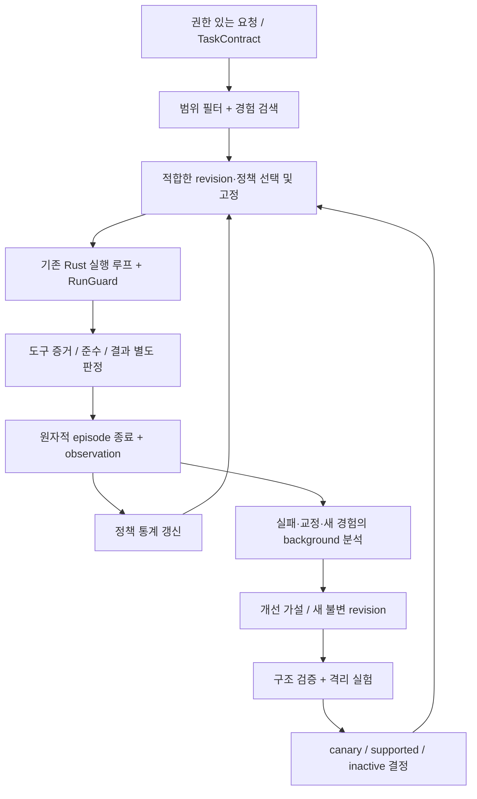

# DOMINION 범용 자기개선 설계 — DeepSeek 구현 기준

작성: 2026-11-05. **설계 산출물이며 구현 완료 보고가 아니다.**

## 0. 읽는 순서와 판정

1. 이 문서: 실제 구현 진단, 알고리즘, Rust·저장 명세, 위험.
2. [단계별 개발 지시서](/Users/gim-yeonsu/dominion-rust/docs/SELF-IMPROVEMENT-TASKS-2026-11-05.md): 의존 순서대로 별도 커밋할 작업.
3. [검증·벤치마크 명세](/Users/gim-yeonsu/dominion-rust/docs/SELF-IMPROVEMENT-BENCHMARK-2026-11-05.md): 모의 모델과 실제 모델, 인과 비교, 성장 판정.

선택한 구조는 **기존 실행 기록을 토대로 한 검증 가능한 절차 + 범위를 나눈 통계적 전략 선택 + 격리된 대조 실험**이다. 새 에이전트 런타임이나 별도 기억 DB를 만들지 않는다. 기존 Rust 실행 루프, SQLite, `learn`/`reflect` 작업을 확장한다. 일반 채팅이 첫 적용 대상이고 `/goal`은 같은 실행·검증 코어를 호출하는 선택 기능이다.

모델 가중치는 바꾸지 않는다. 개선 대상은 절차, 검색 결과, 복구 선택, 검증 프로필, 제한된 실행 정책이다. 코드 변경은 제안으로만 남긴다. **동일 모델의 실제 성공률 상승은 앞으로 실험해야 할 목표이며, 이 문서로 달성했다고 주장하지 않는다.**

## 1. 분석 기준과 현재 구현 진단

### 1.1 확인한 저장소 상태

- 저장소: `hushmind3/dominion-rust`, 브랜치 `codex/native-memory-harness`.
- `git fetch origin codex/native-memory-harness` 후 로컬과 원격 모두 `ac1d0a0f95510a38bfc334c661f338b36e46a5bb`.
- 최근 이력: `ac1d0a0` 난제 보고서 → `b6985ba` 성공 경험 공유 → `c30ad3f` 학습·채널 전파 → `46ed801` 기억·전략 채택 수정.
- 분석 당시 미커밋 변경: `chat/runtime.rs`, `improve.rs`, `learning.rs`, `reflect.rs`, `engine/mod.rs`, `tests/e2e.rs`; 미추적 `engine/procedure.rs`. 이 변경은 HEAD와 별개다. 삭제하거나 덮어쓰지 않는다.
- [기준 보고서](/Users/gim-yeonsu/dominion-rust/docs/HARD-PROBLEMS-2026-11-05.md)의 148 unit + 21 integration, 실제 4B baseline 0 / post 0/3 / cross-agent 0은 **기존 보고 값**이다. 이번 분석에서 테스트나 모델 실험을 재실행하지 않았다.
- 아래 줄 번호는 분석 당시 작업 트리 기준이다. DeepSeek는 작업 시작 시 HEAD·diff를 다시 기록하고 함수 이름으로 위치를 확인한다.

### 1.2 실제 호출 경로

```text
일반 채팅 / room turn
  run_turn_with_policy → 실행 record 생성 / 취소 세대 고정
  run_turn_body → 원문 저장·replyTo → prepare_owner_action
    → system_prompt → memory + skill + improvement + experience 주입
    → 선택적 action_plan → stream_completion
    → 도구 인자 파싱 → [WIP procedure 검사] → 승인 → tools/MCP
    → execution_operation + tool message 저장
    → acceptance / [WIP procedure repair] → 최종 메시지
  finalize_execution → [WIP compliance] → improve::record_execution
  autoLearning이면 learn / 교정 감지 시 reflect enqueue

learn → 페이지·checkpoint → LLM 추출 → save_grounded / 스킬 draft / propose
reflect → 교정·최근 실행 분석 → global experience / strategy / memory / skill draft
goal job → plan → run_quiet_outcome(일반 실행) → acceptance + reviewer → repair/replan
```

`execution`, `execution_operation`, `improvement`, `experience`, `memory`, `skill`, `job`은 대부분 SQLite `records(kind,id,data)`에 저장된다. `messages`는 별도 테이블이다. 이 저장 모델을 유지한다.

### 1.3 재사용·수정 지점

| 위치 | 확인한 구현 | 판단 / 수정 |
|---|---|---|
| [improve::propose](/Users/gim-yeonsu/dominion-rust/src/engine/improve.rs:10) | 근거 ID 목록·rationale 검사, 유사 문구 비교, 기본 `adopted`, harness만 `proposed` | 출처 ID의 의미·권한·내용을 재검증해야 한다. `candidate`부터 시작하고 내용 유사도만으로 기존 절차를 덮어쓰지 않는다. |
| [active_values](/Users/gim-yeonsu/dominion-rust/src/engine/improve.rs:288) | 범위에 맞는 adopted/validated 최대 6개. 작업 적합도·비용·성과 조건 없음 | 작업별 selector로 교체. 한 번 선택한 불변 snapshot을 주입과 실행 양쪽에 사용. |
| [record_execution](/Users/gim-yeonsu/dominion-rust/src/engine/improve.rs:348) | HEAD는 주입 ID + toolCalls + completed로 성공 집계. WIP는 준수 결과도 사용 | WIP는 진전이나 인과 추정이 아니다. 5회·기준 성공률−0.2 방식 폐기. observed와 controlled evidence 분리. |
| [attach_verification](/Users/gim-yeonsu/dominion-rust/src/engine/improve.rs:462) | 같은 record에 검증 정의 덮어쓰기, version 증가 | 실행 중 snapshot은 유지되지만 성과는 ID 단위로 섞인다. 내용 주소 기반 불변 revision과 revision별 통계 필요. |
| [experience::record_with_scope](/Users/gim-yeonsu/dominion-rust/src/engine/experience.rs:97) | signature·outcome·lesson 기반 병합, 근거 최대 12개 | 원시 episode와 재사용 교훈 분리. 근거 12개 잘림으로 원시 이력 유실 금지. |
| [experience::retrieve](/Users/gim-yeonsu/dominion-rust/src/engine/experience.rs:186) | 문자열 포함, 발생 횟수 boost; 검색 자체가 uses 증가 | exposure로 이름 변경. 의미 검색 추가하되 실제 준수나 효용으로 집계하지 않는다. |
| [consolidate](/Users/gim-yeonsu/dominion-rust/src/engine/experience.rs:252) | signature/outcome 중복 정리, 전체 300개 초과 archive | 상반된 교훈도 같은 signature면 묻힐 수 있다. 의미·조건·출처를 보존하고 범위별 working set 관리. |
| [learning::run](/Users/gim-yeonsu/dominion-rust/src/engine/learning.rs:192) | actor별 lock, immutable through ID, grounding·checkpoint | 재사용. remainder가 `throughMessageId=through`로 바뀌어 원래 snapshot 끝을 잃는 경로를 수정. 원본 through 고정, cursor만 이동. |
| [apply_learning](/Users/gim-yeonsu/dominion-rust/src/engine/learning.rs:370) | 기억은 엄격한 원문 검사, 전략은 batch ID 포함 여부 중심 | 전략에서도 메시지 역할·권한·실행 증거 검사. assistant ID를 사실 증거로 채택하지 않는다. |
| [reflect::run](/Users/gim-yeonsu/dominion-rust/src/engine/reflect.rs:107) | 최근 대화·실행을 분석하고 global 산출물 생성. memory는 직접 put | 지연 실행 시 다른 턴이 섞일 수 있다. episode/교정 watermark 고정. `save_grounded` 우회 금지. 원문 대신 승인된 추상 교훈만 범위 확대. |
| [memory::visible](/Users/gim-yeonsu/dominion-rust/src/engine/memory.rs:56) / [save_grounded](/Users/gim-yeonsu/dominion-rust/src/engine/memory.rs:321) | partition·agent·sourceAuthorKey·정확 인용 검사. global은 범위 통과 | 대부분 재사용. 명시적인 공유 허가와 원문/추상본 visibility를 공통화. 정확 인용은 출처 증명이지 추측성 요약의 진실 증명이 아니다. |
| [chat::context](/Users/gim-yeonsu/dominion-rust/src/engine/chat/context.rs:62) | 기억·스킬·전략·경험을 각각 조회 | 실행 시작 때 고정한 ContextSelection을 전달. 중복 절차와 토큰 폭증 방지. |
| [runtime](/Users/gim-yeonsu/dominion-rust/src/engine/chat/runtime.rs:194) | 실제 승인·도구·기록·취소·예산, ordinary acceptance 이미 존재 | 유지. 일반 실행을 완료 주장만 하는 루프로 되돌리지 않는다. 공통 RunGuard를 도구 경계와 완료 경계에 연결. |
| [runtime::action_plan](/Users/gim-yeonsu/dominion-rust/src/engine/chat/runtime.rs:984) | 직접 실행 요청은 별도 LLM 계획; 실패 시 reviewer 호출 | 단순 결정적 실행은 추가 호출 0으로 시작. 필요한 경우만 계획/리뷰 프로필 선택. 비용 계측에 보조 호출도 포함. |
| [goals::run](/Users/gim-yeonsu/dominion-rust/src/engine/goals.rs:9) | plan·실행·검토·repair·replan·중단 checkpoint | 보존. 합성 goal 프롬프트를 새 사용자 지시로 다시 추출하지 않도록 parent task 연결. 중복 평가·중복 보상 제거. |
| [goals::acceptance_gaps](/Users/gim-yeonsu/dominion-rust/src/engine/goals.rs:704) | 파일·실행 근거 검사, 원래 baseline | 공통 verification 모듈로 이동하고 호환 wrapper 유지. 절차 준수와 결과 검증을 통합 판정하되 각각 기록. |
| [jobs](/Users/gim-yeonsu/dominion-rust/src/engine/jobs.rs:125) | 재시작의 uncertain side effect 보류, CAS claim, learn 우선순위 낮음 | 유지. reflect/embed/consolidate도 background class. learn_running 관찰 후 claim은 여러 worker 간 동시 admission을 완전히 보장하지 않으므로 원자적 slot 필요. |
| [Store](/Users/gim-yeonsu/dominion-rust/src/db.rs:111) | put upsert, 단일 record CAS·increment | episode 종료·observation·정책 집계는 여러 record에 걸치므로 하나의 transaction 필요. 읽기 실패를 빈 목록으로 처리하는 기존 API를 새 평가 경로에서 쓰지 않는다. |
| [task-benchmark.sh](/Users/gim-yeonsu/dominion-rust/scripts/task-benchmark.sh:11) | 기본 4317, repo/bench 삭제, autoApproveAll, 파일 내용만 검사 | 현 상태로 실행 금지. 격리 sentinel·읽기 확인·순서 검증·원시 결과 저장이 있는 Rust runner로 대체. shell은 호출 wrapper만. |

### 1.4 미커밋 procedure의 구체적인 결함

기존 시도를 버리지 않고 다음 검증기를 엄격하게 만든다.

- [normalize](/Users/gim-yeonsu/dominion-rust/src/engine/procedure.rs:60)는 잘못된 조건을 필터링해서 나머지만 채택한다. 필수 조건이 조용히 사라지므로 **전체 revision을 Invalid로 거부**해야 한다.
- [operation_matches](/Users/gim-yeonsu/dominion-rust/src/engine/procedure.rs:101)는 `path/file/command/cwd`의 부분 문자열을 검색한다. `report.txt.bak`, `echo report.txt`도 혼동 가능. typed tool adapter가 정규화한 resource ID와 인자 값을 비교한다.
- [evaluate](/Users/gim-yeonsu/dominion-rust/src/engine/procedure.rs:265)는 before의 양쪽 작업이 없으면 true. 이는 조건부 제약의 공허한 충족일 수 있지만 ‘전략 실행’ 증거가 아니다. `NotTriggered`를 구분한다.
- before는 첫 위치만 비교한다. 대상 호출마다 prerequisite 범위·무효화 여부를 검사해야 한다. 정렬은 timestamp/문자열 ID 대신 엔진 단조 sequence를 사용한다.
- [read_workspace_file](/Users/gim-yeonsu/dominion-rust/src/engine/procedure.rs:224)는 lexical 상대경로 검사만 하고 read_to_string한다. symlink 탈출·큰 파일·binary 존재 검사·읽기 오류와 부재를 구분할 필요가 있다.
- [runtime 절차 repair](/Users/gim-yeonsu/dominion-rust/src/engine/chat/runtime.rs:411)는 `!force_final && repairs < 2`에서만 실행된다. 소진 후에는 위반을 terminal failure로 고정하지 않는다. [acceptance_passed](/Users/gim-yeonsu/dominion-rust/src/engine/chat/runtime.rs:861)는 일반 조건만 통과해 force_final을 만들 수 있다. **최종 공통 판정을 우회하는 완료 경로가 있어서는 안 된다.**
- 최종 적용성 계산은 tool=None이라 tools-only 적용 조건을 놓칠 수 있다. 요청 시점의 eligibility와 실행 중 trigger를 별도 기록한다.
- [finalize_execution](/Users/gim-yeonsu/dominion-rust/src/engine/chat/runtime.rs:1136)은 실행 저장 전에 카운터 갱신을 호출한다. 반복 finalization의 중복 집계·중간 crash·동시 덮어쓰기 방지 필요.

## 2. 데이터와 권한의 기본 계약

### 2.1 혼동하면 안 되는 여섯 가지

| 개념 | 정의 | 성공 증거 여부 |
|---|---|---|
| Exposure | 선택된 내용을 실제 provider 요청에 포함 | 아니오 |
| Applicability | 실행 전에 해당 작업·환경에 적용 가능 | 아니오 |
| Trigger | 해당 절차의 조건이 실제 실행에서 발생 | 아니오 |
| Compliance | 요구된 실행·순서·조건을 증거로 충족 | 절차 준수만 증명 |
| TaskOutcome | 사용자 작업 조건을 충족 | 해당 작업 결과 증명 |
| Effect | 같은 조건의 control보다 성과가 개선 | 통제 실험의 대상 분포 내 개선 근거 |

`appliedImprovementIds`는 호환 필드로 남기되 의미를 exposure로 명시한다. 새 집계는 이 값만 보고 갱신하지 않는다. completed는 전송/실행 lifecycle일 수 있으므로 `taskOutcome`을 별도로 제공한다.

### 2.2 작업·실행·증거 단위

- `TaskEpisode`: 실제 권한 있는 원문 요청 한 개 또는 명시적인 계속 작업의 root. `taskId`, `sourceMessageId`, `instructionRevision`, `owner/actor`, scope, 작업 의도·성공 조건·budget을 갖는다.
- `ExecutionAttempt`: 기존 `execution`. 한 episode에 여러 turn, agent, repair 시도가 연결된다. `/goal`의 합성 프롬프트는 `parentTaskId` 아래 attempt일 뿐 새 owner instruction이 아니다.
- `Operation`: 기존 `execution_operation`. proposal/blocked/approved/running/completed/failed/interrupted를 구분하고 `opSeq`, `attemptId`, `taskId`, `origin=model|procedure`, `contractRevision`, `strategyRevision`을 추가.
- `EvidenceRef`: 종류가 명확한 message/operation/artifact/verification/owner_correction 참조. ID만이 아니라 source scope, revision, observedAt, digest, 관찰자를 포함.
- `Experience`: 위 episode들의 추상 교훈·실패 분류·적용 조건·근거 링크. 원본 사실을 대체하지 않는다.

동일 원문에 9명이 대답해도 성공 표본 9개를 만들지 않는다. 작업 단위 결과는 한 번, 정책 결정별 관측은 별도로 한 번. 다른 에이전트의 성공을 읽은 행위와 직접 실행한 행위도 구분한다.

### 2.3 작업 계약과 학습 전략을 분리

`TaskContract`에는 사용자가 요구한 결과, 필요한 권한, 명시한 필수 절차만 들어간다. 전략 후보는 이 계약의 정답·성공 조건·승인 정책을 바꿀 수 없다.

전략은 두 종류다.

1. **StandingConstraint**: 소유자의 유효한 교정에서 확정한 필수 작업 규칙. 실제 사용자 의도·적용 범위를 확인해 버전 고정. 실서비스에서 무작위로 꺼서 실험하지 않는다.
2. **AdaptiveStrategy**: 성공 가능성을 높인다는 가설. 대체 가능한 구현·복구 방법이다. 미준수면 전략 성공으로 집계하지 않지만, 선택적 전략 실패만으로 사용자 작업 결과를 거짓 실패로 바꾸지 않는다.

필수 절차 위반 + 파일 결과만 올바름 = 작업 계약 실패. 선택적 전략 미준수 + 결과 올바름 = 작업 성공 / 전략 준수 실패. 두 사실을 동시에 보존한다.

사용자 지시, 인용문, peer 발화, 도구 결과는 타입으로 구분한다. 기존 문자열 휴리스틱은 초기 intent 후보만 만든다. 구조화된 외부 채널 origin·owner identity·replyTo가 authority의 근거다. 모호한 고위험 새 행동을 반성 모델의 추측으로 승인하지 않는다.

## 3. 알고리즘 전체 흐름



### 3.1 작업 시작

1. owner 원문·수정 이력·범위를 고정한다. 외부 요청이 현재 owner의 권한인지 이미 존재하는 identity/policy 경로로 확인한다.
2. 결정적으로 추출 가능한 조건은 Rust가 계약으로 만든다. 불명확한 작업은 목표 설명과 unknown 검증을 유지한다. 정답을 임의로 보충하지 않는다.
3. 도구 capability·workspace resource baseline·모델 fingerprint·tool schema hash·기억 snapshot을 고정한다.
4. permission/scope/applicability로 후보를 먼저 줄이고 lexical+semantic retrieval을 수행한다.
5. 필수 제약 + 선택적 전략 1개(초기 기본값) + 필요하면 비충돌 보조 스킬을 선택한다. 실험에서는 후보 하나만 바꾸고 나머지를 고정한다.
6. SelectionSnapshot과 실제 주입된 revision ID를 기록한다. context 재생성 때 DB에서 새 후보를 고르지 않는다.

### 3.2 실행 전·중·후 검사

| 시점 | Rust가 하는 일 | LLM 필요 |
|---|---|---|
| 전 | schema, 권한, 모델/도구 호환, 변수 binding, DAG cycle, resource baseline | 모호한 binding/계획만 선택적 |
| 도중 | 매 proposed call의 args/resource/순서/precondition, 취소, 예산, 승인 | 위반 시 작은 구조화 수정 요청 |
| 후 | 결과 oracle + 필수 절차 + evidence readback | 의미 평가가 필요한 항목만 reviewer |
| 실패 | 실패 코드·남은 budget에 맞춘 repair policy 선택 | 필요한 복구만 |

결정적 실패를 reviewer가 뒤집지 못한다. reviewer가 불가능하거나 JSON이 틀리면 semantic verdict는 Unknown이다. ‘도구 성공’만으로 작업 결과가 맞았다고 보지 않는다.

### 3.3 작은 모델을 위한 절차 실행

자연어를 반복 주입하는 것만으로 해결하지 않는다. 전략 revision은 선택적으로 **작고 제한된 partial-order procedure**를 갖는다. 전체 작업을 고정 workflow로 강제하지 않는다.

- 각 node는 typed tool intent 또는 deterministic assertion. dependency는 DAG이며 최대 16 node, 32 edge, 깊이 8.
- `model_guided`: 모델이 제안한 도구를 검증하고 누락 조건을 알려준다. 초안·새 전략의 기본 모드.
- `harness_assisted`: 구조와 근거가 검증된 revision의 다음 준비된 node를 Rust가 실제 tool intent로 제안한다. 사용자 허용 범위와 기존 approval을 그대로 거친다.
- `enforcement`는 필수 제약에 대한 `block`; 선택적 전략은 `observe` 또는 부작용 없이 가능한 제한된 `repair`. 임의 학습 후보가 사용자 명령을 가로막는 전역 규칙이 되지 않는다.
- 모든 값은 literal / owner-grounded task binding / 성공한 앞 node의 검증된 JSON pointer 결과 중 하나. 단순한 텍스트 치환이나 shell 문자열 보간 금지.
- 파일과 실행 명령의 인자를 타입 검사한다. 기존 `terminal_exec(command,args)`를 재사용한다. `shell_exec` 자체는 유지하되 learned macro가 도구 결과의 문자열을 쉘 명령으로 합성하지 못한다.
- 변수 값이 없거나 검증 불가능하면 node는 AwaitBinding. 모델에 정확히 그 값만 요청하거나 model_guided로 내려가며 값·권한을 만들어내지 않는다.
- 하네스가 실행해 성공한 경우 `origin=procedure`, `assistanceMode=harness_assisted`를 남긴다. 모델이 자발적으로 준수한 것으로 보고하지 않는다.

예: ‘작업 전 유효한 입력 형식을 확인하고, 변환 후 출력 스키마 검사’라는 구조는 파일 변환·API 응답 처리·데이터 분석에 공통 적용 가능하다. 구체적 경로·스키마는 이번 TaskContract와 입력 artifact에서 binding한다. 벤치마크 정답은 엔진에 넣지 않는다.

### 3.4 완료와 복구

단 하나의 `finish_attempt` 경로에서 최종 판정한다. early acceptance, force_final, 최대 반복 도달, 도구 없음, 스트림 종료, 재시작 모두 이 경로의 판정을 우회하지 않는다.

```text
cancelled                  → Cancelled
부작용 결과 불명확         → NeedsReview(Unknown)
필수 deterministic 실패    → Failed / budget 내 Repair
필수 semantic 불명확       → NeedsReview(Unknown)
필수 조건 전부 Pass        → Succeeded
작업 결과 검증 미정의      → AnsweredUnverified (성공률에 성공으로 넣지 않음)
```

복구 정책 초기 후보는 `fix_arguments`, `satisfy_prerequisite`, `readback_then_reconcile`, `alternate_tool`, `replan`, `stop`이다. 실패 코드와 도구 capability로 불가능한 후보를 제거한다. 재실행이 위험한 Unknown side effect는 readback/reconcile만 가능하며 retry가 기본값이 아니다.

현행 8 rounds / 40 tool calls / 600초는 상한을 유지한다. 하나의 BudgetLedger가 planner·실행·review·repair·하네스 node를 함께 센다. blocked proposal도 proposal budget을 소비하지만 실제 executed tool 수와 별도 기록한다. 기본 repair는 총 2회, 같은 violation digest는 최대 1회 재시도; 새 증거가 없으면 다른 방법 또는 종료. goal은 parent budget 아래 child limit을 부여하며 매 attempt마다 무제한 리셋하지 않는다.

### 3.5 완료 후 학습

모든 attempt는 성공/실패/취소/unknown을 기록한다. LLM 반성은 모든 턴에 돌리지 않는다. 사용자 교정, 새 failure signature, 동일 실패 3회, 새로운 성공 절차가 있을 때만 background hypothesis 생성. 반복 failure group당 활성 후보 최대 3개, 하루 호출·토큰 예산을 설정하고 초과 시 defer한다.

가설은 `observedFailure`, `suspectedCause`, `proposedChange`, `predictedObservableEffect`, `falsification`, `applicability`, `evidenceRefs`를 갖는다. 관찰과 추측을 구분하며 ‘실패 후 이 방법이 좋을 것 같다’는 유효성 증명이 아니다. 추측은 candidate, 명시적 owner 교정은 권한이 확인된 제약 후보가 된다.

## 4. 전략 선택·갱신 알고리즘

### 4.1 선택한 방법과 대안

초기 구현은 **작업 context bucket별 Beta 성공 추정 + 비용·위험 제약 + 확률이 명시된 ε-greedy 탐색**이다. 작업 특성에 따라 다른 정책 통계를 사용하는 contextual bandit의 단순한 구현이다. 정책 행동 선택이라는 원리는 [Li 등의 contextual bandit 연구](https://arxiv.org/abs/1003.0146)를 참고하되 구현과 효용 정의는 DOMINION에 맞춰 작성한다.

| 후보 | 이번 선택 |
|---|---|
| 고정 규칙 / 성공 횟수 | 권한·검증 invariant에는 사용. 학습 선택기로는 부족. |
| 전역 Beta/Thompson sampling | 작업 난이도가 섞이고 정확한 selection propensity 계산이 번거롭다. 기본 선택기로 채택하지 않음. |
| LinUCB·신경 contextual bandit | 희소 데이터에서 feature·행렬·비정상성 검증 비용이 큼. 후속 비교 후보. |
| bucket별 Beta + ε-greedy | SQLite로 충분, 선택 확률 정확, 실패 유형별 adaptation 설명 가능. 채택. |
| 전체 RL·소스 자동수정 | 현재 요구와 맞지 않음. 미구현. |

### 4.2 Context와 업데이트

`ContextKey = (taskFamily, failureClass_or_none, modelFingerprint, toolCapabilityVersion, riskClass, verifierProfile)`.

- taskFamily는 file_transform/code_change/web_query/research/analysis/multi_agent/other 같은 확장 가능한 label. label 자체는 성공 조건이 아니다.
- raw filename/user ID를 성공 예측 feature로 쓰지 않는다. 공유 권한으로 통계 집계를 먼저 나눈다.
- 처음에는 family/model/risk 기준 coarse bucket. 30개 미만이면 같은 안전 범위 parent 통계를 prior로 소량 차용한다. 다른 모델의 결과는 causal 근거로 이전하지 않는다.

선택용 통계만 시간 감쇠한다. 원시 observation과 실험 결과는 불변이다.

```text
ρ = exp(-ln(2) × elapsed_days / H), H 기본 30일
S ← ρS + y ; F ← ρF + (1-y)     # 최종 결과를 확인한 관측만
α0 = 1 + κ × μ_parent
β0 = 1 + κ × (1-μ_parent)         # parent 없으면 α0=β0=1
κ = min(4, parent_effective_n)    # 다른 bucket prior가 실측을 압도하지 않게 제한
α = α0 + S ; β = β0 + F
μ = α/(α+β)
σ² = αβ / ((α+β)²(α+β+1))
```

`y=1`은 필수 조건이 모두 검증된 성공, `y=0`은 확인된 실패. 취소·승인 거절·외부 서비스 불명확은 task learner의 S/F에 넣지 않고 별도 availability/unknown 통계에 넣는다. 실제 벤치마크의 strict 성공률은 unknown도 분모에 포함한다. 이렇게 해야 unavailable 실행을 빼서 실제 성능을 부풀리지 않는다.

준수 확률도 별도 Beta(C_followed,C_violated)를 둔다. NotApplicable/NotTriggered/Unknown은 준수 성공도 실패도 아니다. 그러나 실험에 배정되고 전략을 무시한 실행은 ITT 결과에서 제거하지 않는다.

비용은 `c = min(1, tokens/tokenCap + activeLatency/latencyCap + toolCost/costCap)`의 사전 고정 가중 합을 사용하고 각 원시 값도 저장한다. 권한 승인 대기 시간은 사용자 체감 지연과 active latency에 따로 표시한다. 위험 사건은 관측 위험률과 고정 capability 위험 상한을 함께 적용한다.

```text
freshness = exp(-ln(2) × days_since_compatible_validation / 90)
Q(a,x) = μ - 1.0σ - 0.10 E[c] - 0.50 U(risk)
         + 0.03 relevance + 0.02 freshness
```

위 가중치는 시작 설정이며 성능 보장이 아니다. relevance·freshness는 [0,1], unknown risk의 U는 1, 시험하지 않은 revision은 production exploit 후보에서 제외. 보상 가중치를 online 모델이 바꾸지 못한다. 위험·권한 invariant는 점수보다 앞선 hard filter다.

### 4.3 탐색 확률과 빈 데이터

- 후보 집합 A에는 항상 `no_optional_strategy` 또는 현재 안정 정책을 포함한다. standing constraint는 어느 arm에서도 유지한다.
- low-risk canary와 격리 실험만 새 revision 탐색 가능. production 기본 ε=0; 소유자가 설정한 저위험 탐색에서 ε=0.05. 테스트 설정에는 ε=0.10 허용.
- `a* = argmax Q`, tie는 revision hash 정렬. 확률 `p(a|x)=(1-ε)·1[a=a*]+ε/|A|`.
- RNG seed, 후보 집합, 모든 Q, p, 정책 version, 실제 선택을 **실행 전에 저장**한다. 저장 실패면 실험 실행을 시작하지 않는다.
- 한 context에 데이터가 없으면 안정 baseline. 불확실성만으로 실서비스에 미검증 변경을 밀어 넣지 않는다.
- tool_policy의 효용은 ‘그 도구의 성공 횟수’가 아니라 해당 정책을 선택한 작업의 결과로 측정한다. 도구를 피하는 정책은 그 도구가 호출되지 않아도 평가 대상이다.

### 4.4 시스템 자체의 개선

같은 selector 인터페이스를 세 decision slot에 적용한다.

1. `strategy`: 이번 작업에서 어느 검증된 방법을 쓸지.
2. `recovery`: 실패 상태에서 어느 복구 방법을 쓸지. 상태·이미 실행한 복구·남은 예산을 고정하고, 주 지표는 terminal outcome, 보조 지표는 다음 checkpoint gap 감소.
3. `verification_profile`: 필수 oracle는 그대로 두고 additional readback / semantic review / stronger semantic review 중 어느 추가 검증을 할지.

검증 profile의 성공 보상은 자기 판정이 아니라 독립적인 benchmark oracle/owner adjudication과의 일치다. 독립 label이 없는 작업은 검증기 정확도 업데이트를 하지 않는다. 저비용 profile도 고정 비율(초기 10%)의 무작위 audited sample을 유지해 쉬운 표본만 평가되는 것을 막는다. 감사 budget이 없으면 profile을 낮추는 학습은 멈춘다.

초기에는 episode별 세 slot 중 **하나만 탐색**한다. 나머지는 고정해야 효과의 원인을 비교할 수 있다. 여러 전략이 동시에 바뀐 경우 bundle revision의 효과로만 보고하고 개별 기여를 만들어내지 않는다.

정책 version은 정해진 관측 batch(초기 20개 확정 관측)마다 재계산해 CAS로 공개한다. in-flight 실행은 이전 snapshot을 끝까지 사용한다. 최근 window에서 성과 하락·환경 fingerprint 변화가 생기면 통계를 삭제하지 않고 compatibility를 stale로 바꿔 canary로 재검증한다. 심각한 권한/데이터 손상 1건은 즉시 quarantine한다.

## 5. 인과 귀속과 승격

### 5.1 두 종류의 통계를 섞지 않는다

관찰 데이터는 ‘이 context에서 이 선택 뒤에 어떤 결과가 났나’를 알려준다. 선택된 방법이 어려운 작업에서만 쓰였다면 낮은 성공률만으로 나쁜 방법이라고 단정할 수 없다. Beta score는 선택 휴리스틱이며 인과 증거가 아니다.

인과 효과의 1차 근거는 **동일한 초기 환경의 무작위 paired control/treatment 실험**이다. 모델, quantization, prompt 구성, 정보, 도구·권한, verifier, token/time 한도, 기억 snapshot을 고정하고 전략 revision/실행 모드 하나만 변경한다. 순서는 AB/BA를 무작위화한다.

`ITT = mean(Y_treatment - Y_control)`를 사용한다. 전략 미준수·실패 실행을 제외하지 않는다. `P(success | followed)`는 진단 지표이며 causal effect로 표시하지 않는다. ‘준수했을 때만 집계’하면 성공하기 쉬운 실행만 남는 사후 선택 편향이 생긴다.

### 5.2 승격 상태와 근거 등급을 분리

상태: `candidate → eligible → sandbox_passed → canary → active`; `inactive`, `quarantined`, `superseded`, `rejected`로 이동 가능. 새 내용은 새 revision이다.

근거 등급:

- E0 `hypothesis`: 출처 있는 가설.
- E1 `structural`: schema·mock·권한·복구 경로 통과. 실전 효과 증명 아님.
- E2 `observed`: 실제 결과 관측. 대조군 없는 상관.
- E3 `controlled_preliminary`: 통제 비교를 했지만 효과 또는 표본의 불확실성이 큼.
- E4 `controlled_supported`: 사전 등록된 holdout 비교 기준을 충족. **그 모델·작업 분포·환경 범위에서만** 효과 지원.

owner가 명시한 필수 규칙은 E4가 아니어도 유효한 constraint다. 규칙의 정당성과 성공률 개선 주장은 다른 문제다. 기존 `validated`를 E4로 자동 변환하지 않는다.

### 5.3 성과 계산과 불확실성

독립 평가 단위는 task instance이며 같은 instance의 seed 반복은 묶는다. `d_i`는 instance 내 paired 평균 차이로 [-1,1]이다. 같은 template가 사실상 같은 과제면 template 단위 cluster로 올리고 N도 그 수로 센다.

```text
Δhat = (1/N) Σ d_i
보수적 halfwidth h = sqrt(2 × ln(2/α*) / N)
CI = [max(-1, Δhat-h), min(1, Δhat+h)]
α* = 0.05 / M    # 사전 등록한 동시 비교 개수 M
```

이는 독립 bounded 단위에 적용하는 보수적 Hoeffding bound다. 고정된 사례 목록에 대한 결과를 새로운 모든 작업에 일반화하지 않는다. 별도로 cluster bootstrap 10,000회 percentile interval을 제공하되 작은 N·biased task sampling에서 보장되는 구간이라고 부르지 않는다.

E4 기본 판정은 conservative lower bound > 사전 설정 δ(초기 0.05), 새로운 심각한 위험 사건 없음, 사전 비용 한도 내, held-out family에서도 regression 기준 충족이다. 이 bound는 비싸다. `N > 2 ln(2/α*)/(Δhat-δ)^2` 정도가 필요하므로 3회·10회로 효과 입증했다고 표시하지 않는다. 예산이 부족하면 E3 canary로 남길 수 있고, owner가 제한된 활성화를 선택해도 근거 등급은 바뀌지 않는다. 정확한 미해결 상태가 거짓 승격보다 낫다.

실험 중 유리한 시점에 멈춰 통과시키지 않는다. 종료 sample 수·비교·δ를 사전 고정한다. 연속 관찰은 위해 중단만 허용하며, 추가 표본으로 새 판단을 하려면 별도 experiment ID와 α 배분을 등록한다. 비용·준수·과제군 지표는 secondary로 표시한다.

### 5.4 기록된 선택을 이용한 정책 평가

propensity가 있는 데이터에만 off-policy 보조 평가를 허용한다. [무작위 로그 기반 평가 연구](https://arxiv.org/abs/1003.5956)가 강조하는 지원 범위와 선택 편향 문제를 적용한다.

```text
w_i = π_new(a_i|x_i) / p_logged(a_i|x_i)
V_SNIPS = Σ w_i y_i / Σ w_i
ESS = (Σ w_i)^2 / Σ w_i^2
```

logged p=0인 새 행동은 평가 불가능. raw weights와 cap=20을 적용한 민감도 결과를 둘 다 기록한다. clipped 추정은 편향이 생기므로 승격 단독 근거로 쓰지 않는다. ESS<30, missing outcome>10%, policy/context 변경이 큰 경우 inconclusive. 선택된 행동 로그를 재생한다고 실행하지 않은 도구 결과를 알 수 있는 것은 아니다. 최종 확인은 새 통제 실행이다.

## 6. 장기 기억·경험 검색과 통합

### 6.1 검색

권한 필터를 **검색 전과 결과 주입 전** 두 번 적용한다. memory/experience/improvement의 각자 다른 global bypass를 공통 KnowledgeVisibility로 통합한다.

1. lexical: 기존 tokens와 한국어 character bigram을 함께 사용, 기존 문구 검색 fallback 유지.
2. semantic: 선택한 로컬 embedding provider로 비동기 문서 인덱싱. 벡터는 `(modelDigest, dimensions, normalizationVersion, contentHash)`별 분리.
3. query embedding은 cache 우선. 첫 호출의 hard deadline 초기 150ms; 초과하면 lexical만 사용하고 background에서 cache 채움. 실제 목표 수치는 성능 실험으로 조정.
4. 각 top-30 결과를 `RRF(d)=Σ 1/(60+rank_j(d))`로 합치고 타입·적용 조건·stale·모순을 재정렬한다. [RRF 원 논문](https://plg.uwaterloo.ca/~gvcormac/cormacksigir09-rrf.pdf)의 순위 결합만 참고한다.
5. 상위 4 experience, 최대 3 선택 절차, 원문 source link와 제한된 요약만 context에 넣는다. 필수 제약은 잘라내지 말고 공간 부족을 명시한다.

초기에는 별도 벡터 서버 없이 SQLite BLOB + Rust cosine scan을 사용한다. 범위별 최대 10,000 hot vector(메모리·지연 측정 후 조정); archival 검색은 명시적으로 늘릴 수 있다. 모든 vector를 영구 삭제해서 상한을 맞추지 않는다. FTS5 가용성을 확인할 경우 lexical index에 사용할 수 있으나 별도 engine 의존은 만들지 않는다.

로컬 adapter 첫 구현은 [Ollama `/api/embed`](https://docs.ollama.com/api/embed)의 `model`, `input`, `embeddings` 계약을 사용할 수 있다. `truncate=false`, NaN/0norm/dimension 불일치 거부. 로컬 서비스가 없으면 degraded lexical mode로 명시한다. private raw text를 외부 embedding API에 자동 전송하지 않는다.

### 6.2 중복·충돌·일반화

- **중복**: 동일한 authority/scope/applicability/contract hash/내용이면 같은 revision. evidence refs를 set union하고 원본 episode는 유지.
- **충돌**: 동일 fact key·author·scope에서 상반된 값이면 source와 유효기간 비교. owner 교정은 해당 사용자 선호를 우선 정정하지만 이미 관찰된 도구 결과를 과거부터 변경하지 않는다.
- **전략 충돌**: 순서 cycle, 같은 자원에 상반된 pre/postcondition이면 conflict set. 유사 문장이라고 merge하지 않는다. specificity·authority로 명확히 해소되지 않으면 optional 후보 제외 또는 unknown.
- **일반화**: 서로 다른 task instance 3개 이상의 유사 failure/성공에서 binding 변수 후보를 만들 수 있다. 수치는 발동 조건일 뿐 검증 기준 아님. 기존 성공 예시와 counterexample fixture 양쪽에서 재검증해 새 revision으로 낸다.
- **스킬화**: active procedure revision을 `skill.procedureRevisionId`로 참조하는 manifest 생성. 별도 자연어 복사본을 실행 권위로 만들지 않는다. 기존 draft UI/API와 호환한다.
- **비활성화**: 위험, compatibility 불일치, 새 controlled regression, 반복 미준수면 revision inactive/quarantined. 선택 통계 감쇠만으로 과거 evidence를 삭제하지 않는다.
- **working set**: scope별 최근 유효성과 활용 기준으로 hot/cold 분리. 치명적 실패·owner correction·active revision의 근거는 pin. 낮은 사용률만으로 삭제 금지.

### 6.3 공유와 신뢰

KnowledgeSource와 ShareProjection을 분리한다. raw transcript/경로/계정 ID는 원래 범위에 남는다. projection에는 추상 lesson, typed applicability, 민감값 없는 변수 schema, 근거 digest, 원본 범위 opaque ref만 넣는다. 원문 권한이 없는 agent가 opaque ref로 원문을 조회할 수 없어야 한다.

기본 공유는 같은 partition. partition 간 공유는 소유자가 설정한 source→destination 정책 안에서만 수행한다. `global` 문자열 하나로 모든 원문을 공개하지 않는다. 기존 global record는 원본 유지 후 `legacy_unreviewed`로 분류하고 cross-partition 주입을 잠근다. 승인된 추상본만 새 projection으로 공개한다.

다른 에이전트의 말은 가설 출처가 될 수 있지만 성공 evidence는 아니다. 실행 ID·artifact digest·oracle 결과가 있어야 재사용 성과를 기록한다. 공유 지식을 가져온 agent는 자기 모델/환경에서 cold prior부터 시작하고 cross-agent benchmark를 거친다.

## 7. Rust 구현 명세

### 7.1 모듈 책임

| 모듈 | 변경 책임 |
|---|---|
| `engine/improve.rs` | 기존 facade 유지. revision 제안·lifecycle·승격 API. counter 기반 승격 제거. |
| `engine/procedure.rs` | WIP를 typed compiler + 적용/순서 검사로 확장. 장대해지면 `procedure/{types,compile,guard}.rs`로 이동. |
| 신규 `engine/verification.rs` | goals acceptance의 실제 검사 재사용·통합. TaskContract·Outcome·Evidence. |
| 신규 `engine/adaptation/{mod,types,selector,stats}.rs` | context별 선택·확률·통계·policy version. 외부 agent framework 아님. |
| 신규 `engine/episode.rs` | 기존 execution들을 root task에 연결, 종료 transaction 요청. |
| 신규 `engine/retrieval.rs` | 기존 memory/experience를 조회하는 hybrid index adapter. 저장 원본 재사용. |
| 기존 `experience.rs`, `memory.rs` | grounding·visibility·projection·consolidation. |
| 기존 `chat/runtime.rs`, `context.rs` | RunGuard hook, snapshot 전달, 공통 completion, 보조 호출 계측. |
| 기존 `goals.rs`, `goal_control.rs` | parent task 전달, 동일 guard 호출, 기존 cancellation/repair 유지. |
| 기존 `learning.rs`, `reflect.rs`, `jobs.rs` | immutable snapshot·후보 생성·낮은 우선순위 background, idempotent job. |
| 기존 `db.rs`, `migrations.rs` | schema migration·transaction·indexed query·read errors. |
| 신규 `src/bin/dominion-benchmark.rs` | 독립 실험 orchestrator. main binary 자동 선택 변화 주의: Cargo default-run 유지. |

### 7.2 핵심 타입 계약

아래는 새 API의 목표 명세다. 기존 코드에 이미 존재한다고 오해하지 않는다. `Id`는 UUID/String wrapper, `Revision`은 canonical JSON SHA-256, `EngineResult<T>`는 명시적인 error enum을 가진 Result다. serde는 camelCase, enum은 tagged `type`, unknown field 거부, 배열·문자열 길이 상한을 적용한다.

```rust
pub enum CheckVerdict { Pass, Fail, Unknown, NotApplicable }
pub enum Compliance { Followed, Violated, NotTriggered, Unknown, NotApplicable }
pub enum TaskOutcome { Succeeded, Failed, Unknown, Cancelled, AnsweredUnverified }
pub enum FailureClass {
    InvalidArguments, MissingPrerequisite, ToolFailure, WrongArtifact,
    MissingEvidence, ModelNoncompliance, SemanticUncertain,
    PermissionDenied, EnvironmentUnavailable, OutcomeUnknown, BudgetExhausted,
}
pub struct EvidenceRef {
    pub kind: EvidenceKind, pub id: Id, pub revision: Option<Revision>,
    pub scope: ScopeRef, pub observed_at: Timestamp, pub digest: Option<String>,
}
pub struct TaskContract {
    pub task_id: Id, pub revision: Revision, pub source: InstructionSource,
    pub scope: ScopeRef, pub intent: TaskIntent, pub family: String,
    pub mandatory: Vec<CheckSpec>, pub bindings: BindingSet,
    pub permissions: PermissionSnapshot, pub budget: BudgetLimits,
}
pub struct StrategyRevision {
    pub strategy_id: Id, pub revision: Revision, pub parent: Option<Revision>,
    pub applicability: Predicate, pub authority: StrategyAuthority,
    pub procedure: Option<ProcedureSpec>, pub advice: Option<String>,
    pub checks: Vec<CheckSpec>, pub provenance: Vec<EvidenceRef>,
    pub compatibility: Compatibility, pub scope: ScopeRef,
}
pub struct Decision {
    pub id: Id, pub task_id: Id, pub slot: DecisionSlot, pub context: ContextKey,
    pub candidates: Vec<CandidateScore>, pub selected: ArmId,
    pub probability: f64, pub policy_revision: Revision, pub rng_seed: u64,
}
pub struct Observation {
    pub decision_id: Id, pub attempt_id: Id, pub outcome: TaskOutcome,
    pub compliance: Compliance, pub checks: Vec<CheckResult>,
    pub evidence: Vec<EvidenceRef>, pub costs: CostVector,
    pub regime: ObservationRegime, pub labels: LabelProvenance,
}
pub struct SelectionSnapshot {
    pub contract: TaskContract, pub strategies: Vec<StrategyRevision>,
    pub decisions: Vec<Decision>, pub context_items: Vec<ContextItem>,
    pub memory_watermark: String, pub snapshot_hash: Revision,
}
```

`ObservationRegime`은 production_observed / sandbox_control / sandbox_treatment / canary다. 각 필드의 missing/default는 migration에서만 처리하고 새 실행에서는 필수다.

`CheckSpec` 지원 타입:

| 타입 | 필드 / 판정 |
|---|---|
| ResourceExists/Absent/Changed | ResourceRef, baseline digest, observation freshness |
| FileEquals/Contains | ResourceRef, 명시적 expected binding, byte/text mode, maxBytes |
| JsonSchema/JsonPredicate | artifact JSON pointer, 제한된 schema·비교 연산 |
| ToolSucceeded | tool capability, typed arg predicates, operation evidence |
| Before/After | node 또는 operation selector, per_target/task 범위, invalidation rule |
| SemanticRubric | frozen rubric, 필요한 evidence, judge profile, calibration version |

FileEquals는 임의 trim하지 않는다. newline normalization이 필요한 계약은 명시한다. FileExists는 읽을 수 있는 UTF-8 여부와 다르다. Unknown(접근 오류)과 Absent(ENOENT)를 구분한다. check는 read-only; 변경이 필요한 검증 준비도 정상 tool operation으로 승인·기록한다.

### 7.3 함수 시그니처

```rust
// 기존 facade를 통해 점진 교체
pub fn propose_candidate(state: &AppState, input: CandidateInput)
    -> EngineResult<StrategyRevision>;
pub fn compile(spec: &StrategyRevision, catalog: &ToolCatalog,
    contract: &TaskContract) -> Result<CompiledProcedure, Vec<CompileError>>;
pub fn select(state: &AppState, task: &TaskContract, candidates: &[StrategyRevision],
    policy: &PolicySnapshot, seed: u64) -> EngineResult<SelectionSnapshot>;

pub enum GuardDecision {
    Allow, Block(Violation), NeedBinding(BindingRequest), Stop(StopReason),
}
impl RunGuard {
    pub fn new(snapshot: SelectionSnapshot, ledger: BudgetLedger) -> Self;
    pub fn before_call(&mut self, call: &TypedToolIntent,
        trace: &VerifiedTrace) -> GuardDecision;
    pub fn next_ready_intent(&self, trace: &VerifiedTrace)
        -> Option<TypedToolIntent>;
    pub fn after_call(&mut self, operation: &DurableOperation) -> EngineResult<()>;
    pub async fn finish(&mut self, ctx: &VerificationContext<'_>)
        -> EngineResult<AttemptEvaluation>;
}
pub async fn dispatch_intent(ctx: &ExecutionContext<'_>, intent: TypedToolIntent,
    guard: &mut RunGuard) -> EngineResult<DurableOperation>;
pub fn finalize_once(store: &Store, finalization: &Finalization)
    -> EngineResult<FinalizeResult>; // AlreadyApplied or Applied
pub async fn retrieve(state: &AppState, query: RetrievalQuery,
    deadline: std::time::Instant) -> EngineResult<RetrievedContext>;
pub fn update_policy(store: &Store, batch: &[Observation], expected: Revision)
    -> EngineResult<PolicySnapshot>;
pub async fn run_experiment(ctx: &JobContext, manifest: ExperimentManifest)
    -> EngineResult<ExperimentResult>;
```

`VerificationContext`는 cancel handle, deadline, bounded read adapter, immutable contract, evidence reader를 포함한다. disk/CPU 작업은 bounded blocking executor에서 수행하며 DB Mutex를 잡은 상태로 await하지 않는다. `dispatch_intent`는 모델과 procedure 양쪽에서 공유하는 현재 승인·도구실행 경로다. 두 번째 tools executor를 만들지 않는다.

### 7.4 저장 스키마와 트랜잭션

원본 `records`에 추가할 kind:

| kind | key | 주요 내용 |
|---|---|---|
| task_episode | task UUID | contract, source, attempts, root status, selection snapshot refs |
| improvement_revision | SHA-256 | 불변 StrategyRevision canonical JSON |
| strategy_lifecycle | strategy UUID | active revision, state, evidenceGrade, revision counter |
| strategy_decision | decision UUID | 후보·score·확률·snapshot |
| strategy_observation | hash(decision,attempt,labelRevision) | 준수·결과·근거·비용·regime |
| policy_snapshot | revision hash | slots·bucket 설정·승격 기준·생성 cutoff |
| policy_stats | hash(scope,context,arm,regime) | S/F·준수·비용·unknown, lastUpdate, version |
| experiment | experiment UUID | immutable manifest, 상태, 근거 등급 |
| experiment_trial | hash(experiment,pair,arm,seed) | 환경 hash·assignment·원시 result refs |
| knowledge_projection | projection hash | scope 허가·추상본·provenance opaque ref |
| failure_hypothesis | hypothesis UUID | 관찰·가설·반증 조건·후속 revision |

기존 `improvement`는 UI·API용 facade/projection을 유지한다. 기존 experience는 episodeRefs, applicability, sourceGrade, conflictSet, projectionId를 추가한다. canonical JSON hash는 object key 정렬·명시적 schemaVersion·UTF-8 직렬화 규칙을 고정한다.

추가 SQL 테이블은 학습 원본을 복제하는 DB가 아니라 기존 record의 원자성·인덱스를 위한 보조 구조다.

```sql
CREATE TABLE adaptation_schema(version INTEGER PRIMARY KEY, applied_at TEXT NOT NULL);
CREATE TABLE adaptation_finalizations(
  attempt_id TEXT NOT NULL, evaluation_revision TEXT NOT NULL,
  payload_hash TEXT NOT NULL, applied_at TEXT NOT NULL,
  PRIMARY KEY(attempt_id, evaluation_revision)
);
CREATE TABLE adaptation_updates(
  observation_id TEXT NOT NULL, projection_version TEXT NOT NULL,
  PRIMARY KEY(observation_id, projection_version)
);
CREATE TABLE knowledge_vectors(
  record_kind TEXT NOT NULL, record_id TEXT NOT NULL, content_hash TEXT NOT NULL,
  model_digest TEXT NOT NULL, dimensions INTEGER NOT NULL,
  vector BLOB NOT NULL, created_at TEXT NOT NULL,
  PRIMARY KEY(record_kind, record_id, content_hash, model_digest)
);
CREATE INDEX idx_operation_run ON records(json_extract(data,'$.runId'))
  WHERE kind='execution_operation';
CREATE INDEX idx_execution_task ON records(json_extract(data,'$.taskId'))
  WHERE kind='execution';
```

`finalize_once`는 하나의 SQLite transaction에서 terminal execution/episode·observation·finalization marker를 기록한다. 동일 key+동일 payload면 재호출 성공, 다른 payload면 conflict error. terminal record를 성공으로 저장하기 전에 모든 mandatory evaluation이 존재해야 한다.

통계는 해당 observation을 별도 transaction에서 읽고 `adaptation_updates` INSERT와 stats 갱신을 함께 commit한다. 중간 crash 후 미반영 observation을 다시 처리한다. 재판정은 새 labelRevision으로 저장하고 옛 결과의 가산을 반복하지 않는다. 영향받은 bucket을 immutable observations에서 재구축하는 projection version을 발행한다.

단조 operation sequence는 attempt record의 nextSeq 증가와 operation intent 저장을 같은 transaction에서 수행한다. `running` 부작용 이후 crash는 Unknown. 성공으로 추정하거나 자동 재실행하지 않는다. timestamp는 표시용이고 순서 증명의 기준이 아니다.

### 7.5 마이그레이션

1. SQLite backup API 또는 서버가 정지된 일관된 복제본 사용. live WAL DB 파일만 복사하지 않는다.
2. schema version 생성, 필요한 열은 JSON additive. 기존 execution/message/operation 내용 보존.
3. legacy adopted/validated는 `legacy_observed` revision과 E0/E2 구분으로 이전. 과거 uses/successes는 `legacyCounters`로만 보관; 새 causal score의 초기 성공으로 사용하지 않음.
4. WIP verification은 strict compiler 통과 시 E1, 실패 시 원본을 보관하고 invalid reason 기록. 필수 조건 일부를 삭제해 통과시키지 않음.
5. provenance 없는 legacy global은 local/source-scope 가시성만 유지하고 cross-scope는 검토 대상으로 전환.
6. migration은 재실행해 같은 hash/record가 생기는 idempotent transaction. readback 실패 시 version을 올리지 않음.
7. feature flags: `adaptation.observe`, `adaptation.enforce`, `adaptation.select`, `adaptation.explore`. 기존 필수 acceptance·권한·취소는 어느 flag로도 끌 수 없음.
8. downgrade는 새 record를 삭제하지 않고 selection/enforcement 확장만 끄며 기존 안정 guard 사용. 사용자 데이터·미커밋 소스 자동 reset 금지.

### 7.6 runtime 의사코드

```text
source = resolve_authorized_instruction(request, optional_parent_task)
task = load_or_create_episode(source)               # 합성 peer/goal 문자열은 source 아님
snapshot = freeze_context_and_select(task)
attempt = persist_attempt(task, snapshot)
guard = RunGuard(snapshot, child_budget(parent_budget))
while budget_remaining:
    observe_cancel_epoch()
    intent = guard.next_ready_intent(trace) OR model.next_intent(context)
    if intent is final_answer:
        evaluation = guard.finish(current_evidence)
        if evaluation.requires_repair AND repair_allowed:
            select_recovery_with_logged_propensity(); continue
        break
    decision = guard.before_call(intent, trace)
    persist_proposal_and_decision(decision)
    if blocked: budget.charge_proposal(); bounded_repair_or_stop(); continue
    operation = dispatch_through_existing_approval_and_tools(intent)
    persist_operation_result_and_artifact_refs(operation)
    guard.after_call(operation)
evaluation = guard.finish_even_on_early_exit_or_budget_exhaustion()
finalize_once(attempt, evaluation, observations)
enqueue_projection_updates_and_triggered_learning_once()
```

## 8. 반응 속도·재시작·운영 제약

- foreground의 기본 경로는 추가 LLM 호출 0. 단순 검증은 Rust와 bounded readback, semantic 필요 시만 reviewer 호출. 상시 planner와 상시 reflect는 제거 대상이지만 기존 수행·검증 기능은 제거하지 않는다.
- 기본 retrieval+guard CPU p95 목표 50ms 이하(10k hot item 기준). query embedding deadline 별도. 실제 4B inference 지연과 분리해 계측한다.
- background model 작업은 provider별 제한된 slot을 공유하고 foreground 대기 시 새 작업 시작을 미룬다. 이미 시작한 GPU 호출은 즉시 선점 가능하다고 가정하지 않는다. timeout을 제한하고 queue wait를 기록한다.
- `learn`, `reflect`, `embed`, `consolidate`, `policy_update`는 durable job로 처리. 주기적 full scan 대신 변경 record cursor와 적절한 index를 사용.
- 취소·승인 거절은 strategy가 우회하지 못한다. 기존 kill/process-group·epoch·pending approval 복구 테스트를 보존한다.
- `4317` 서비스, 실제 DB, 토큰, Discord/Telegram 발송, 브라우저·DMG·UI는 이번 범위 밖. 실험은 별도 data/workspace/profile이며 실서비스 자격증명을 복사하지 않는다.

## 9. 미해결 위험과 실험이 필요한 판단

| 위험 | 설계로 막는 부분 | 실제로 확인할 부분 |
|---|---|---|
| 4B가 절차를 무시 | typed guard, bounded repair, harness-assisted mode | 새 작업에서 성공률이 얼마나 증가하는가 |
| 잘못된 성공 조건 | owner contract와 strategy 조건 분리, provenance | 자연어 의도를 얼마나 정확히 계약으로 만드는가 |
| 잘못된 학습 가설 | candidate 격리, counterexamples, 통제 비교 | 반성 모델의 후보 생성 수율·비용 |
| semantic judge 편향 | blinded rubric, unknown, 독립 labels | 해당 분야에서의 false accept/reject율 |
| 희소 데이터·표본 비용 | prior 제한, 근거 등급, 보수적 CI | 실용 예산으로 유의미한 차이를 발견할 수 있는가 |
| 자원·도구 변화 | fingerprint·stale·재검증 | 실제 drift 감지 민감도·false rollback |
| 잘못된 일반화 | parameter binding·negative examples·새 revision | 한국어 paraphrase와 unseen family 전이 |
| 프롬프트 과부하 | 선택 snapshot·토큰 상한·중복 제거 | 4k context 모델에서 최적의 정보량 |
| 원문 유출·오염 | projection ACL·출처 검사·global migration | 실제 기존 데이터에 대한 migration 검토 |
| 비멱등 도구 중단 | Unknown·readback·reconcile | 각 외부 tool의 조회·멱등성 지원 |

이 설계는 범용 강화를 위한 측정·제어 구조를 제공한다. 범용 AGI 성능이나 모든 모델에서의 지속적인 단조 성장을 보장하지 않는다. 다음 구현의 첫 성공은 **일반 채팅에서 준수·실제 결과·불확실성을 정확히 기록하고, 동일 모델의 대조 실험에서 개선 여부를 재현 가능하게 측정하는 것**이다. 그 위에서 정책의 선택이 실측 성과에 따라 달라져야 한다.
