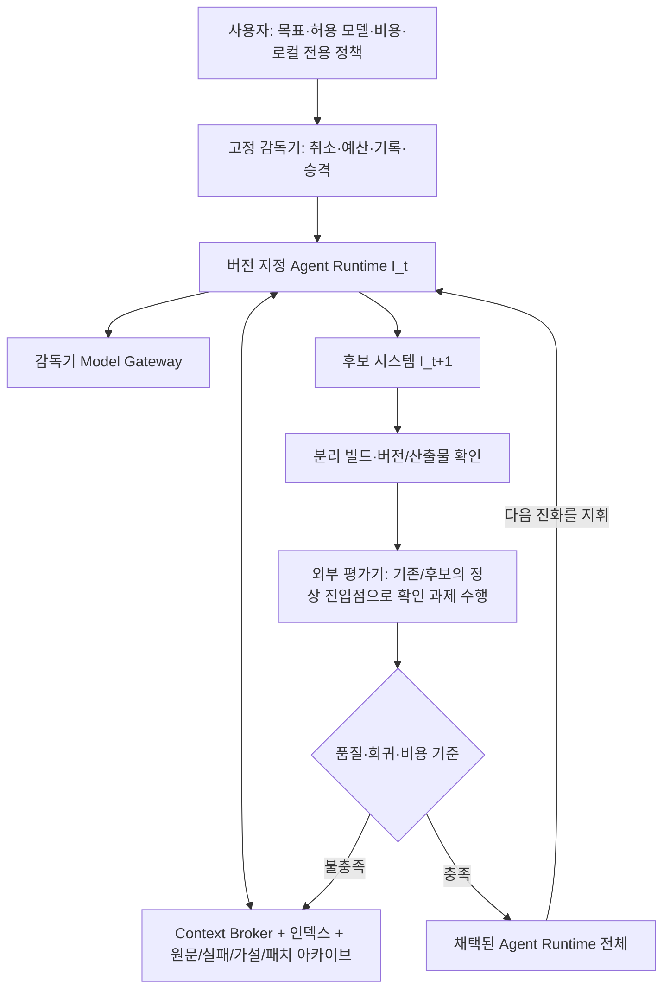

# DOMINION 재귀적 자기개선 구조 점검

점검 기준: `dominion-sub3`, `70d83b2b9163a26911016039ce1af03340e39e32`. 소스 수정·추가 모델 호출 없이 호출 경로와 저장 기록을 검토했다. 현재 유료 RSI 실행은 모두 중단했다.

## 결론

**버전별 코드 후보를 생성·빌드·평가·보관하는 기반은 있다. 하지만 사용자가 요구한 ‘다음 세대 지능 시스템 전체를 재설계하고 그 시스템이 다시 자신을 개선’하는 구조로는 아직 미완성이다.**

부족한 것은 작은 함수 몇 개의 수정이 아니라, 진화 대상과 고정 감독기의 경계, 과제·평가의 범용성, 경험을 소비하는 방식, 비용 집행의 위치다. 현재 구조를 완성된 RSI로 설명하면 안 된다.

사용자 요구는 다음과 같다.

- 진화 대상: 알고리즘·후보 탐색·하네스·기억·학습·도구·백엔드·프론트 전체.
- 모델: 등록된 API/로컬 모델을 선택한다. 딥시크는 저렴한 실험 기본값이며 전역 고정 조건이 아니다. 고가 모델을 자동 우선 선택하지 않는다.
- 실행: 로컬 모델 장시간 실행을 지원한다. 로컬 전용에서는 유료 API로 자동 전환하지 않는다.
- 경험: 실패한 패치·컴파일 오류·검색 결과·읽은 코드·미완성 가설도 보존하고 재사용한다. 저장 또는 호출 횟수를 개선 성공으로 세지 않는다.
- 이번 요청: 구조만 점검한다. 세부 구현과 오류 수정은 다른 작업자에게 인계할 수 있다. 유료 실험을 재개하지 않는다.

## 유지할 수 있는 기반

| 구성 | 확인한 구현 | 판정 |
|---|---|---|
| 소스 후보 격리 | detached Git worktree, 패치와 원본 해시, 검증된 쓰기 기록 | 재사용 가능 |
| 버전 실행 증거 | 채택 HEAD 빌드, `--rsi-worker-identity`, 바이너리 SHA, 실제 worker 프로세스 | 재사용 가능 |
| 후보 검증·승격 | 컴파일 검사, 고정 평가기 A/B, 계보·패치 일치 확인, 검증본만 채택 | 기반 존재 |
| 실패·중립 후보 보관 | `rsi_run`, `rsi_generation`, `execution_operation`, 경험 자료, `rsi_archive` | 기반 존재 |
| 모델 선택 | 등록 제공자/모델 선택, 로컬 전용과 야간 설정 | 수동 선택 기반 존재 |
| 작업 수명 | DB 체크포인트, 부모 중단에 따른 자식 취소, 재시작 복구 | 재사용 가능 |

관련 파일: [rsi_worktree.rs](/Users/gim-yeonsu/dominion-rust/src/engine/rsi_worktree.rs:892), [rsi_evolve.rs](/Users/gim-yeonsu/dominion-rust/src/engine/rsi_evolve.rs:2891), [rsi_archive.rs](/Users/gim-yeonsu/dominion-rust/src/engine/rsi_archive.rs:1), [jobs.rs](/Users/gim-yeonsu/dominion-rust/src/engine/jobs.rs:123).

## 구조상 해결해야 할 문제

### 1. 다음 세대가 실행하는 범위가 전체 제어기까지 이어지지 않는다

현재 `run_loop`는 실행 중인 기존 서버 안에 남아 있고, 새 버전으로 빌드해 실행하는 경로는 주로 `--rsi-worker-job`이다. 새 worker의 채팅·도구 하네스 등은 바뀔 수 있지만, 기존 부모가 수행하는 목표 구성·초기 대상 선택·프롬프트 준비·세대 제어를 수정한 코드가 같은 캠페인의 다음 세대에서 전부 실행되는 구조는 아니다. 서버 재설치는 캠페인 종료 후 별도 경로다.

따라서 ‘새 worker가 실행됐다’는 증거와 ‘수정한 시스템 전체가 다음 진화를 지휘했다’는 증거를 구분해야 한다.

근거: [빌드와 worker 구성](/Users/gim-yeonsu/dominion-rust/src/engine/rsi_evolve.rs:2950), [기존 부모의 목표 재구성](/Users/gim-yeonsu/dominion-rust/src/engine/rsi_evolve.rs:3088), [새 worker의 선택 로직](/Users/gim-yeonsu/dominion-rust/src/engine/rsi_evolve.rs:4043).

**인계 방향:** 고정 감독기는 예산·취소·기록·평가·승격만 소유한다. 계획·모델 선택·검색·기억·학습·도구 운용·후보 생성은 버전이 지정된 Agent Runtime 안으로 옮기고, 채택한 runtime 전체가 다음 세대를 지휘하게 한다.

### 2. ‘전체 소스 허용’과 실제 탐색 범위가 다르다

`rsiSystemEvolution` 경로는 매 세대 `improver` 분야를 지정하고, 개발 증거가 있으면 `rsi_evolve.rs`를 다시 대상으로 사용한다. 개발 증거 선택은 과거 특정 ‘tools → memory 이탈’ 기록에 의존한다. 해결 여부와 현재 소스의 유효성을 판단해 다른 개선 기회로 이동하는 범용 과제 관리자가 아니다.

하네스·기억·학습 코드가 수정 가능한 경로인 것은 맞다. 그러나 전체 시스템의 병목을 자율적으로 탐색하는 구조가 완성됐다는 뜻은 아니다.

근거: [시스템 모드의 대상 지정](/Users/gim-yeonsu/dominion-rust/src/engine/rsi_evolve.rs:3088), [특정 과거 기록에서 개발 증거 선택](/Users/gim-yeonsu/dominion-rust/src/engine/rsi_meta.rs:27).

**인계 방향:** 내용 해시와 해결 상태를 가진 과제 레지스트리가 필요하다. 실제 실패·사용자 목표·회귀·비용·미탐색 영역에서 과제를 만들고, 현재 소스에서 유효한 과제를 선택한다. 특정 파일·과거 오류에 대한 영구 고정을 제거한다.

### 3. 메타 평가는 출발점이며 범용 시스템 평가가 아니다

현재 메타 평가의 두 후속 과제는 모두 `decompose.rs`의 한국어 순차 작업 분해를 다룬다. 개선 전후 실행 파일을 실제로 사용하고, 동일 모델·예산·원본으로 패치를 생성해 동결 검사로 채점하는 방향은 맞다. 다만 이 결과로 기억·학습·도구·하네스 전체의 개선 능력을 일반화할 수 없다.

또한 평가용 `rsiMetaEpisode` 분기가 피평가 파일인 `rsi_evolve.rs` 안에 있고, 그 분기는 정상 실행과 다른 입력 전이를 재생한다. 후보가 평가 전용 경로만 바꾸는 경우를 배제하지 못한다. 평가기 파일을 보호하는 것만으로 충분한 분리가 되지 않는다.

근거: [두 고정 과제와 입력](/Users/gim-yeonsu/dominion-rust/src/engine/rsi_meta.rs:70), [반복 및 점수 집계](/Users/gim-yeonsu/dominion-rust/src/engine/rsi_meta.rs:186), [평가 전용 worker 분기](/Users/gim-yeonsu/dominion-rust/src/engine/rsi_evolve.rs:4074).

**인계 방향:** 정상 runtime 진입점을 그대로 실행하는 외부 평가기가 필요하다. 개발용 과제와 확인용 과제를 분리하고, 기억·도구·문맥·학습·코딩/하네스 등 여러 분야의 대표 작업을 등록한다. 평가 훅을 진화 대상 안에 심는 방식은 최소화한다.

### 4. 아카이브가 아직 능동적인 문맥·실험 관리자로 작동하지 않는다

원문 해시·읽기 결과·실패·미완성 가설은 저장된다. 그러나 주요 소비 방식은 기존 자료를 긴 프롬프트에 붙이고 모델이 다시 탐색하는 것이다. 전체 문맥을 매 호출마다 재전송하면, 자료를 저장했어도 토큰 낭비가 계속된다. 단순한 저장량이나 재사용 자료 건수로 이 문제의 해결을 판단할 수 없다.

**인계 방향:** 로컬 인덱스와 경험 저장소 위에 Context Broker를 둔다. 필요한 정의와 참조·호출 위치·관련 실패·현재 소스 차이로 작은 작업 묶음을 만들고, 중복 읽기·같은 실패 재시도·변경되지 않은 구간을 로컬에서 판정한다. 모델에는 필요한 증분만 전달한다. 실패 자료는 다음 가설·경로·예산 선택에 실제로 사용돼야 한다.

근거: [인덱스 탐색](/Users/gim-yeonsu/dominion-rust/src/engine/tools.rs:724), [연구 저장](/Users/gim-yeonsu/dominion-rust/src/engine/rsi_evolve.rs:1805), [연구 문맥 재사용](/Users/gim-yeonsu/dominion-rust/src/engine/rsi_evolve.rs:2406).

### 5. 모델·비용 집행을 진화 대상 밖에서 보장해야 한다

현재 예산 계산과 사용량 기록의 일부가 새 worker가 실행하는 코드에 포함돼 있다. 로컬 전용 검사는 시작 시 선택된 제공자를 확인하고, 메타 평가에서는 실행 후 실제 모델 경로를 대조한다. 그러나 후보가 수정할 수 있는 하네스의 동작과 무관하게 허용 모델·유료 API 사용·예산을 집행하는 외부 경계는 아니다.

**인계 방향:** 모델 호출은 고정 감독기의 Model Gateway를 통과시킨다. 사용자가 허용한 제공자·모델·비용 정책과 실제 사용량을 그쪽에서 집행한다. 비교 실험 한 쌍에서는 같은 모델을 쓰되, 시스템 전체를 특정 모델에 영구 고정하지 않는다. 로컬 전용에서는 유료 경로 자체를 제공하지 않는다.

## 권장하는 큰 흐름

## 인계 시 완료 판정

세부 기능을 추가하기 전에 다음 구조 증거부터 확인한다.

1. 채택된 새 runtime의 계획·검색·기억/학습·도구·후보 생성 경로가 다음 세대에서 실제 실행된다.
2. 기존/후보 runtime을 정상 진입점과 동등한 예산으로 비교하며, 평가 전용 분기만 개선해 통과할 수 없다.
3. 과제 선택이 특정 파일과 과거 오류에 고정되지 않고, 해결된 문제를 현재 소스에서 다시 탐색하지 않는다.
4. 실패와 읽기 자료의 재사용이 다음 실행의 중복 검색·입력 토큰을 줄였다는 기록이 있다.
5. 진화된 코드가 모델 호출 경로를 바꾸더라도 감독기가 사용자 비용·로컬 전용 정책을 집행한다.

위 조건을 확인하기 전에는 단위 테스트 통과, 호출 수, 연구 자료 수, 연속 커밋 수만으로 RSI 완성을 선언하지 않는다.

## 실측 상태

이 작업에서 시작한 다섯 캠페인의 저장된 사용량 합계는 **1,037,543 토큰, 모델 호출 42회, 채택 0건**이다. 이는 앱에 보고된 사용량이며 실제 청구 금액을 뜻하지 않는다. 마지막 캠페인은 420,774 토큰·12회 호출 후 중단했다. 현재 실행 중인 RSI 작업은 0개다.

관련 단위·재사용 테스트와 통합 테스트는 통과했지만, 이 실측은 재귀 성과를 입증하지 못했다. 다음 작업자는 위 구조 문제를 먼저 다루고, 사용자의 요청 없이 유료 실험을 재개하지 않아야 한다.
